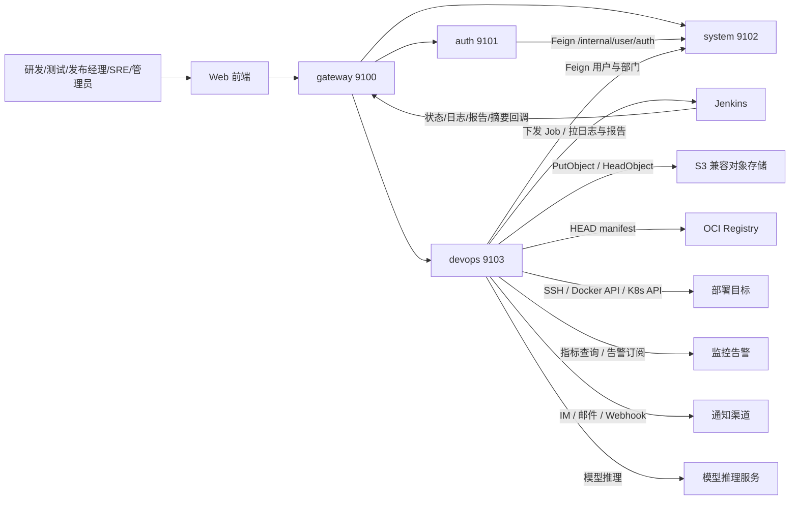
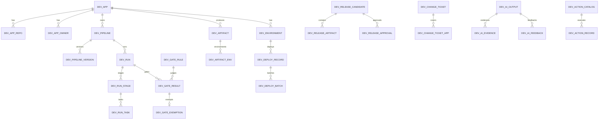
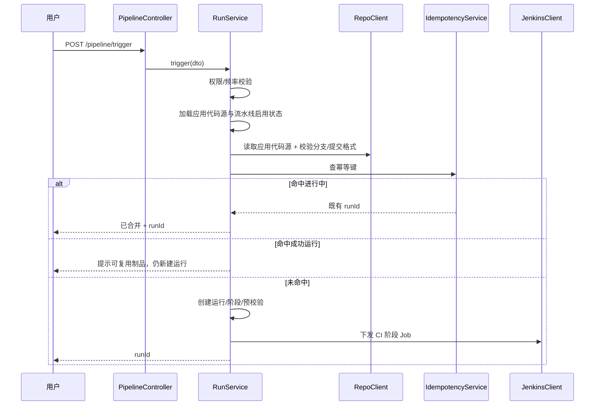
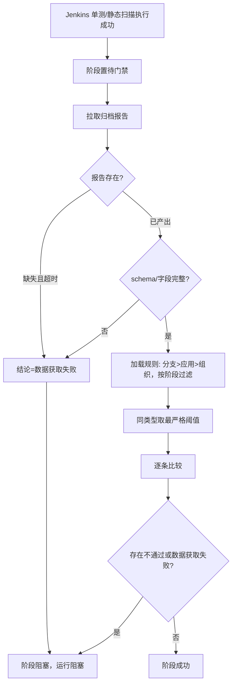
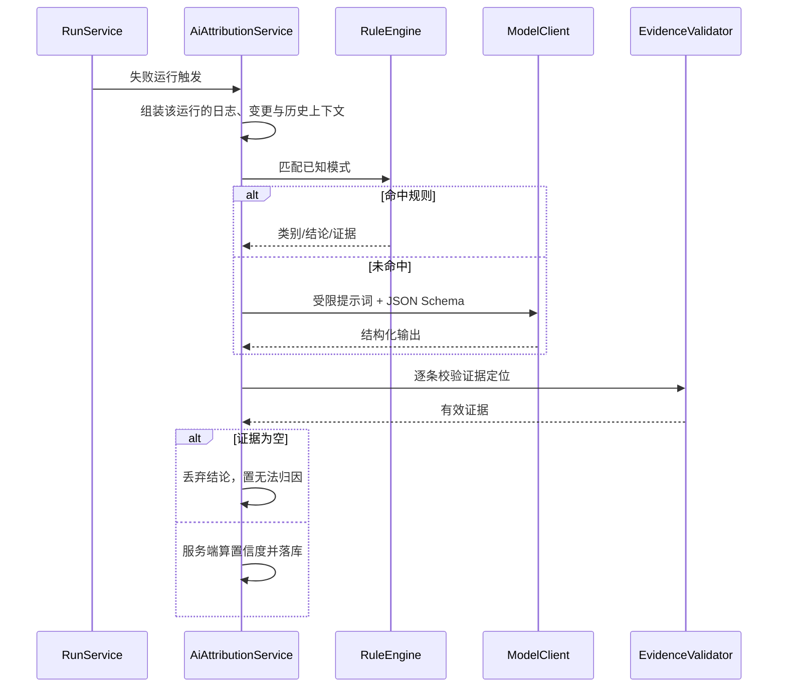

# 渡口 Ferry 开发设计文档

| 项 | 内容 |
| --- | --- |
| 文档版本 | V1.0.0 |
| 编写日期 | 2026-11-18 |
| 需求依据 | 《PRD-渡口 Ferry》V1.5.0 |
| 适用读者 | 后端、前端、测试、运维、架构评审 |
| 文档状态 | 设计稿，待评审 |

## 目录

- 0. 文档说明
- 1. 总体架构（上下文、服务端口、包结构、依赖方向、网关路由、部署拓扑）
- 2. 领域模型（聚合边界、实体关系、统一枚举、状态机）
- 3. 公共设计（返回结构、鉴权、多租户、数据权限口径、操作日志、锁、幂等、敏感数据、导出、Feign、回调签名、第三方依赖）
- 4. 数据库设计（74 张表，按应用/流水线/门禁/制品/环境部署/发布/AI/度量/系统扩展分域）
- 5. 核心流程设计（21 个流程）
- 6. 接口设计（按域分组的完整接口清单）
- 7. 前端设计（路由菜单、页面要点、目录、交互、权限、样式）
- 8. 非功能设计
- 9. 安全设计
- 10. 可观测性
- 11. 数据迁移与兼容
- 12. 分期实施计划（M0–M9）
- 13. 验证方案
- 14. 风险与待决事项
- 附录 A 配置项 / B 权限矩阵 / C 菜单种子 / D Jenkins 结果同步契约 / E AI 输出 Schema / F 变更检查清单 / G 需求覆盖对照表

## 0. 文档说明

### 0.1 目的

把 PRD 的 43 项功能翻译成可施工的工程方案：模块边界、数据模型、接口契约、状态机、失败路径、权限口径、前端结构、分期顺序和验证方式。开发、评审、验收均以本文件与 PRD 为共同依据；冲突时以 PRD 的业务口径为准，以本文件的技术口径为准。

### 0.2 范围

- 覆盖 PRD 全部 43 项功能，含应用管理、流水线管理、质量门禁、制品管理、环境与部署、发布准入、生产发布、AI 助手、系统管理扩展、效能看板、导出。
- 覆盖新建 `devops` 业务模块、`system` 模块能力扩展、`common-*` 公共能力增强、`gateway` 开放 API、前端页面与路由菜单。
- 不覆盖 Jenkins、GitLab/GitHub/Gitee、S3 兼容对象存储、OCI Registry、Kubernetes、Docker、监控、APM、负载均衡、权限中心、工单系统的内部实现，只定义对接契约与失败处置。

### 0.3 已定技术决策

| 编号 | 决策 | 理由 |
| --- | --- | --- |
| D1 | 后端只新增一个业务模块 `devops`，分 `devops-api` / `devops-biz`，内部按 `app`、`pipeline`、`gate`、`artifact`、`env`、`release`、`ai` 分包 | 与删除前的模块结构一致，减少 6 个子域各自 api/biz 带来的 18 个 Maven 模块与跨域 Feign 开销；域内以 Service 边界约束调用 |
| D2 | `devops` 单向依赖 `system-api`，`system` 不依赖 `devops` | 用户、部门、角色主数据归 system；应用与环境主数据归 devops，二者通过 ID 引用 |
| D3 | 数据权限本期只做功能权限 + 生产操作权限；不建 `sys_role_app_env`，不做应用-环境级过滤 | 减少首期授权模型复杂度与页面改造；生产操作仍由独立 `:prod` 权限串守住；外键统一命名，后续可增量接入 |
| D4 | Jenkins 结果同步只走出站轮询：状态查 `api/json`/`wfapi/describe`，门禁报告拉归档产物；不配置任何入站回调 | 保持 Jenkins 脚本纯净，不注入 `ferryNotify`、`CALLBACK_URL`、`STAGE_MAP` |
| D5 | 制品字节存对象存储与 OCI Registry，渡口只存元数据 | PRD 方案 A，渡口不进入拉镜像关键路径 |
| D6 | 所有列表统一 `R<IPage<XxxVO>>`，导出统一异步任务 | 与现有接口风格、审计要求一致 |

### 0.4 设计假设

1. Jenkins 具备 PRD 待确认 #3 的六项能力；不具备时按 PRD 给定的降级口径执行，本设计在对应章节标注降级分支。
2. 对象存储与 OCI Registry 的选型按待确认 #20 的推荐项推进；本设计只依赖标准 S3 API 与 OCI Distribution Spec。
3. 权限中心暂未接入，用户、部门、角色仍由本系统维护；接入后替换 `ISystemFeign` 的实现即可，调用方不变。
4. 首期单租户运行；`sys_*` 系统表保留 `tenant_id` 并固定写默认值，`dev_*` 业务表不参与租户隔离、不设 `tenant_id`。
5. 不引入单元测试框架，验证按冒烟脚本、类型检查、编译门禁与实际操作执行。

### 0.5 术语

沿用 PRD 第三章。本文件额外使用：

| 术语 | 含义 |
| --- | --- |
| 应用级对象 | 只归属应用、不区分环境的对象，如应用档案、流水线、运行、门禁规则、制品元数据 |
| 环境级对象 | 必须精确到应用下某个环境的对象，如环境、部署、回滚、发布执行、健康检查 |
| 结果同步 | Ferry 出站轮询 Jenkins 构建/阶段状态，并按需拉取归档报告；Jenkins 不向 Ferry 回调 |
| 执行器 | 实现 prepare/deploy/observe/rollback/status 五动作的部署适配器 |

---

## 1. 总体架构

### 1.1 系统上下文



### 1.2 服务与端口

| 服务 | 端口 | 职责 |
| --- | --- | --- |
| gateway | 9100 | 路由、限流、内部接口隔离、开放 API 鉴权、回调签名校验 |
| auth | 9101 | 登录、验证码、登出、登录失败锁定 |
| system | 9102 | 用户、部门、岗位、角色、菜单、字典、参数、区域、租户、操作日志、通知、开放 Token、存储策略、导出任务 |
| devops | 9103 | 应用、流水线、运行、门禁、制品、环境、部署、发布、AI、度量 |

### 1.3 模块与包结构

```text
server/devops/
├── devops-api/
│   └── com.ferry.devops.api/
│       ├── dto/{app,pipeline,gate,artifact,env,release,ai}/
│       ├── dto/query/...
│       ├── entity/...
│       ├── enums/...
│       ├── vo/...
│       ├── vo/tree/...
│       └── feign/IDevopsFeign.java
└── devops-biz/
    └── com.ferry.devops.biz/
        ├── DevopsApplication.java
        ├── controller/{app,pipeline,gate,artifact,env,release,ai,metric,workbench}/
        ├── service/{...}/I*.java
        ├── service/{...}/impl/*.java
        ├── mapper/...
        ├── wrapper/...
        ├── integration/{jenkins,repo,storage,registry,deployer,monitor,notify,ai}/
        ├── scheduler/...
        └── feign/DevopsFeign.java
```

包内调用规则：

1. Controller 只调本域 Service，不跨包直调 Mapper。
2. `release` 读 `artifact`、`gate`、`run` 数据走对方 Service 接口，不复制查询逻辑。
3. `ai` 只读业务 Service 与已落库的输出表，不写业务表。
4. `integration/ai` 用 Spring AI 的 `ChatClient` 封装模型调用，不上手写 HTTP；模型提供方由配置 `ferry.devops.ai.provider` 切换，业务层只依赖 `ChatClient`，不感知厂商。
4. `integration` 只做协议转换，不含业务判断；超时、重试、熔断在集成层完成。
5. 公共能力（树、导出、锁、脱敏、操作日志注解）上提 `common-*`，`devops` 内不重复实现。

### 1.4 依赖方向

```text
gateway  -> common-web, common-security, common-core
auth     -> system-api, common-web, common-security, common-cache
system   -> common-*, system-api
devops   -> system-api, common-*, devops-api
common-* -> 不依赖任何业务模块
```

- `system` 不依赖 `devops`；跨域只靠 ID 与 HTTP。
- `devops-api` 不依赖 `system-api`，保证 system-biz 若未来需要引用 devops 契约时不形成环。
- `common-jdbc` 的租户处理器只处理 `sys_*` 系统表；`dev_*` 业务表不参与租户过滤。

### 1.5 网关路由

Nacos `ferry-gateway.yaml` 增加：

```yaml
spring:
  cloud:
    gateway:
      server:
        webflux:
          routes:
            - id: ferry-devops
              uri: lb://ferry-devops
              predicates:
                - Path=/ferry-devops/**
              filters:
                - StripPrefix=1
```

`/ferry-devops/callback/**` 在 `AuthConst.DEFAULT_EXCLUDE_PATH`（登记 `/callback/**`）与网关开放 API 过滤器中放行，但必须通过签名校验；`/ferry-devops/internal/**` 仍由 `InternalPathFilter` 挡住外部访问。

### 1.6 部署拓扑

- 编排服务 `devops` 无状态，可按 CPU 横向扩容；定时任务用 ShedLock 选主，避免多实例重复执行。
- 制品数据面由对象存储与 OCI Registry 独立承担，`devops` 停机不影响节点按摘要拉镜像。
- 执行器与回调处理放在独立线程池，HTTP 线程不被长任务占满。

---

## 2. 领域模型

### 2.1 聚合边界

| 聚合根 | 内部实体 | 一致性边界 |
| --- | --- | --- |
| App | AppRepo、AppOwner | 应用编码不可变；删除前校验阻塞项 |
| Pipeline | PipelineVersion、PipelineTemplate、TemplateVersion、TemplateVariable | 版本快照不可变；运行只读快照 |
| Run | RunStage、RunStageTask、Precheck | 状态机由服务层单点推进 |
| GateRule | RunStageGate、GateExemption、Baseline、BaselineIssue | 判定与豁免分离；结果绑定规则快照 |
| Artifact | ArtifactEnv、CleanTask、Compensation | 摘要唯一；跨环境只改标记 |
| Environment | EnvConfig、DeployLock、DeployRecord、DeployBatch、HealthSample、RollbackRecord | 部署锁串行化；配置按版本 |
| ReleaseCandidate | ReleaseArtifact、CheckItem、Approval、ReleaseRecord、ReleaseStrategy | 提交后制品锁定；状态单向 |
| ChangeTicket | TicketApp | 生产校验的引用源 |
| AiOutput | AiEvidence、AiFeedback、ActionRecord | 证据校验在落库前 |

### 2.2 实体关系



### 2.3 统一枚举

枚举一律建 `XxxEnum` 并带静态 `contains` / `of` 校验，数据库存 `tinyint`，禁止裸魔法值。

| 枚举 | 取值 | 使用处 |
| --- | --- | --- |
| RunStatus | 1 排队中、2 运行中、3 阻塞、4 成功、5 失败、6 超时、7 已取消、8 结果待确认 | dev_run.status |
| StageStatus | 1 未开始、2 进行中、3 成功、4 失败、5 阻塞、6 跳过、7 超时、8 已复用、9 已取消、10 待门禁 | dev_run_stage.status |
| StageType | 0 预检（可选配置，服务端生成五项结论）、1 构建、2 单元测试、3 静态扫描、4 制品入库、5 部署非生产、6 集成测试、7 准入、8 生产发布 | dev_pipeline_stage、dev_run_stage.type |
| GateStatus | 1 通过、2 不通过、3 不适用、4 已豁免、5 数据获取失败 | dev_run_stage_gate.status |
| ArtifactForm | 1 包制品、2 镜像制品 | dev_artifact.form |
| DeployType | 1 SSH、2 Docker、3 Kubernetes | dev_environment.deploy_type |
| EnvCategory | 1 测试、2 预发、3 生产 | dev_environment.category |
| DeployStatus | 1 未开始、2 执行中、3 观察中、4 成功、5 失败、6 已回滚、7 已取消 | dev_deploy_record.status |
| BatchStatus | 1 未执行、2 执行中、3 观察中、4 成功、5 失败、6 已回滚、7 已取消 | dev_deploy_batch.status |
| RcStatus | 1 草稿、2 待审批、3 已批准、4 发布中、5 观察中、6 已完成、7 已回滚、8 已驳回、9 已取消 | dev_release_candidate.status |
| CheckConclusion | 1 通过、2 不通过、3 不适用、4 已知悉 | dev_release_check_item.manual_conclusion |
| RiskLevel | 1 低、2 中、3 高 | dev_release_candidate.risk_level |
| TicketStatus | 1 草稿、2 待审批、3 已批准、4 已实施、5 已关闭、6 已取消 | dev_change_ticket.status |
| ActionLevel | 0 L0、1 L1、2 L2、3 L3 | dev_action_catalog.level |
| ActionStatus | 1 已提议、2 待确认、3 已授权、4 执行中、5 执行成功、6 执行失败、7 已撤销、8 已拒绝 | dev_action_record.status |
| AiOutputType | 1 失败归因、2 准入辅助、3 发布预案、4 异常归因 | dev_ai_output.type |
| NotifyEvent | 运行失败、门禁阻塞、门禁数据获取失败、豁免到期、发布单待审批、发布开始、发布熔断、回滚完成、动作执行成功 | sys_notify_template.event |

### 2.4 状态机

运行状态机、发布单状态机、AI 动作状态机沿用 PRD 整体架构，落到 `DevopsStateMachine` 常量表并由 Service 单点校验；非法流转统一抛 `ServiceException("当前状态不允许该操作")`。

阶段状态机补充约束：

- 只有 `未开始` 可转 `进行中`；`进行中` 可转 `待门禁/失败/超时/已取消`。
- 单测/静态扫描阶段执行成功后先转 `待门禁`，门禁通过转 `成功`，不通过或数据缺失转 `阻塞`。
- `阻塞` 在豁免/撤销/到期后无阻塞结论时可回 `成功`；人工中止可转 `已取消`。
- 断点重跑的新运行中，复用阶段只允许 `已复用`，不得再下发。
- 终态 `成功/失败/跳过/超时/已复用/已取消` 不再流转。

---

## 3. 公共设计

### 3.1 返回结构

沿用 `R<T>`：

| 场景 | 结构 | code |
| --- | --- | --- |
| 分页 | `R<IPage<XxxVO>>` | 200 |
| 列表/树 | `R<List<XxxVO>>` | 200 |
| 写操作 | `R<String>`，文案「新增成功/修改成功/删除成功」 | 200 |
| 业务拒绝 | 全局异常处理器转 `R` | 400 |
| 未登录 | `AuthFilter` 直接写响应 | 401 |
| 无权限 | `AuthException` | 403 |
| 不存在 | `ServiceException` | 404 |
| 状态冲突/重复 | `ServiceException` | 409 |
| 限流 | 网关写响应 | 429 |

业务失败一律抛 `ServiceException`，`boolean` 只表示数据库写入结果。Controller 不 try-catch。

### 3.2 鉴权与权限串

- 每个接口显式标注 `@PreAuthorize`，权限串为 `devops:<资源>:<动作>` 或 `system:<资源>:<动作>`。
- 菜单页面给 `devops:<资源>:*` 通配，按钮给具体动作；按钮权限随页面菜单下发，不单独建菜单行。
- 权限串与前端 `can()`、菜单 `perms`、验收用例三处必须同名，改一处即全改。
- 生产操作使用独立权限串：`devops:deploy:prod`、`devops:rollback:prod`、`devops:release:prod`、`devops:config:prod`，与普通动作分开授权。
- 免登录接口只有：登录、验证码、租户列表、开放 API（Token 校验）、健康检查、接口文档。
- 开放 API 不经过 `@PreAuthorize`，由网关校验 Token 后注入应用范围，业务层再校验资源是否属于该应用。

### 3.3 多租户

- `sys_*` 系统表保留 `tenant_id`，由 `MybatisTenantLineHandler` 与 `MybatisMetaObjectHandler` 统一维护。
- `dev_*` 业务表不使用 `tenant_id`，不纳入租户过滤；业务 SQL 不写租户条件。
- 首期单租户运行，系统表租户值固定写默认值；多租户自助注册、计费、租户管理后台本期不建设。
- 登录页选租户走免登录 `/tenant/list`；开放 API 的租户取 Token 绑定值，不取请求头。

### 3.4 数据权限

#### 3.4.1 本期口径

本期**只做功能权限 + 生产操作保护，不做应用-环境数据权限**。

| 能力 | 本期 | 说明 |
| --- | --- | --- |
| 功能权限 | 做 | `@PreAuthorize` 逐接口校验，与菜单 `perms`、前端 `can()` 同串 |
| 部门数据权限 | 沿用现有 | `@DataScope` + `DataPermissionHandler`，用于系统管理域的用户、部门等表 |
| 应用-环境数据权限 | 不做 | 不建 `sys_role_app_env`，不加 `@AppScope`/`@EnvScope`，列表不做应用/环境范围过滤 |
| 生产操作保护 | 做（简化为功能权限） | 生产部署/回滚/发布启动/熔断继续等接口使用独立的 `:prod` 权限串，不依赖环境授权 |

影响：

1. 所有已登录且持有对应功能权限的用户，可查看全部应用与环境数据。
2. 「谁能操作生产」由功能权限控制：不给某角色 `devops:deploy:prod`、`devops:rollback:prod`、`devops:release:prod` 即无法操作；授权粒度到角色，不能按应用细分。
3. 接口与页面的应用、环境下拉按业务条件返回，不做范围裁剪。
4. 双人确认保留：操作人与确认人不能相同，属流程约束，与数据权限无关。

`AuthUtil` 增补一个通用判断，供业务方法在拿到环境类别后调用：

```java
// 未持有指定权限标识时抛 403
public static void checkPerm(String perm)
```

`PreAuthorizeAspect` 的分段通配匹配逻辑上提为 `PermMatcher.matches(List<AuthPerm>, String)`，注解校验与该判断共用一份实现，避免两套规则。

#### 3.4.2 生产操作

生产相关写方法在 Service 首行按环境类别补一道判断：

```java
// 先取环境类别，生产环境再要求独立的生产权限
Environment env = environmentService.getById(envId);
if (EnvCategoryEnum.PRODUCTION.getValue().equals(env.getCategory())) {
    AuthUtil.checkPerm("devops:deploy:prod");
}
```

- 校验内容：读取环境 `category`，为生产时要求调用方持有对应 `:prod` 权限；非生产环境只校验普通功能权限（注解已覆盖）。
- 权限串固定四组：`devops:deploy:prod`、`devops:rollback:prod`、`devops:release:prod`、`devops:config:prod`（生产配置修改）。
- `AuthUtil` 不新增应用范围字段，会话只保留现有用户、部门、角色、权限信息。
- 操作人与确认人相同时抛 `ServiceException("操作人与确认人不能为同一人")`。

#### 3.4.3 后续演进

若后续要做应用-环境数据权限，按以下顺序增量接入，不改动业务代码结构：

1. 新增 `sys_role_app_env` 与角色授权页。
2. `AuthUser` 增加应用/环境 id 集合，登录时算快照。
3. 新增 `@AppScope`/`@EnvScope`，在 `DataPermissionHandler` 追加过滤。
4. 页面下拉按范围裁剪，接口对越权对象返回 403。

本期在 `DataPermissionHandler` 预留扩展点（见 3.4.4），后续只加实现。

#### 3.4.4 预留扩展点

- `DataPermissionHandler.getSqlSegment` 当前只处理 `@DataScope`；未标注解的 Mapper 直接放行。
- 业务表查询按 4.1 第 12 条选择 `XxxWrapper#lambda` 或 `XxxMapper.xml`；无论走哪种，后续加应用范围都只需在 Wrapper、XML 或拦截器一处追加。
- 所有应用级、环境级对象的外键字段统一命名 `app_id`、`env_id`，为后续按列过滤预留。

### 3.5 操作日志

#### 3.5.1 记录范围

全部写操作、导出、日志下载、开放 API 调用、登录成功与失败、权限变更。日志表只插不改不删。

#### 3.5.2 实现

- 注解 `@Log(type=LogType.UPDATE, objectType="APP", objectId="#body.id", objectName="#body.name", before="@appService.getById(#body.id)", after="#body")` 标在 Service 写方法。
- 变更前后值都由表达式指定：`before` 在业务方法执行前求值，读数据库旧状态；`after` 在执行后求值。未写表达式时该字段留空，不拿提交的表单冒充旧值。表达式可按 Bean 名调用查询方法，写法与 `@Cacheable` 一致。
- 新增与修改合一的 `save` 方法加 `detectUpdate = true`，按对象 id 是否存在区分操作类型。
- 切面在方法返回后取一次对象快照，经 `LogSanitizer` 把凭据类字段替换为「已变更」，同步写 `sys_log`；落在事务外层，业务提交后再写，失败只记错误日志不影响业务结果。
- 切面同时记录请求方式、请求地址与执行的 Java 方法，用于回溯「从哪个入口点的」，请求地址按列宽 255 截断。
- 流程类动作（触发、晋级、部署、回滚、审批、动作执行）由 Service 显式调用 `LogUtil.record`，携带关联单号与理由。
- 来源 IP 取 `WebUtil.getIp`，链路号取 MDC `traceId`，操作时间在切面内取当前时间写入 `op_time`。

#### 3.5.3 存储与导出

- `sys_log` 保留 365 天，归档任务每天 04:00 导出到对象存储冷目录，归档后行保留只读标记。
- 导出带水印首行：导出人、导出时间、筛选条件摘要；导出动作自身再记一条日志。
- 日志查询按 `tenant_id + op_time` 联合索引，默认近 7 天。

### 3.6 分布式锁

`LockUtil` 封装在 `common-cache`，基于 Redisson 的 `RLock`：

```java
boolean tryLock(String key, Duration ttl)                  // 不等待
boolean tryLock(String key, Duration ttl, Duration maxWait) // 限时等待
boolean unlock(String key)                                  // 仅释放当前线程持有的锁
```

- 实现：`RedissonClient.getLock(key)`，抢锁、Lua 释放、持有者校验全部由 Redisson 完成，不自拼脚本。
- **续期**：`ttl` 传 `null` 时启用 Redisson 看门狗，默认每 10 秒自动续期，进程存活期间不释放；传具体值时到期即释放，不续期。
- 客户端由 `RedisCacheAutoConfiguration` 按 `spring.data.redis.*` 构建，与缓存指向同一实例；只用 Redisson 核心包，`redisson-spring-boot-starter` 绑定 Boot 3 不适用。
- 部署锁键 `ferry:devops:deploy:lock:{appId}:{envId}`，TTL 30 分钟且启用看门狗，部署期间持续续期。
- 抢锁失败抛 `ServiceException(HttpStatus.CONFLICT, "该环境存在进行中的部署")`，并回传持锁人、开始时间。
- 同时写 `dev_deploy_lock` 镜像表供页面展示；进程退出后锁随看门狗停止在 TTL 内释放，清理任务把镜像行置失效并告警。

### 3.7 幂等与并发

- 请求级防重统一使用 `@Idempotent` + Redis SETNX + TTL（默认 60 秒），不落库；重复命中直接拒绝。
- 手动触发按 `appId + refValue + pipelineVersion` 查询 `dev_run`：命中活动运行（排队/运行/阻塞）返回既有 `runId` 并标记“已合并”；命中成功运行不阻断，本次新建运行，预校验提示其制品可在制品管理页复用。
- 触发/重跑接口的幂等键由注解 SpEL 生成，避免前端重复点击与网络重试；业务唯一性仍由 `dev_run` 状态查询兜底。
- 同一应用同一时刻只允许一个进行中的重跑；由活动运行查询与触发入口幂等共同控制。
- 回调按阶段终态与 `dev_run_stage_gate (run_stage_id, rule_type)` 唯一键幂等，重复回调返回成功但不重复落库。
- `dev_run_idempotency` 表与 `dev_run.idempotent_key` 列已删除。
- 回调按 `run_id + build_no + seq` 幂等写入，重复回调返回成功但不重复落库。

### 3.8 敏感数据

- 仓库访问令牌（`dev_app_repo.repo_token`）与环境敏感配置（`dev_env_config.value_type=2`）按内部系统约定明文存储；敏感配置读取时返回掩码，其余 Token、OAuth Secret 仍用 `CryptoUtil.aesEncrypt` 加密存库。
- 日志入库前用正则对 Token、手机号、身份证号、邮箱打码，原文不落库。
- 审计前后值对 `password`、`secret`、`token`、`privateKey` 字段只写「已变更」。
- Swagger 文档中敏感字段标注 `@Schema(accessMode = READ_ONLY)`。

### 3.9 导出

统一 `ExportTaskService`：

1. 接口把查询条件与导出范围（勾选 ids 或筛选条件）写入 `sys_export_task`，返回任务号。
2. 小于 1 万条走线程池同步生成；超过转队列，每 500 条一批写临时文件。
3. 生成 CSV 或 Excel（EasyExcel），首行水印，文件放对象存储，7 天有效。
4. 失败按 5/30/120 秒重试 3 次，仍失败通知发起人。
5. 列表页轮询任务状态，完成后给下载链接；下载动作记审计。

### 3.10 内部接口与 Feign

- `/internal/**` 只给服务间调用，网关外部不可达。
- `IDevopsFeign` 提供给 system 的能力：应用/环境选项、应用负责人、环境当前制品、运行状态查询。
- `ISystemFeign` 提供给 devops 的能力：用户批量查询、部门树、角色下用户、应用授权清理、通知发送。
- Feign 超时 3 秒，读操作重试 1 次，写操作不自动重试。

### 3.11 出站集成

Jenkins 不配置任何入站回调，网关不保留 `/callback/jenkins/**` 路由。所有 Jenkins 调用由 Ferry 出站发起：创建/更新 Job、触发构建、查询构建与阶段状态、拉取归档报告与制品摘要；凭据统一从 Nacos 配置读取，不进代码库。

### 3.12 第三方依赖

#### 3.12.1 现有基线

框架与中间件客户端全部用现成组件，不重写：

| 类别 | 组件 | 现状 |
| --- | --- | --- |
| 应用框架 | Spring Boot 4.0.9、Spring Cloud 2025.1.4、Spring Cloud Alibaba 2025.1.0.0 | 已引入 |
| 持久层 | MyBatis-Plus 3.5.18（含 jsqlparser 扩展） | 已引入 |
| 缓存 | spring-boot-starter-data-redis | 已引入 |
| 文档 | springdoc-openapi 3.1.1 | 已引入 |
| 验证码 | easy-captcha 1.6.2 | 已引入 |
| 导出 | EasyExcel 4.0.3 | 已引入 |
| 加密 | spring-security-crypto | 已引入 |
| AI | spring-ai-bom 2.0.0 | 已声明 BOM，接入 AI 时由 `devops` 引 starter |

`common-core` 的 `StrUtil`、`BeanUtil`、`JsonUtil`、`HttpUtil` 等均为对上述库的薄封装，不重复造轮子，继续维护即可。

#### 3.12.2 新增依赖

devops 模块落地前需在 `server/pom.xml` 的 `dependencyManagement` 统一版本，业务模块不写 `<version>`。

| 依赖 | 用途 | 为什么现有不够 | 备选与取舍 |
| --- | --- | --- | --- |
| `com.github.mwiede:jsch` | SSH 执行器：连接、命令、SFTP 传包 | `common-core` 只有 HTTP 客户端 | Apache MINA SSHD 偏服务端场景且更重；JSch 原版停更，mwiede 为社区维护 fork |
| `io.fabric8:kubernetes-client` | K8s 执行器：部署、rollout 监听、回滚 | 无 K8s 客户端 | 官方 client-java API 冗长；fabric8 DSL 更贴合编排 |
| `com.github.docker-java:docker-java` | Docker 执行器：容器生命周期、健康检查、摘要查询 | 无 Docker API 封装 | 手写 REST 需处理 Unix socket 与 TLS，不建议 |
| `software.amazon.awssdk:s3` | 制品上传、`HeadObject` 反查、预签名、导出文件存取 | 无对象存储客户端 | MinIO SDK 绑定单一实现；AWS SDK v2 是 S3 协议标准实现 |
| `net.javacrumbs.shedlock:shedlock-spring` + provider | 多实例定时任务选主 | `LockUtil` 只解决业务锁，不解决调度重复执行 | Quartz 集群模式需额外表与配置，偏重 |
| `org.redisson:redisson` | 分布式锁：可重入、看门狗自动续期、原子释放 | 自写 Lua 需要自己维护持有者标识与续期线程 | 只用核心包，starter 绑定 Boot 3 不可用 |
| `org.springframework.retry:spring-retry` | Jenkins、模型、通知的失败重试与退避 | 无标准重试抽象 | Resilience4j 功能更全但引入状态机与配置成本；重试策略简单，Spring Retry 足够 |
| `org.yaml:snakeyaml` | 流水线 YAML 解析与行号定位 | 无 YAML 解析能力 | Spring Boot 已传递引入，直接复用，不单独声明版本 |

#### 3.12.3 明确不引入

| 候选 | 理由 |
| --- | --- |
| Hutool、Guava、Commons-Lang3 | 与现有 `StrUtil`/`CollUtil`/`ObjUtil` 重复，违反「同一份规则只实现一次」 |
| MapStruct | 已有 `BeanUtil` + `BeanCopier` 缓存，DTO 转换量不足以支撑注解处理器成本 |
| Sa-Token、Spring Security 全家桶 | 现有 `AuthFilter` + `@PreAuthorize` 已闭环，替换等于重写鉴权 |
| JWT 库 | 令牌是不透明串存 Redis，无 JWT 需求；根 POM 的 `jjwt.version` 属性无任何模块引用，属遗留配置 |
| XXL-Job、ElasticJob | 定时任务只有度量跑批、清理、豁免到期等少数几个，ShedLock 足够 |
| Flyway、Liquibase | 表结构变更直接改全量建表脚本并归档，不引入迁移框架 |

#### 3.12.4 依赖引入规则

1. 新增依赖必须说明「解决什么问题、为什么现有 `common-*` 不够、考虑过哪些备选」，评审通过后写入本节。
2. 版本只在 `server/pom.xml` 的 `dependencyManagement` 声明，业务模块不写 `<version>`。
3. 升级依赖单独提交，不夹在功能改动里。
4. 优先复用已引入组件的能力，不为单一场景引入重量级框架。

## 4. 数据库设计

### 4.1 约定

1. 主键统一 `bigint`，MyBatis-Plus `assign_id` 生成，不用自增；每张表必须有主键或复合主键，关系表也不例外。
2. `sys_*` 系统表带 `tenant_id varchar(12) not null`，由拦截器与填充器维护，业务代码不写；`dev_*` 业务表不设 `tenant_id`，不参与租户隔离。
3. 主数据表一律继承 `BaseEntity`，带 `create_user/create_time/update_user/update_time/is_deleted`；只有「没有公共字段的关系表」才不继承，其删除为物理删除，SQL 不加 `is_deleted`。只增不改的流水表（日志、采样、调用明细）同样继承，`update_user/update_time` 留空即可。
4. 时间统一 `datetime(3)`；金额无；枚举用 `tinyint` 并在字段注释写明取值。
5. 布尔字段一律以 `is_` 开头，类型 `tinyint(1)`，默认 `0` 或 `1` 显式声明；实体字段同名驼峰（`is_enabled` → `isEnabled`），不在 DTO 里用 `enabled` 这类无前缀命名。
6. 字段名只用小写字母、数字、下划线，以字母开头，长度一般不超过三个单词。`status`、`type`、`level`、`value`、`result`、`source`、`sort`、`code` 在 MySQL 8 中均非保留字，可直接使用，与现有 `sys_*` 表保持一致；真正属于保留字的词（如 `rank`、`row`、`groups`、`system`）不得用作字段名。
7. 索引命名：普通索引 `idx_<表名去模块前缀>_<列>`，唯一索引 `uk_<表名去模块前缀>_<列>`；MySQL 主键索引固定名为 `PRIMARY`，不自定义 `pk_`。表名前缀维持 `dev_` / `sys_`，不加 `t_`（与现有库一致）。
8. 表名不超 32 字符；当前最长 `dev_pipeline_template_derivation` 为 32，接近上限，新增表不得再长。
9. 不使用外键，跨表一致性由 Service 保证。
10. 所有表 `ENGINE=InnoDB DEFAULT CHARSET=utf8mb4 COLLATE=utf8mb4_0900_ai_ci`。
11. 表结构最终落在 `docs/mysql/ferry.sql`，本文件的字段清单是施工依据。
12. 查询实现按复杂度选：单表、条件之间是与关系、无 OR 分组时用 `XxxWrapper#lambda`；出现 OR 分组、多表关联、子查询、聚合、复杂排序时写进 `XxxMapper.xml`，不在 Java 里堆嵌套 Wrapper。XML 手写 SQL 必须自带 `is_deleted = 0`；`sys_*` 表租户条件由拦截器补，`dev_*` 表不写租户条件。

例外说明：

- `dev_artifact` 不继承 `BaseEntity`：软删除用 `delete_seq`（删除时置为自身 id，未删为 0）而不是 `is_deleted`，因为同一版本允许「删除→恢复→再删除」，需要唯一的删除序号参与唯一索引。该表仍有 `create_user/create_time/update_user/update_time` 四个公共字段，只是不使用逻辑删除。
- 其余所有业务表（包括 `sys_log`、`dev_health_sample` 等只增不改的流水表）一律继承 `BaseEntity`，公共字段由填充器统一写入。日志类表业务上不更新，`update_user/update_time` 留空即可，不构成不继承的理由。

### 4.2 应用域

#### dev_app 应用档案

| 字段 | 类型 | 空 | 说明 |
| --- | --- | --- | --- |
| id | bigint | 否 | 主键 |
| code | varchar(40) | 否 | 应用编码，小写字母/数字/中划线，创建后不可改 |
| name | varchar(100) | 否 | 应用名称 |
| team_id | bigint | 否 | 所属团队，对应 sys_dept.id |
| platform | tinyint | 否 | 代码平台 1 GitLab 2 GitHub 3 Gitee |
| default_branch | varchar(100) | 是 | 默认分支 |
| default_commit_id | varchar(40) | 是 | 默认提交 |
| storage_bucket | varchar(100) | 是 | 对象存储 bucket |
| storage_path | varchar(255) | 是 | 对象存储路径前缀 |
| registry_repo | varchar(200) | 是 | OCI Registry 仓库名 |
| monitor_type | varchar(30) | 是 | 监控系统类型 |
| monitor_dashboard | varchar(500) | 是 | 监控大盘地址 |
| alert_group | varchar(100) | 是 | 告警规则组 |
| oncall_window | varchar(100) | 是 | 值班时段 |
| description | varchar(500) | 是 | 描述 |
| create_user/create_time/update_user/update_time/is_deleted | — | — | 公共字段 |

索引：`uk_app_code (code)`、`idx_app_team (team_id)`、`idx_app_name (name)`。

说明：删除为逻辑删除；存在进行中运行、进行中部署、未关闭发布单时拒绝删除。应用编码不可复用，删除后同编码不允许重建，唯一索引不带 `is_deleted`。

**Jenkins 联动（Job 名 = 应用编码）**：新建应用时按应用编码初始化禁用态空白 Pipeline Job（GitHub 项目属性携带仓库主页与应用显示名称）；编辑应用（含修改仓库地址）时托管刷新该属性；删除应用时同步删除对应 Jenkins Job（幂等，失败仅告警不影响删除）。应用与流水线 1:1，保存流水线按应用编码更新同一 Job 的脚本。

#### dev_app_repo 应用代码源

| 字段 | 类型 | 空 | 说明 |
| --- | --- | --- | --- |
| id | bigint | 否 | 主键 |
| app_id | bigint | 否 | 应用id |
| platform | tinyint | 否 | 平台枚举，与 dev_app.platform 一致 |
| repo_path | varchar(200) | 否 | group/project 路径 |
| repo_url | varchar(500) | 否 | 完整 Git 地址 |
| repo_token | varchar(500) | 是 | 仓库访问令牌，明文存储（内部系统使用） |
| is_main | tinyint(1) | 否 | 是否主仓库，默认 0 |
| default_branch | varchar(100) | 是 | 该仓库默认分支 |
| is_public | tinyint(1) | 否 | 是否公开仓库，默认 0 |

索引：`idx_app_repo_app (app_id)`、`idx_app_repo_main (app_id, is_main)`；每个应用仅一个主仓库，由 Service 保证。

#### dev_app_owner 应用负责人

| 字段 | 类型 | 空 | 说明 |
| --- | --- | --- | --- |
| id | bigint | 否 | 主键 |
| app_id | bigint | 否 | 应用id |
| user_id | bigint | 否 | 用户id |
| type | tinyint | 否 | 1 负责人 2 备份负责人 |
| sort | int | 否 | 顺序 |

索引：`idx_app_owner_app (app_id, type, sort)`、`uk_app_owner (app_id, user_id)`。

### 4.3 流水线域

> **⚠ 口径说明（2026-11 重构后）**：本节下方表格为历史设计稿，实际表结构以 `docs/mysql/ferry.sql` 为唯一权威。现状：
> - `dev_pipeline`：`id/app_id/name/status/version` + 公共字段；**status 兼职同步态**（0停用 1启用 2待配置 3同步失败），无 owner/last_run 冗余列、无 current_version_id。
> - **无 `dev_pipeline_version` 版本快照表**：版本以 `dev_pipeline_stage`/`dev_pipeline_stage_task` 的 `version` 列多份行存储，版本号即流水线当前 `version` 字段；`docs/mysql/ferry.sql` 中含存量库增量 ALTER 注释（`dev_run.job_name` 等）。
> - **流水线模板域（dev_pipeline_template*）已下线**。
> - Jenkins 集成契约见 5.3.1（Job 名 `<应用编码>`、应用创建即初始化空白 Job、保存即同步、完整声明式脚本）。

#### dev_pipeline 流水线（历史设计稿，实际以 ferry.sql 为准）

| 字段 | 类型 | 空 | 说明 |
| --- | --- | --- | --- |
| id | bigint | 否 | 主键 |
| app_id | bigint | 否 | 应用id |
| name | varchar(100) | 否 | 流水线名称 |
| is_enabled | tinyint(1) | 否 | 启用 1 是 0 否 |
| disabled_reason | varchar(500) | 是 | 停用原因 |
| current_version_id | bigint | 是 | 当前版本id |
| owner_id | bigint | 是 | 负责人 |
| last_run_id | bigint | 是 | 最近运行id |
| last_run_status | tinyint | 是 | 最近运行状态冗余 |
| last_run_time | datetime(3) | 是 | 最近运行时间 |
| create_user/create_time/update_user/update_time/is_deleted | — | — | 公共字段 |

索引：`idx_pipeline_app (app_id)`、`idx_pipeline_name (name)`、`idx_pipeline_last (last_run_time)`。

#### dev_pipeline_version 流水线版本快照

| 字段 | 类型 | 空 | 说明 |
| --- | --- | --- | --- |
| id | bigint | 否 | 主键 |
| pipeline_id | bigint | 否 | 流水线id |
| version_no | int | 否 | 自增版本号 |
| content_json | longtext | 否 | 结构化定义 |
| content_yaml | longtext | 是 | YAML 原文 |
| content_hash | varchar(64) | 否 | 内容 sha256 |
| change_note | varchar(500) | 否 | 变更说明 |
| source_version_id | bigint | 是 | 回退来源版本 |
| source_type | tinyint | 否 | 1 表单 2 YAML 3 回退 4 模板合并 |
| create_user/create_time | — | — | 创建字段 |

索引：`uk_pipeline_version (pipeline_id, version_no)`，`idx_pipeline_version_hash (content_hash)`。

快照只插不改；`content_json` 结构见 5.1。

#### dev_pipeline_template 流水线模板

| 字段 | 类型 | 空 | 说明 |
| --- | --- | --- | --- |
| id | bigint | 否 | 主键 |
| scope | tinyint | 否 | 1 组织级 2 团队级 |
| team_id | bigint | 是 | 团队id，团队级必填 |
| name | varchar(100) | 否 | 模板名称 |
| scene | varchar(200) | 是 | 适用场景 |
| is_enabled | tinyint(1) | 否 | 启停 |
| current_version_id | bigint | 是 | 当前版本 |
| derived_count | int | 否 | 派生数，默认 0 |
| create_user/create_time/update_user/update_time/is_deleted | — | — | 公共字段 |

索引：`idx_template_scope (scope, team_id)`、`idx_template_name (name)`。

#### dev_pipeline_template_version 模板版本

| 字段 | 类型 | 空 | 说明 |
| --- | --- | --- | --- |
| id | bigint | 否 | 主键 |
| template_id | bigint | 否 | 模板id |
| version_no | int | 否 | 版本号 |
| content_json | longtext | 否 | 定义 |
| content_yaml | longtext | 是 | YAML |
| content_hash | varchar(64) | 否 | 摘要 |
| change_note | varchar(500) | 否 | 变更说明 |
| source_version_id | bigint | 是 | 回退来源 |
| create_user/create_time | — | — | 创建字段 |

索引：`uk_template_version (template_id, version_no)`。

#### dev_pipeline_template_var 模板占位变量

| 字段 | 类型 | 空 | 说明 |
| --- | --- | --- | --- |
| id | bigint | 否 | 主键 |
| template_version_id | bigint | 否 | 模板版本id |
| name | varchar(50) | 否 | 变量名 |
| description | varchar(200) | 是 | 说明 |
| default_value | varchar(200) | 是 | 默认值 |
| is_required | tinyint(1) | 否 | 是否必填 |

索引：`uk_template_var (template_version_id, name)`。

#### dev_pipeline_template_derivation 派生关系

| 字段 | 类型 | 空 | 说明 |
| --- | --- | --- | --- |
| id | bigint | 否 | 主键 |
| template_id | bigint | 否 | 模板id |
| template_version_id | bigint | 否 | 派生时版本 |
| pipeline_id | bigint | 否 | 派生出的流水线 |
| merged_version_id | bigint | 是 | 最近合并后的流水线版本 |
| is_behind | tinyint(1) | 否 | 是否落后于模板 |
| last_merge_time | datetime(3) | 是 | 最近合并时间 |

索引：`uk_derivation_pipeline (pipeline_id)`、`idx_derivation_template (template_id)`。

#### dev_run 运行

| 字段 | 类型 | 空 | 说明 |
| --- | --- | --- | --- |
| id | bigint | 否 | 主键id |
| app_id | bigint | 否 | 应用id |
| pipeline_id | bigint | 否 | 流水线id |
| code | varchar(32) | 否 | 运行编号 RUN-yyyyMMdd-序号 |
| branch | varchar(100) | 否 | 分支 |
| ref_type | tinyint | 否 | 引用类型 1=Commit 2=Tag/Ref |
| ref_value | varchar(100) | 否 | 引用值（触发输入或应用登记默认值） |
| trigger_type | tinyint | 否 | 触发类型 1=手动 2=自动 |
| trigger_user | bigint | 否 | 触发人id |
| trigger_note | varchar(500) | 是 | 触发说明 |
| status | tinyint | 否 | 状态 1=排队中 2=运行中 3=阻塞 4=成功 5=失败 6=超时 7=已取消 8=结果待确认 |
| pipeline_version | int | 否 | 流水线版本号 |
| jenkins_job_id | varchar(128) | 是 | Jenkins任务id |
| jenkins_build_no | bigint | 是 | Jenkins构建编号 |
| jenkins_queue_id | bigint | 是 | Jenkins队列项id |
| pre_check_status | tinyint | 是 | 预检状态 1=正常 2=异常 |
| pre_check_content | varchar(500) | 是 | 预检内容 |
| start_time | datetime(3) | 是 | 开始时间 |
| end_time | datetime(3) | 是 | 结束时间 |
| create_user/create_time/update_user/update_time/is_deleted | — | — | 公共字段 |

索引：`uk_code (code)`、`idx_run_pipeline (pipeline_id, start_time)`、`idx_run_app_status (app_id, status)`、`idx_run_status_ctime (status, create_time)`、`idx_run_source (app_id, pipeline_version, ref_value, status)`。

#### dev_run_stage 运行阶段

| 字段 | 类型 | 空 | 说明 |
| --- | --- | --- | --- |
| id | bigint | 否 | 主键id |
| run_id | bigint | 否 | 运行id |
| type | tinyint | 否 | 阶段类型 0=预检（流水线定义可选配置；触发前五项校验，status 直接成功，result 存逐项结论）、1=构建 2=单元测试 3=静态扫描 4=制品入库 5=部署非生产 6=集成测试 7=准入 8=生产发布 |
| name | varchar(100) | 否 | 阶段名称 |
| status | tinyint | 否 | 状态 1=未开始 2=进行中 3=成功 4=失败 5=阻塞 6=跳过 7=超时 8=已复用 9=已取消 10=待门禁 |
| result | longtext | 是 | 执行/门禁结果摘要(JSON)：status(如 SUCCESS/PENDING_GATE/BLOCKED)、desc、startTime/endTime/durationMs、Jenkins 细节；单测/扫描阶段另含 gate 节点（门禁摘要），与执行结果按字段合并 |
| sort | int | 否 | 排序号 |
| start_time/end_time | datetime(3) | 是 | 起止时间 |
| create_user/create_time/update_user/update_time/is_deleted | — | — | 公共字段 |

索引：`idx_stage_run (run_id, sort)`、`idx_stage_status_end (status, end_time)`。

#### dev_run_stage_task 运行阶段任务

| 字段 | 类型 | 空 | 说明 |
| --- | --- | --- | --- |
| id | bigint | 否 | 主键id |
| run_id | bigint | 否 | 运行id |
| run_stage_id | bigint | 否 | 运行阶段id |
| name | varchar(100) | 否 | 任务名称 |
| executor | varchar(50) | 是 | 执行器 |
| script_ref | varchar(200) | 是 | 源码脚本路径 |
| script_content | longtext | 是 | 自定义脚本内容 |
| status | tinyint | 否 | 状态 1=未开始 2=进行中 3=成功 4=失败 5=阻塞 6=跳过 7=超时 8=已复用 9=已取消；实际写入1/3/4/6/9，不使用10=待门禁 |
| result | longtext | 是 | 任务执行结果(JSON)：status(成功/失败/跳过/取消)、desc、executor、scriptRef/scriptContent、time 及 Jenkins 细节 |
| sort | int | 否 | 排序号 |
| start_time/end_time | datetime(3) | 是 | 起止时间 |
| create_user/create_time/update_user/update_time/is_deleted | — | — | 公共字段 |

索引：`idx_stage_task_stage (run_stage_id, sort)`、`idx_stage_task_run (run_id)`。

#### dev_run_operation 运行干预记录

| 字段 | 类型 | 空 | 说明 |
| --- | --- | --- | --- |
| id | bigint | 否 | 主键 |
| run_id | bigint | 否 | 运行id |
| type | tinyint | 否 | 1 暂停 2 继续 3 中止 |
| reason | varchar(500) | 是 | 原因 |
| operator | bigint | 否 | 操作人 |
| create_time | datetime(3) | 否 | 时间 |

索引：`idx_run_op (run_id, create_time)`。

### 4.4 门禁域

#### dev_gate_rule 门禁规则

| 字段 | 类型 | 空 | 说明 |
| --- | --- | --- | --- |
| id | bigint | 否 | 主键 |
| scope_type | tinyint | 否 | 1 组织 2 应用 3 分支 |
| app_id | bigint | 是 | 应用id，应用/分支级必填 |
| branch_pattern | varchar(200) | 是 | 分支通配，仅分支级 |
| rule_type | tinyint | 否 | 1 单测通过率 2 行覆盖率 3 分支覆盖率 4 阻断漏洞 5 高危依赖 6 许可证黑名单 |
| rule_name | varchar(100) | 否 | 规则名 |
| threshold | varchar(500) | 否 | 阈值 |
| compare_direction | tinyint | 否 | 1 不低于 2 不高于 |
| stage_types | varchar(20) | 否 | 作用阶段，逗号分隔 |
| is_exempt_allowed | tinyint(1) | 否 | 是否允许豁免 |
| is_enabled | tinyint(1) | 否 | 启停 |
| version | int | 否 | 规则版本，每次修改 +1 |
| create_user/create_time/update_user/update_time/is_deleted | — | — | 公共字段 |

索引：`idx_gate_rule_scope (scope_type, app_id, is_enabled)`、`idx_gate_rule_type (rule_type)`。

#### dev_run_stage_gate 运行阶段门禁结果

| 字段 | 类型 | 空 | 说明 |
| --- | --- | --- | --- |
| id | bigint | 否 | 主键id |
| run_id | bigint | 否 | 运行id |
| run_stage_id | bigint | 否 | 运行阶段id |
| rule_id | bigint | 是 | 规则id |
| rule_type | tinyint | 否 | 规则类型 1=单元测试通过率 2=行覆盖率 3=分支覆盖率 4=阻断级漏洞数 5=高危依赖漏洞数 6=许可证黑名单 |
| rule_version | int | 是 | 规则版本号 |
| rule_snapshot | varchar(4000) | 否 | 规则快照(JSON) |
| current_value | varchar(500) | 是 | 当前值 |
| threshold | varchar(500) | 是 | 阈值 |
| status | tinyint | 否 | 状态 1=通过 2=不通过 3=不适用 4=已豁免 5=数据获取失败 |
| evidence | varchar(1000) | 是 | 证据链接 |
| source | varchar(500) | 是 | 报告来源 |
| schema_version | varchar(20) | 是 | 报告schema版本 |
| fetch_error | varchar(500) | 是 | 原因说明 数据获取失败/不适用/豁免原因 |
| create_time | datetime(3) | 否 | 创建时间 |
| update_time | datetime(3) | 是 | 更新时间 |

索引：`uk_run_stage_gate (run_stage_id, rule_type)`、`idx_run_stage_gate_run (run_id, status)`、`idx_run_stage_gate_rule (rule_id)`。

#### dev_gate_exemption 门禁豁免

| 字段 | 类型 | 空 | 说明 |
| --- | --- | --- | --- |
| id | bigint | 否 | 主键 |
| run_stage_gate_id | bigint | 否 | 运行阶段门禁结果id |
| run_id | bigint | 否 | 运行id |
| rule_id | bigint | 否 | 规则id |
| reason | varchar(500) | 否 | 理由，不少于 20 字 |
| expire_at | datetime(3) | 否 | 到期时间 |
| issue_no | varchar(100) | 是 | 关联问题单 |
| applicant | bigint | 否 | 申请人 |
| status | tinyint | 否 | 1 生效 2 已到期 3 已撤销 |
| create_time | datetime(3) | 否 | 申请时间 |

索引：`idx_exempt_result (run_stage_gate_id)`、`idx_exempt_expire (status, expire_at)`。

#### dev_gate_baseline 存量基线

| 字段 | 类型 | 空 | 说明 |
| --- | --- | --- | --- |
| id | bigint | 否 | 主键 |
| app_id | bigint | 否 | 应用id |
| tool | varchar(50) | 否 | 扫描工具 |
| rule_version | varchar(50) | 是 | 规则版本 |
| total_count | int | 否 | 问题总数 |
| severity_stats | varchar(200) | 是 | 各级别数量 JSON |
| fingerprint_version | varchar(20) | 否 | 指纹算法版本 |
| is_active | tinyint(1) | 否 | 是否生效 |
| create_user/create_time | — | — | 创建字段 |

索引：`idx_baseline_app (app_id, is_active)`。

#### dev_gate_baseline_issue 基线问题

| 字段 | 类型 | 空 | 说明 |
| --- | --- | --- | --- |
| id | bigint | 否 | 主键 |
| baseline_id | bigint | 否 | 基线id |
| fingerprint | varchar(64) | 否 | 问题指纹 |
| rule_id | varchar(100) | 否 | 规则 |
| severity | tinyint | 否 | 1 阻断 2 高危 3 中危 4 低危 |
| file_path | varchar(500) | 是 | 文件路径 |
| snippet_hash | varchar(64) | 是 | 片段哈希 |
| status | tinyint | 否 | 1 遗留 2 已修复 3 误报 |

索引：`uk_baseline_issue (baseline_id, fingerprint)`、`idx_baseline_issue_sev (severity)`。

#### dev_gate_baseline_reset 基线重设

| 字段 | 类型 | 空 | 说明 |
| --- | --- | --- | --- |
| id | bigint | 否 | 主键 |
| app_id | bigint | 否 | 应用id |
| old_baseline_id | bigint | 是 | 原基线 |
| new_baseline_id | bigint | 是 | 新基线 |
| reason | varchar(500) | 否 | 理由 |
| approver | bigint | 是 | 审批人 |
| status | tinyint | 否 | 1 待审批 2 已通过 3 已驳回 |
| create_time | datetime(3) | 否 | 申请时间 |

索引：`idx_baseline_reset_app (app_id, status)`。

#### dev_issue 存量问题清单

| 字段 | 类型 | 空 | 说明 |
| --- | --- | --- | --- |
| id | bigint | 否 | 主键 |
| app_id | bigint | 否 | 应用id |
| fingerprint | varchar(64) | 否 | 指纹 |
| severity | tinyint | 否 | 级别 |
| rule_type | tinyint | 是 | 规则类型 |
| file_path | varchar(500) | 是 | 文件路径 |
| status | tinyint | 否 | 1 新增 2 遗留 3 已修复 4 误报 |
| assignee | bigint | 是 | 修复责任人 |
| first_seen | datetime(3) | 否 | 首次出现 |
| last_seen | datetime(3) | 是 | 最近出现 |

索引：`uk_issue_fingerprint (app_id, fingerprint)`、`idx_issue_status (app_id, status, severity)`。

### 4.5 制品域

#### dev_artifact 制品元数据

| 字段 | 类型 | 空 | 说明 |
| --- | --- | --- | --- |
| id | bigint | 否 | 主键 |
| app_id | bigint | 否 | 应用id |
| version | varchar(100) | 否 | 版本号 |
| form | tinyint | 否 | 1 包制品 2 镜像制品 |
| digest | varchar(100) | 否 | sha256 摘要 |
| size | bigint | 否 | 字节数 |
| run_id | bigint | 否 | 产出运行 |
| build_no | bigint | 是 | Jenkins 构建号 |
| build_image | varchar(100) | 是 | 构建镜像 |
| branch | varchar(100) | 是 | 分支 |
| commit_id | varchar(40) | 是 | 提交 |
| builder | bigint | 是 | 构建人 |
| gate_conclusion | tinyint | 是 | 汇总结论 |
| prod_use_status | tinyint | 否 | 1 当前生效 2 历史版本 3 从未使用 |
| confirm_status | tinyint | 否 | 1 正常 2 待确认 |
| delete_seq | bigint | 否 | 删除序号，0 表示未删 |
| deleted_at | datetime(3) | 是 | 软删除时间 |
| delete_source | tinyint | 是 | 1 人工 2 清理任务 |
| create_user/create_time/update_user/update_time | — | — | 公共字段 |

索引：`uk_artifact_version (app_id, version, delete_seq)`、`uk_artifact_digest (digest, delete_seq)`、`idx_artifact_app_time (app_id, create_time)`、`idx_artifact_run (run_id)`。

#### dev_artifact_env 制品环境标记

| 字段 | 类型 | 空 | 说明 |
| --- | --- | --- | --- |
| id | bigint | 否 | 主键 |
| artifact_id | bigint | 否 | 制品id |
| env_id | bigint | 否 | 环境id |
| env_category | tinyint | 否 | 环境类别快照 |
| source_env_id | bigint | 是 | 晋级来源环境 |
| promoter | bigint | 是 | 晋级人 |
| promoted_at | datetime(3) | 是 | 晋级时间 |

索引：`uk_artifact_env (artifact_id, env_id)`、`idx_artifact_env_env (env_id)`。

#### dev_artifact_clean_policy 制品清理策略

| 字段 | 类型 | 空 | 说明 |
| --- | --- | --- | --- |
| id | bigint | 否 | 主键 |
| app_id | bigint | 否 | 应用id，全局策略写 0 |
| keep_latest | int | 否 | 保留最近 N 个，默认 20 |
| is_keep_prod | tinyint(1) | 否 | 永久保留生产用过的 |
| soft_delete_days | int | 否 | 软删除保留天数，默认 30 |
| cron | varchar(50) | 是 | 执行时间 |
| is_auto_exec | tinyint(1) | 否 | 自动执行 |

索引：`uk_clean_policy_app (app_id)`。

#### dev_artifact_clean_task 清理任务

| 字段 | 类型 | 空 | 说明 |
| --- | --- | --- | --- |
| id | bigint | 否 | 主键 |
| app_id | bigint | 否 | 应用id |
| task_time | datetime(3) | 否 | 任务时间 |
| pending_count | int | 否 | 待清理数 |
| deleted_count | int | 否 | 实际清理数 |
| status | tinyint | 否 | 1 待确认 2 已执行 3 失败 |
| manifest_file | varchar(500) | 是 | 清单文件地址 |
| operator | bigint | 是 | 执行人 |

索引：`idx_clean_task_app (app_id, task_time)`。

#### dev_artifact_clean_item 清理明细

| 字段 | 类型 | 空 | 说明 |
| --- | --- | --- | --- |
| id | bigint | 否 | 主键 |
| task_id | bigint | 否 | 任务id |
| artifact_id | bigint | 否 | 制品id |
| version | varchar(100) | 否 | 版本快照 |
| digest | varchar(100) | 否 | 摘要快照 |
| size | bigint | 否 | 大小 |
| keep_reason | varchar(200) | 是 | 保留原因 |

索引：`idx_clean_item_task (task_id)`。

#### dev_artifact_compensation 制品补偿

| 字段 | 类型 | 空 | 说明 |
| --- | --- | --- | --- |
| id | bigint | 否 | 主键 |
| artifact_id | bigint | 否 | 制品id |
| run_id | bigint | 否 | 运行id |
| scene | tinyint | 否 | 1 push 成功写表失败 2 写表成功 push 失败 |
| attempt | int | 否 | 尝试次数 |
| status | tinyint | 否 | 1 处理中 2 成功 3 失败 |
| last_error | varchar(500) | 是 | 最近错误 |

索引：`idx_comp_artifact (artifact_id, status)`。

### 4.6 环境与部署域

#### dev_environment 环境

| 字段 | 类型 | 空 | 说明 |
| --- | --- | --- | --- |
| id | bigint | 否 | 主键 |
| app_id | bigint | 否 | 应用id |
| name | varchar(50) | 否 | 环境名 |
| category | tinyint | 否 | 1 测试 2 预发 3 生产 |
| deploy_type | tinyint | 否 | 1 SSH 2 Docker 3 Kubernetes |
| is_protected | tinyint(1) | 否 | 保护标记，生产自动置 1 |
| target_config | json | 否 | 目标资源，结构见 5.6 |
| health_config | json | 是 | 健康检查配置 |
| observe_minutes | int | 是 | 观察时长分钟 |
| config_version | int | 否 | 配置版本，默认 0 |
| current_artifact_id | bigint | 是 | 当前生效制品 |
| status | tinyint | 否 | 1 正常 2 异常 |
| create_user/create_time/update_user/update_time/is_deleted | — | — | 公共字段 |

索引：`uk_env_name (app_id, name, is_deleted)`、`idx_env_app (app_id)`、`idx_env_category (category)`。

#### dev_env_config 环境配置

| 字段 | 类型 | 空 | 说明 |
| --- | --- | --- | --- |
| id | bigint | 否 | 主键 |
| env_id | bigint | 否 | 环境id |
| config_key | varchar(200) | 否 | 配置键 |
| config_value | text | 是 | 配置值 |
| value_type | tinyint | 否 | 1 普通 2 敏感 |
| version | int | 否 | 配置版本 |
| is_encrypted | tinyint(1) | 否 | 是否加密 |
| create_user/create_time/update_user/update_time/is_deleted | — | — | 公共字段 |

索引：`uk_env_config (env_id, config_key)`。

#### dev_deploy_lock 部署锁镜像

| 字段 | 类型 | 空 | 说明 |
| --- | --- | --- | --- |
| id | bigint | 否 | 主键 |
| app_id | bigint | 否 | 应用id |
| env_id | bigint | 否 | 环境id |
| owner | varchar(64) | 否 | 持锁标识 |
| owner_ip | varchar(50) | 是 | 持锁人地址 |
| acquired_at | datetime(3) | 否 | 获取时间 |
| heartbeat_at | datetime(3) | 是 | 心跳 |
| expire_at | datetime(3) | 否 | 到期 |
| is_active | tinyint(1) | 否 | 是否有效 |

索引：`idx_deploy_lock_env (app_id, env_id, is_active)`。

#### dev_deploy_record 部署记录

| 字段 | 类型 | 空 | 说明 |
| --- | --- | --- | --- |
| id | bigint | 否 | 主键 |
| deploy_no | varchar(32) | 否 | 部署编号 DP-yyyyMMdd-序号 |
| app_id | bigint | 否 | 应用id |
| env_id | bigint | 否 | 环境id |
| deploy_type | tinyint | 否 | 执行器类型 |
| artifact_id | bigint | 否 | 制品id |
| release_id | bigint | 是 | 发布单id |
| batch_plan | varchar(1000) | 是 | 批次计划 JSON |
| precheck_snapshot | varchar(2000) | 是 | 校验快照 |
| status | tinyint | 否 | 1 未开始 2 执行中 3 观察中 4 成功 5 失败 6 已回滚 7 已取消 |
| operator | bigint | 否 | 操作人 |
| confirmer | bigint | 是 | 确认人，生产必填 |
| start_time/end_time/duration | — | — | 时间 |
| fail_reason | varchar(500) | 是 | 失败原因 |

索引：`idx_deploy_app_env (app_id, env_id, start_time)`、`uk_deploy_no (deploy_no)`。

#### dev_deploy_batch 部署批次

| 字段 | 类型 | 空 | 说明 |
| --- | --- | --- | --- |
| id | bigint | 否 | 主键 |
| deploy_id | bigint | 否 | 部署id |
| batch_no | int | 否 | 批次号 |
| target_count | int | 否 | 影响实例数 |
| target_snapshot | varchar(2000) | 否 | 实例清单快照 |
| status | tinyint | 否 | 1–7 |
| start_time/end_time | datetime(3) | 是 | 时间 |
| health_result | tinyint | 是 | 1 通过 2 不通过 |

索引：`idx_batch_deploy (deploy_id, batch_no)`。

#### dev_health_item 健康检查项配置

| 字段 | 类型 | 空 | 说明 |
| --- | --- | --- | --- |
| id | bigint | 否 | 主键 |
| env_id | bigint | 否 | 环境id |
| check_type | tinyint | 否 | 1 存活 2 成功率 3 P95 4 错误日志 5 核心指标 |
| threshold | varchar(50) | 否 | 阈值 |
| sample_interval | int | 否 | 采样间隔秒 |
| consecutive | int | 否 | 连续命中次数 |
| is_supported | tinyint(1) | 否 | 该类型是否支持 |

索引：`uk_health_item (env_id, check_type)`。

#### dev_health_sample 健康检查采样

| 字段 | 类型 | 空 | 说明 |
| --- | --- | --- | --- |
| id | bigint | 否 | 主键 |
| deploy_id | bigint | 否 | 部署id |
| batch_id | bigint | 是 | 批次id |
| check_type | tinyint | 否 | 检查项 |
| value | varchar(50) | 是 | 采样值 |
| threshold | varchar(50) | 是 | 阈值快照 |
| conclusion | tinyint | 否 | 1 通过 2 不通过 3 不支持 |
| sampled_at | datetime(3) | 否 | 采样时间 |

索引：`idx_sample_deploy (deploy_id, sampled_at)`。

#### dev_deploy_precheck 部署前校验

| 字段 | 类型 | 空 | 说明 |
| --- | --- | --- | --- |
| id | bigint | 否 | 主键 |
| deploy_id | bigint | 否 | 部署id |
| check_type | tinyint | 否 | 1 制品存在 2 形态匹配 3 环境空闲 4 依赖兼容 5 变更单 |
| conclusion | tinyint | 否 | 1 通过 2 不通过 |
| detail | varchar(500) | 是 | 明细 |
| checked_at | datetime(3) | 否 | 时间 |

索引：`idx_precheck_deploy (deploy_id)`。

#### dev_rollback_record 回滚记录

| 字段 | 类型 | 空 | 说明 |
| --- | --- | --- | --- |
| id | bigint | 否 | 主键 |
| deploy_id | bigint | 是 | 关联部署 |
| env_id | bigint | 否 | 环境id |
| artifact_id | bigint | 否 | 回滚目标制品 |
| current_artifact_id | bigint | 是 | 回滚前制品 |
| reason | varchar(500) | 否 | 原因 |
| operator | bigint | 否 | 操作人 |
| confirmer | bigint | 是 | 确认人 |
| start_time/end_time/duration | — | — | 时间 |
| result | tinyint | 否 | 1 成功 2 失败 |

索引：`idx_rollback_env (env_id, start_time)`。

### 4.7 发布域

#### dev_change_ticket 变更单

| 字段 | 类型 | 空 | 说明 |
| --- | --- | --- | --- |
| id | bigint | 否 | 主键 |
| ticket_no | varchar(32) | 否 | 变更单号 CH-yyyyMMdd-序号 |
| type | tinyint | 否 | 1 常规 2 紧急 3 标准 |
| title | varchar(200) | 否 | 标题 |
| content | text | 是 | 变更内容 |
| window_start/window_end | datetime(3) | 否 | 计划窗口 |
| rollback_plan | text | 是 | 回滚方案 |
| impact_json | json | 是 | 影响评估 |
| status | tinyint | 否 | 1 草稿 2 待审批 3 已批准 4 已实施 5 已关闭 6 已取消 |
| applicant | bigint | 否 | 申请人 |
| approver | bigint | 是 | 审批人 |
| source | tinyint | 否 | 1 本系统 2 外部同步 |
| external_no | varchar(100) | 是 | 外部单号 |
| create_user/create_time/update_user/update_time/is_deleted | — | — | 公共字段 |

索引：`uk_ticket_no (ticket_no)`、`idx_ticket_status (status, window_start)`。

#### dev_change_ticket_app 变更单应用

| 字段 | 类型 | 空 | 说明 |
| --- | --- | --- | --- |
| id | bigint | 否 | 主键 |
| ticket_id | bigint | 否 | 变更单id |
| app_id | bigint | 否 | 应用id |

索引：`uk_ticket_app (ticket_id, app_id)`、`idx_ticket_app_app (app_id)`。

#### dev_release_candidate 发布单

| 字段 | 类型 | 空 | 说明 |
| --- | --- | --- | --- |
| id | bigint | 否 | 主键 |
| rc_no | varchar(32) | 否 | 发布单号 RC-yyyyMMdd-序号 |
| title | varchar(200) | 否 | 标题 |
| description | varchar(1000) | 是 | 描述 |
| status | tinyint | 否 | 1 草稿 2 待审批 3 已批准 4 发布中 5 观察中 6 已完成 7 已回滚 8 已驳回 9 已取消 |
| risk_level | tinyint | 是 | 1 低 2 中 3 高 |
| risk_score | decimal(4,2) | 是 | 加权分 |
| risk_detail | varchar(1000) | 是 | 五因子明细 JSON |
| impact_json | json | 是 | 三层影响面 |
| window_start/window_end | datetime(3) | 否 | 计划窗口 |
| change_ticket_id | bigint | 是 | 变更单id |
| creator | bigint | 否 | 创建人 |
| submitted_at | datetime(3) | 是 | 提交时间 |
| closed_at | datetime(3) | 是 | 关闭时间 |
| create_user/create_time/update_user/update_time/is_deleted | — | — | 公共字段 |

索引：`uk_rc_no (rc_no)`、`idx_rc_status (status, window_start)`、`idx_rc_creator (creator)`。

#### dev_release_artifact 发布单制品

| 字段 | 类型 | 空 | 说明 |
| --- | --- | --- | --- |
| id | bigint | 否 | 主键 |
| rc_id | bigint | 否 | 发布单id |
| app_id | bigint | 否 | 应用id |
| artifact_id | bigint | 否 | 制品id |
| gate_conclusion | tinyint | 是 | 门禁汇总快照 |
| is_locked | tinyint(1) | 否 | 是否锁定 |

索引：`uk_rc_artifact (rc_id, app_id)`、`idx_rc_artifact_artifact (artifact_id)`。

#### dev_release_check_item 准入检查项

| 字段 | 类型 | 空 | 说明 |
| --- | --- | --- | --- |
| id | bigint | 否 | 主键 |
| rc_id | bigint | 否 | 发布单id |
| check_type | tinyint | 否 | 1 门禁 2 影响面 3 回滚方案 4 监控覆盖 5 变更单 6 值班确认 |
| system_conclusion | tinyint | 否 | 系统结论 |
| manual_conclusion | tinyint | 是 | 人工结论 1 通过 2 不通过 3 不适用 4 已知悉 |
| remark | varchar(500) | 是 | 备注 |
| evidence | varchar(1000) | 是 | 证据 |

索引：`uk_rc_check (rc_id, check_type)`。

#### dev_release_approval 审批记录

| 字段 | 类型 | 空 | 说明 |
| --- | --- | --- | --- |
| id | bigint | 否 | 主键 |
| rc_id | bigint | 否 | 发布单id |
| node | int | 否 | 审批节点 |
| approver | bigint | 否 | 审批人 |
| opinion | varchar(500) | 否 | 意见 |
| result | tinyint | 否 | 1 通过 2 驳回 |
| create_time | datetime(3) | 否 | 时间 |

索引：`idx_approval_rc (rc_id, node)`。

#### dev_release_strategy 发布策略

| 字段 | 类型 | 空 | 说明 |
| --- | --- | --- | --- |
| id | bigint | 否 | 主键 |
| app_id | bigint | 否 | 应用id |
| windows_json | json | 否 | 多段发布窗口 |
| is_closure_excluded | tinyint(1) | 否 | 是否排除封网 |
| observe_minutes | int | 是 | 默认观察期覆盖值 |

索引：`uk_strategy_app (app_id)`。

#### dev_network_closure 封网期

| 字段 | 类型 | 空 | 说明 |
| --- | --- | --- | --- |
| id | bigint | 否 | 主键 |
| start_date | date | 否 | 开始日期 |
| end_date | date | 否 | 结束日期 |
| scope | tinyint | 否 | 1 全局 2 应用 3 团队 |
| app_id | bigint | 是 | 应用id |
| team_id | bigint | 是 | 团队id |
| reason | varchar(200) | 是 | 原因 |

索引：`idx_closure_date (start_date, end_date)`、`idx_closure_app (app_id)`。

#### dev_release_record 发布记录

| 字段 | 类型 | 空 | 说明 |
| --- | --- | --- | --- |
| id | bigint | 否 | 主键 |
| rc_id | bigint | 否 | 发布单id |
| app_id | bigint | 否 | 应用id |
| env_id | bigint | 否 | 环境id |
| deploy_type | tinyint | 否 | 部署类型 |
| artifact_id | bigint | 否 | 制品id |
| batch_detail | json | 是 | 批次明细快照 |
| health_snapshot | json | 是 | 健康检查快照 |
| result | tinyint | 否 | 1 成功 2 失败 3 已回滚 4 已取消 |
| operator | bigint | 否 | 操作人 |
| confirmer | bigint | 是 | 确认人 |
| start_time/end_time/duration | — | — | 时间 |
| is_rolled_back | tinyint(1) | 否 | 是否回滚过 |

索引：`idx_release_record_rc (rc_id)`、`idx_release_record_app (app_id, start_time)`。

#### dev_release_timeline 发布单时间线

| 字段 | 类型 | 空 | 说明 |
| --- | --- | --- | --- |
| id | bigint | 否 | 主键 |
| rc_id | bigint | 否 | 发布单id |
| node | varchar(200) | 否 | 节点 |
| operator | bigint | 是 | 操作人 |
| remark | varchar(500) | 是 | 备注 |
| create_time | datetime(3) | 否 | 时间 |

索引：`idx_timeline_rc (rc_id, create_time)`。

### 4.8 AI 域

#### dev_ai_output AI 输出

| 字段 | 类型 | 空 | 说明 |
| --- | --- | --- | --- |
| id | bigint | 否 | 主键 |
| type | tinyint | 否 | 1 失败归因 2 准入辅助 3 预案 4 异常归因 |
| biz_id | varchar(64) | 否 | 业务id |
| app_id | bigint | 是 | 应用id |
| run_id | bigint | 是 | 运行id |
| rc_id | bigint | 是 | 发布单id |
| alert_id | varchar(64) | 是 | 告警id |
| category | varchar(50) | 是 | 根因类别 |
| conclusion | varchar(1000) | 是 | 结论 |
| confidence | tinyint | 是 | 1 高 2 中 3 低 |
| suggestion_json | json | 是 | 建议 |
| model_version | varchar(100) | 是 | 模型版本 |
| prompt_version | varchar(50) | 是 | 提示版本 |
| rule_version | varchar(50) | 是 | 规则版本 |
| knowledge_version | varchar(50) | 是 | 知识版本 |
| status | tinyint | 否 | 1 成功 2 丢弃 3 超时 4 无法归因 |
| duration | bigint | 是 | 耗时 |
| discarded_reason | varchar(200) | 是 | 丢弃原因 |
| create_time | datetime(3) | 否 | 生成时间 |

索引：`idx_ai_output_biz (type, biz_id)`、`idx_ai_output_app (app_id, create_time)`。

#### dev_ai_evidence 证据

| 字段 | 类型 | 空 | 说明 |
| --- | --- | --- | --- |
| id | bigint | 否 | 主键 |
| output_id | bigint | 否 | 输出id |
| type | tinyint | 否 | 1 阶段 2 门禁/指标 3 变更 4 历史 5 任务 |
| locator | varchar(500) | 否 | 定位 |
| snippet | varchar(1000) | 是 | 原文片段 |
| is_valid | tinyint(1) | 否 | 服务端校验是否通过 |
| sort | int | 否 | 顺序 |

索引：`idx_evidence_output (output_id, sort)`。

#### dev_ai_feedback 反馈

| 字段 | 类型 | 空 | 说明 |
| --- | --- | --- | --- |
| id | bigint | 否 | 主键 |
| output_id | bigint | 否 | 输出id |
| is_helpful | tinyint(1) | 否 | 是否有帮助 |
| correct_answer | varchar(1000) | 是 | 正确答案 |
| user_id | bigint | 否 | 反馈人 |
| create_time | datetime(3) | 否 | 时间 |

索引：`idx_feedback_output (output_id)`。

#### dev_action_catalog 动作目录

| 字段 | 类型 | 空 | 说明 |
| --- | --- | --- | --- |
| id | bigint | 否 | 主键 |
| action_id | varchar(50) | 否 | 动作标识 |
| name | varchar(100) | 否 | 名称 |
| level | tinyint | 否 | 0–3 |
| params_schema | json | 否 | 参数约束 |
| precondition | varchar(500) | 是 | 前置条件 |
| undo_mode | varchar(100) | 是 | 撤销方式 |
| is_undoable | tinyint(1) | 否 | 是否可撤销 |
| freq_minutes | int | 是 | 频控窗口 |
| freq_limit | int | 是 | 窗口内上限 |
| is_enabled | tinyint(1) | 否 | 启停 |

索引：`uk_action_id (action_id)`。

#### dev_action_record 动作记录

| 字段 | 类型 | 空 | 说明 |
| --- | --- | --- | --- |
| id | bigint | 否 | 主键 |
| action_id | varchar(50) | 否 | 动作标识 |
| level | tinyint | 否 | 级别 |
| source | tinyint | 否 | 1 归因 2 预案 3 异常 |
| biz_id | varchar(64) | 是 | 业务id |
| app_id | bigint | 是 | 应用id |
| env_id | bigint | 是 | 环境id |
| params_json | json | 是 | 参数 |
| reason | varchar(500) | 是 | 理由 |
| evidence_json | json | 是 | 证据 |
| operator | bigint | 否 | 执行人 |
| model_version | varchar(100) | 是 | 模型版本 |
| prompt_version | varchar(50) | 是 | 提示版本 |
| status | tinyint | 否 | 1–8 |
| execute_time | datetime(3) | 是 | 执行时间 |
| undo_deadline | datetime(3) | 是 | 撤销截止 |
| undo_time | datetime(3) | 是 | 撤销时间 |
| undo_user | bigint | 是 | 撤销人 |
| result | varchar(500) | 是 | 结果 |
| error | varchar(500) | 是 | 失败原因 |

索引：`idx_action_record_app (app_id, execute_time)`、`idx_action_record_action (action_id, status)`。

#### dev_app_ai_level 应用 AI 授权

| 字段 | 类型 | 空 | 说明 |
| --- | --- | --- | --- |
| id | bigint | 否 | 主键 |
| app_id | bigint | 否 | 应用id |
| level | tinyint | 否 | 已开通最高级别 |
| granted_by | bigint | 否 | 授权人 |
| granted_at | datetime(3) | 否 | 授权时间 |

索引：`uk_app_ai_level (app_id)`。

#### dev_ai_eval_sample 评测样本

| 字段 | 类型 | 空 | 说明 |
| --- | --- | --- | --- |
| id | bigint | 否 | 主键 |
| output_id | bigint | 否 | 输出id |
| source | tinyint | 否 | 1 没帮助 2 人工修正 |
| score | tinyint | 是 | 评分 |
| note | varchar(500) | 是 | 备注 |

索引：`idx_eval_output (output_id)`。

#### dev_ai_prompt_version 提示版本

| 字段 | 类型 | 空 | 说明 |
| --- | --- | --- | --- |
| id | bigint | 否 | 主键 |
| code | varchar(50) | 否 | 版本号 |
| content | longtext | 否 | 提示内容 |
| status | tinyint | 否 | 1 草稿 2 生效 3 归档 |

索引：`uk_prompt_code (code)`。

#### dev_ai_rule_pattern 规则模式库

| 字段 | 类型 | 空 | 说明 |
| --- | --- | --- | --- |
| id | bigint | 否 | 主键 |
| name | varchar(100) | 否 | 模式名 |
| pattern | varchar(500) | 否 | 正则 |
| category | varchar(50) | 否 | 根因类别 |
| is_enabled | tinyint(1) | 否 | 启停 |

索引：`idx_rule_pattern_enabled (is_enabled)`。

### 4.9 度量域

#### dev_metric_daily 每日指标

| 字段 | 类型 | 空 | 说明 |
| --- | --- | --- | --- |
| id | bigint | 否 | 主键 |
| stat_date | date | 否 | 统计日 |
| app_id | bigint | 否 | 应用id |
| deploy_freq | int | 是 | 部署频率 |
| lead_time_p50 | bigint | 是 | 变更前置时间秒 |
| change_fail_rate | decimal(5,4) | 是 | 变更失败率 |
| mttr_p50 | bigint | 是 | 恢复时长秒 |
| gate_exempt_rate | decimal(5,4) | 是 | 豁免率 |
| gate_fetch_fail_rate | decimal(5,4) | 是 | 数据获取失败率 |
| ai_adopt_rate | decimal(5,4) | 是 | 采纳率 |
| ai_low_confidence_rate | decimal(5,4) | 是 | 低置信占比 |
| ai_refusal_rate | decimal(5,4) | 是 | 拒答率 |
| action_success_rate | decimal(5,4) | 是 | 动作成功率 |
| action_undo_rate | decimal(5,4) | 是 | 动作撤销率 |
| data_status | tinyint | 否 | 1 正常 2 数据不足 |

索引：`uk_metric_day (stat_date, app_id)`。

#### dev_stage_stat 阶段耗时统计

| 字段 | 类型 | 空 | 说明 |
| --- | --- | --- | --- |
| id | bigint | 否 | 主键 |
| stat_date | date | 否 | 统计日 |
| app_id | bigint | 否 | 应用id |
| stage_type | tinyint | 否 | 阶段类型 |
| p50 | bigint | 是 | 中位耗时 |
| p90 | bigint | 是 | P90 耗时 |
| fail_count | int | 否 | 失败数 |

索引：`uk_stage_stat (stat_date, app_id, stage_type)`。

### 4.10 系统扩展表

#### sys_log 操作日志

| 字段 | 类型 | 空 | 说明 |
| --- | --- | --- | --- |
| id | bigint | 否 | 主键 |
| tenant_id | varchar(12) | 否 | 租户编码 |
| create_user_name | varchar(50) | 是 | 操作人昵称快照 |
| op_time | datetime | 否 | 操作时间 |
| op_type | tinyint | 是 | 1 新增 2 修改 3 删除 4 授权 5 导出 6 登录 7 下载 8 执行 |
| request_method | varchar(10) | 是 | 请求方式，如 POST |
| request_url | varchar(255) | 是 | 请求地址 |
| method_name | varchar(200) | 是 | 执行的 Java 方法，类名.方法名 |
| object_type | varchar(50) | 是 | 对象类型 |
| object_id | varchar(64) | 是 | 对象id |
| object_name | varchar(200) | 是 | 对象名称快照 |
| action | varchar(100) | 是 | 动作描述 |
| before_value | text | 是 | 变更前值，敏感字段已打码 |
| after_value | text | 是 | 变更后值，敏感字段已打码 |
| ip | varchar(50) | 是 | 来源 IP |
| trace_no | varchar(64) | 是 | 链路号 |
| status | tinyint | 是 | 1 成功 2 失败 |
| fail_reason | varchar(500) | 是 | 失败原因 |
| ticket_no | varchar(100) | 是 | 关联单号 |
| create_user | bigint | 是 | 操作人id |
| create_time | datetime | 是 | 入库时间 |
| update_user/update_time/is_deleted | — | — | 公共字段，只插不改，后两列不用 |

索引：`idx_log_time (tenant_id, op_time)`、`idx_log_user (create_user, op_time)`、`idx_log_object (object_type, object_id)`。

说明：

- 操作人就是 `create_user`，不再重复建 `user_id` / `user_account`。
- `op_time` 是操作发生时间，`create_time` 是入库时间。同步落库时两者基本一致，改为异步落库后必须分开，因此单独保留操作时间。
- `create_user_name` 是昵称快照，用户改名或删除后仍能还原当时的操作人；这是审计要求的留存，不是冗余。
- 不设 `app_id`：PRD 没有这个字段，数据权限本期不做，属于预留字段。
- 模块特有信息不放列：用 `object_type` / `object_id` / `object_name` 定位对象，用 `before_value` / `after_value` 的 JSON 承载上下文。新增模块不需要改表结构。

#### sys_notify_channel 通知渠道

| 字段 | 类型 | 空 | 说明 |
| --- | --- | --- | --- |
| id | bigint | 否 | 主键 |
| tenant_id | varchar(12) | 否 | 租户编码 |
| name | varchar(100) | 否 | 渠道名 |
| type | tinyint | 否 | 1 IM 2 邮件 3 Webhook |
| config_json | json | 否 | 连接配置，敏感项加密 |
| status | tinyint | 否 | 1 正常 2 异常 |
| last_send_time | datetime(3) | 是 | 最近发送 |
| last_error | varchar(500) | 是 | 最近失败 |

索引：`idx_channel_type (type, status)`。

#### sys_notify_template 通知模板

| 字段 | 类型 | 空 | 说明 |
| --- | --- | --- | --- |
| id | bigint | 否 | 主键 |
| tenant_id | varchar(12) | 否 | 租户编码 |
| event | varchar(50) | 否 | 事件 |
| channel_type | tinyint | 否 | 渠道类型 |
| title_template | varchar(300) | 否 | 标题模板 |
| body_template | text | 否 | 正文模板 |
| variables | varchar(500) | 是 | 变量清单 |
| is_enabled | tinyint(1) | 否 | 启停 |

索引：`uk_notify_template (tenant_id, event, channel_type)`。

#### sys_notify_subscription 通知订阅

| 字段 | 类型 | 空 | 说明 |
| --- | --- | --- | --- |
| id | bigint | 否 | 主键 |
| tenant_id | varchar(12) | 否 | 租户编码 |
| event | varchar(50) | 否 | 事件 |
| role_id | bigint | 是 | 按角色订阅 |
| user_id | bigint | 是 | 按用户订阅 |
| channel_id | bigint | 否 | 渠道id |

索引：`idx_notify_sub_event (event)`。

#### sys_notify_record 通知记录

| 字段 | 类型 | 空 | 说明 |
| --- | --- | --- | --- |
| id | bigint | 否 | 主键 |
| tenant_id | varchar(12) | 否 | 租户编码 |
| event | varchar(50) | 否 | 事件 |
| receiver | bigint | 是 | 接收人 |
| channel_id | bigint | 否 | 渠道 |
| content | text | 否 | 内容快照 |
| status | tinyint | 否 | 1 待发 2 成功 3 失败 4 合并 |
| retry_count | int | 否 | 重试次数 |
| fail_reason | varchar(500) | 是 | 失败原因 |
| send_time | datetime(3) | 是 | 发送时间 |
| create_time | datetime(3) | 否 | 创建时间 |

索引：`idx_notify_record_status (status, create_time)`、`idx_notify_record_event (event)`。

#### sys_notify_dnd 免打扰

| 字段 | 类型 | 空 | 说明 |
| --- | --- | --- | --- |
| id | bigint | 否 | 主键 |
| tenant_id | varchar(12) | 否 | 租户编码 |
| scope | tinyint | 否 | 1 全局 2 角色 3 用户 |
| role_id | bigint | 是 | 角色id |
| user_id | bigint | 是 | 用户id |
| start_time | time | 否 | 开始 |
| end_time | time | 否 | 结束 |

索引：`idx_dnd_scope (scope, role_id, user_id)`。

#### sys_notify_escalation 升级规则

| 字段 | 类型 | 空 | 说明 |
| --- | --- | --- | --- |
| id | bigint | 否 | 主键 |
| tenant_id | varchar(12) | 否 | 租户编码 |
| event | varchar(50) | 否 | 事件 |
| unread_minutes | int | 否 | 未读分钟数 |
| escalate_role_id | bigint | 否 | 升级角色 |

索引：`idx_escalation_event (event)`。

#### sys_open_token 开放 API Token

| 字段 | 类型 | 空 | 说明 |
| --- | --- | --- | --- |
| id | bigint | 否 | 主键 |
| tenant_id | varchar(12) | 否 | 租户编码 |
| app_id | bigint | 否 | 绑定应用 |
| token_hash | varchar(64) | 否 | sha256 |
| token_mask | varchar(30) | 否 | 掩码 |
| quota_per_minute | int | 否 | 每分钟配额，默认 100 |
| status | tinyint | 否 | 1 正常 2 禁用 |
| expire_at | datetime(3) | 是 | 过期时间 |
| last_used_time | datetime(3) | 是 | 最近调用 |

索引：`uk_open_token_hash (token_hash)`、`idx_open_token_app (app_id)`。

#### sys_open_api_log 开放 API 调用明细

| 字段 | 类型 | 空 | 说明 |
| --- | --- | --- | --- |
| id | bigint | 否 | 主键 |
| tenant_id | varchar(12) | 否 | 租户编码 |
| token_id | bigint | 否 | Token |
| app_id | bigint | 否 | 应用 |
| path | varchar(300) | 否 | 接口 |
| ip | varchar(50) | 是 | 调用方 IP |
| response_code | int | 否 | 响应码 |
| duration | bigint | 否 | 耗时 |
| create_time | datetime(3) | 否 | 时间 |

索引：`idx_open_log_token (token_id, create_time)`。

#### sys_export_task 导出任务

| 字段 | 类型 | 空 | 说明 |
| --- | --- | --- | --- |
| id | bigint | 否 | 主键 |
| tenant_id | varchar(12) | 否 | 租户编码 |
| module | varchar(50) | 否 | 模块 |
| filters | varchar(2000) | 是 | 筛选条件 |
| ids | text | 是 | 勾选id |
| format | tinyint | 否 | 1 CSV 2 Excel |
| row_count | int | 是 | 行数 |
| status | tinyint | 否 | 1 待执行 2 执行中 3 成功 4 失败 5 已过期 |
| file_url | varchar(500) | 是 | 文件地址 |
| fail_reason | varchar(500) | 是 | 失败原因 |
| retry_count | int | 否 | 重试 |
| expire_at | datetime(3) | 是 | 过期时间 |
| create_user/create_time | — | — | 创建字段 |

索引：`idx_export_status (status, create_time)`、`idx_export_user (create_user)`。

#### sys_storage_policy 存储与保留策略

| 字段 | 类型 | 空 | 说明 |
| --- | --- | --- | --- |
| id | bigint | 否 | 主键 |
| tenant_id | varchar(12) | 否 | 租户编码 |
| app_id | bigint | 否 | 应用id，0 为全局 |
| log_keep_days | int | 否 | 日志保留天数 |
| log_keep_days | int | 否 | 操作日志留存天数，≥365 |
| archive_path | varchar(500) | 是 | 归档位置 |

索引：`uk_storage_policy (tenant_id, app_id)`。

### 4.11 数据量与归档

| 表 | 预估日增 | 归档策略 |
| --- | --- | --- |
| dev_run | 3000 | 永久保留元数据 |
| dev_run_stage_gate | 3 万 | 随运行保留 180 天 |
| dev_deploy_record / dev_health_sample | 5000 / 30 万 | 采样 90 天，记录永久 |
| sys_log | 2 万 | 365 天后归档只读 |
| dev_metric_daily | 500 | 永久 |
## 5. 核心流程设计

### 5.1 流水线定义

#### 5.1.1 定义结构

`content_json` 固定结构：

```json
{
  "schemaVersion": 1,
  "stages": [
    {
      "type": 1,
      "name": "构建",
      "timeoutSeconds": 1800,
      "tasks": [
        { "name": "maven-build", "executor": "jenkins", "scriptRef": "build", "params": {} }
      ],
      "outputs": ["artifact"]
    }
  ]
}
```

约束：

- `stages` 1–8 个，`type` 唯一，顺序即执行顺序。
- 单阶段 `tasks` 1–30 个。
- `timeoutSeconds` 60–86400。
- 前四类阶段必须含至少一个 `executor=jenkins` 的任务；后四类阶段由编排器执行，`executor` 取 `deployer`、`gate`、`release`。
- YAML 与 JSON 互转由 `PipelineDefinitionCodec` 完成，转换失败带行号返回。

#### 5.1.2 保存与版本

1. 校验权限、定义合法性、任务数上限。
2. 读取当前版本，计算 `content_hash`；hash 未变直接返回「内容未变更」。
3. 新版本号 = 当前最大版本号 + 1，写入快照，`source_type` 按入口记 1/2/3/4。
4. 回退：以来源版本内容复制成新版本，`source_version_id` 指向被回退版本，写审计。
5. 保存成功后更新 `dev_pipeline.current_version_id`，进行中的运行不变。

#### 5.1.3 模板派生与合并

- 派生时复制模板版本内容，替换内置变量，生成独立流水线初版，写 `dev_pipeline_template_derivation`。
- 模板发新版本后只把派生关系 `is_behind=1`，并推提示；不自动改定义。
- 合并由用户在差异页逐条确认，合并结果按 5.1.2 生成新版本，更新 `merged_version_id`、`is_behind=0`。
- 模板存在派生关系时只允许停用，不允许删除。

### 5.2 手动触发



#### 5.2.1 前置校验

按 PRD 五项顺序串行，任一不通过即返回并落一条 `PRECHECK` 状态的运行（拒绝原因写 `pre_check_result`）与审计：

1. 仓库信息完整：应用管理已登记主仓库，`repo_url` 与 `repo_path` 非空。
2. 分支已指定：触发时未填写分支则回退应用登记的默认分支（`dev_app.repo_branch`），仍为空则不通过。
3. 提交格式：触发时未填写提交则回退应用登记的默认提交（`dev_app.repo_commit_id`）；commit 为 7–40 位十六进制，Tag/Ref 校验 1–100 字符的 Git ref 命名。
4. 定义匹配：流水线启用、存在当前版本、阶段与任务齐备，并真实探测 Jenkins Job 存在（不存在直接不通过，提示重新保存流水线触发同步）。
5. 幂等检查：按 3.7 的键判定。

五项通过后由 `AiPrecheckAssistant` 做一次风险研判，提示词包含触发信息、五项结论与 Jenkins Job 同步状态；模型否决则不触发。研判在预校验接口即执行并随结果返回（`aiPassed`/`aiReason`），触发接口复用该结论，不重复调用模型。校验结论汇总（含 AI 风险研判理由）写入 `dev_run.pre_check_result`，触发结果通过接口即时返回。

#### 5.2.2 频率与并发

- 同一用户同一应用 60 秒内第 6 次触发，返回 429「操作过于频繁」。
- 触发接口加 `appId` 维度短锁，防止并发创建同键运行；数据库唯一索引兜底。
- 同一应用同一时刻允许多条运行，但同一流水线只允许一条排队/运行中的运行；新触发命中时走合并。

#### 5.2.3 创建

事务内写入 `dev_run`（状态排队中）、按快照写 `dev_run_stage`（定义中配置了 type=0 预检阶段时，该阶段落为成功且 result 存五项结论；其余阶段未开始）、写幂等记录。事务提交后通过 `TransactionSynchronization.afterCommit` 触发一次 Jenkins 构建，避免轮询早于运行记录提交。

下发失败区分两类：鉴权失败、Job 创建失败、4xx 等明确失败直接将运行置「失败」；超时、连接中断、5xx 等可能已送达 Jenkins 的失败置「结果待确认」并记录 30 分钟截止时间，由轮询任务继续补正。禁止运行无记录。

#### 5.2.4 分支与提交候选

触发弹窗的候选数据由 `RepoClient` 实时查询应用登记的代码平台，不落库、不做长缓存（前端 `staleTime` 60 秒）。

| 平台 | 分支 | 提交 |
| --- | --- | --- |
| GitLab | `GET /api/v4/projects/{urlencoded project}/repository/branches?per_page=100` | `GET /api/v4/projects/{urlencoded project}/repository/commits?ref_name={branch}&per_page={limit}` |
| GitHub | `GET /repos/{owner}/{repo}/branches?per_page=100`（github.com 走 `api.github.com`，企业版走 `/api/v3`） | `GET /repos/{owner}/{repo}/commits?sha={branch}&per_page={limit}` |
| Gitee | `GET /api/v5/repos/{owner}/{repo}/branches?per_page=100` | `GET /api/v5/repos/{owner}/{repo}/commits?sha={branch}&per_page={limit}` |

- 鉴权：GitLab `PRIVATE-TOKEN`、GitHub `Authorization: Bearer`、Gitee `access_token` 查询参数；令牌为空按公开仓库访问。
- 安全：仓库地址只接受 http/https，`git@host:path` 与 `ssh://` 统一转为 https；令牌不返回前端，`HttpUtil` 落日志前对 `access_token` 等查询参数打码。
- 限制：分支最多 100 个、提交默认 10 条（上限 50）；请求超时 5 秒，失败不重试，前端降级为手动输入并内联提示原因。
- 失败语义：401/403 提示检查访问令牌，404 提示仓库/分支不存在或无权访问，429 提示平台限流。
- 项目路径解析：GitLab 保留多级 group；GitHub/Gitee 取 owner/repo 两段；仓库地址末尾 `.git` 自动忽略。

### 5.3 运行状态与 Jenkins 契约

#### 5.3.1 下发与状态轮询

- **Job 名 = `<应用编码>`**（`JenkinsJobNames.appJobName` 拼接并做白名单校验），**一个应用一个 Jenkins Job，应用与流水线 1:1**。新建应用时初始化禁用态空白 Job（含 GitHub 项目属性：仓库主页 + 应用显示名称）；保存流水线按应用编码找到同一 Job 更新脚本并解除禁用；删除应用时同步删除 Job（幂等，404 视为成功）。**运行记录保存实际构建 Job 名**（`dev_run.job_name`，即应用编码）。迁移说明：存量旧协议 Job（`<编码>-pipeline-<流水线ID>`）在下次保存流水线时按新名创建新 Job，旧 Job 与构建历史需在 Jenkins 手工清理。
- **保存即同步**：`/pipeline/save`、`/definition/save`、`/version/rollback`、`/pipeline/changeStatus` 统一经 `PipelineJobSyncService` 创建或更新 Jenkins Pipeline Job；触发路径不再创建/更新 Job，Job 缺失时触发直接报「请先保存流水线触发同步」。同步失败不回滚保存——定义已落库，流水线状态落「同步失败」，可经 `/pipeline/sync` 重试；失败详情仅记日志（脱敏，不含 Jenkins 地址与凭据）。数据库与 Jenkins 不宣称原子事务。
- **脚本自包含**：`PipelineScriptRenderer.render` 把三表定义渲染为完整声明式 `pipeline { agent any; stages { ... } }`——Checkout 阶段引用 Job 参数（`REPO_URL/BRANCH/COMMIT_ID/GIT_CREDENTIALS_ID`）实现实际代码检出，type 1–4 的 jenkins 任务静态展开为 `stage → timeout(默认1800) → sh '''…'''`，制品入库阶段输出 `archiveArtifacts`；名称与多行命令按 Groovy 单引号规则转义，`buildTool` 仅作注释（工具环境由执行节点提供）。**配置页预览与 Job 同步共用同一渲染结果（预览即所得）**；旧的 `ferry-job-template.xml` 模板与 `STAGE_SPEC` 动态解释协议已删除，构建参数为 `RUN_ID`、`APP_CODE`、`BRANCH`、`COMMIT_ID`、`REF_TYPE`、`REF_VALUE`、`REPO_URL`、`SNAPSHOT`、`GIT_CREDENTIALS_ID`（无 STAGE_SPEC）。仓库令牌不下发 Jenkins，私有仓库签出使用 Jenkins 侧凭据；`scriptRef` 仅作源码脚本路径提示，不自动加载执行。
- **Job 配置更新以安全 XML 辅助类（`JenkinsJobXml`）完成**：解析使用加固 `DocumentBuilderFactory`（禁 DOCTYPE/外部实体，防 XXE）；创建为最小 `flow-definition` 配置（11 个参数、`DisableConcurrentBuilds`、`LogRotator(30)`、`sandbox`、GitHub 项目属性）；更新前读取现有 `config.xml` 验证根元素类型与归属标记（description 前缀 `Managed by Ferry: <jobName>`），仅替换脚本、禁用位、Ferry 参数与 GitHub 项目属性（并清理遗留 `STAGE_SPEC` 参数），人工追加的其余配置原样保留；**同名非 Ferry 管理 Job 拒绝覆盖**。`auto-create-job=false` 时缺失 Job 直接同步失败。
- **流水线状态口径**（`dev_pipeline.status`）：`0停用 1启用 2待配置（空定义，Job 同步为空脚本并禁用） 3同步失败`。触发仅允许「启用」；待配置/同步失败在触发预校验给出明确提示。无阶段或任务时允许保存，创建或更新为空脚本、禁用的 Pipeline Job 并标记待配置，不伪造运行。
- **active-run 保护**：存在排队/运行/结果未确认构建时，阻止覆盖可执行脚本（避免排队构建串版本），待构建结束后重试同步；空定义清理与停用同步不受限。旧版本运行断点重跑时先自动回退（复制运行时版本定义为新当前版本并同步），再创建新运行。
- 触发走 `buildWithParameters`（form 表单），从响应 `Location` 解析 queue item；构建号未立即分配时保存 `jenkins_queue_id`，由轮询任务通过队列项解析。
- **Ferry 主动轮询 Jenkins**（`RunPollingScheduler`，每 5 秒）：
  - `GET /job/{job}/{buildNo}/api/json` 获取 `building/result/timestamp/duration`；
  - `GET /job/{job}/{buildNo}/wfapi/describe` 获取阶段状态（Pipeline Stage View 插件）；插件不可用时降级为构建级状态。
  - 轮询范围：最近 24 小时内、状态为排队中/运行中/结果待确认的运行，单批最多 50 条。
- 阶段按名称映射到运行阶段：成功、失败、进行中、取消、未执行分别落对应状态；构建成功时未下发阶段置「跳过」。
- Job 配置默认 `disableConcurrentBuilds`、保留最近 30 次构建；生成脚本不依赖 `readJSON` 等插件步骤。
- 重跑复用阶段不下发；缓存失效时锁定可选起始阶段并提示。

#### 5.3.2 结果同步（纯轮询）

1. **状态**：`RunPollingScheduler` 按 60 秒（活动运行）/ 300 秒（结果待确认）轮询 Jenkins；构建级状态来自 `api/json`，阶段明细来自 `wfapi/describe`，插件不可用时降级为构建级状态。生成的 Jenkins 脚本不注入任何回调函数、回调地址或阶段映射参数。
2. **日志**：日志正文保留在 Jenkins，不入库。阶段/任务的执行结果（状态、耗时、Jenkins 状态、门禁结论）由轮询写入 `dev_run_stage.result` / `dev_run_stage_task.result`，作为运行详情展示与 AI 归因的证据源。
3. **报告与摘要**：Ferry 按运行记录的 `jenkins_job_id + jenkins_build_no` 拉取归档产物，单测/扫描归一化报告由 `RunStageGateEvaluator` 解析并写 `dev_run_stage_gate`；制品摘要进入入库复核。

#### 5.3.3 兜底与不一致

- 状态同步以 60/300 秒轮询为准：构建级状态来自 `api/json`，阶段状态来自 `wfapi/describe`。
- Jenkins 暂时不可用：运行保持排队中/运行中，恢复后下一轮轮询继续补正，不丢记录。
- 下发阶段明确失败（4xx、Job 创建失败）置运行失败；超时/5xx 置「结果待确认」，轮询任务继续尝试。
- 本地记录与 Jenkins 不一致时保留本地状态，写告警并生成一次复核任务。

#### 5.3.4 阶段推进

- 轮询到阶段进行中：写阶段「进行中」与开始时间；运行置「运行中」。
- 单测/静态扫描阶段执行成功：阶段置「待门禁」，由 `RunStageGateEvaluator` 拉取归一化报告判定；门禁通过后阶段成功，不通过或数据缺失则阶段阻塞。
- 其他 CI 阶段执行成功：写阶段成功；构建整体成功且全部 CI 阶段门禁通过后运行置「成功」，未下发的部署/发布阶段置「跳过」。
- 轮询到阶段失败：写失败，构建整体失败时运行置「失败」，未下发阶段置「跳过」。
- 阶段超时/取消：Jenkins result 为 ABORTED 时运行置「已取消」；超时由 Jenkins 侧阶段状态映射。
- 全部 CI 阶段成功且门禁通过：运行置「成功」；后续部署/发布由发布域单独推进。

### 5.4 日志

1. 入库前按 `LogMasker` 打码：凭据、手机号、身份证、邮箱、AK/SK。
2. 按任务分段，每段 500 行，段内保留原始行号。
3. 单任务超过 10 万行只存前 10 万行并置 `is_truncated=1`，面板标注「日志已截断」。
4. AI 组装上下文时若命中截断，置信度上限降为「中」。
5. 下载走导出任务，权限 `devops:run:downloadLog`，动作记审计。

### 5.5 阶段门禁判定



1. 单测阶段拉取 `reports/ferry-unit-test-summary.json`，按 `(tests−failures−errors)÷tests`、行覆盖率、分支覆盖率判定；分母为 0 判数据获取失败。
2. 静态扫描阶段拉取 `reports/ferry-gate-summary.json`，按阻断漏洞、高危依赖、许可证黑名单判定。
3. 报告缺失/网络异常在超时前持续重试；超时后阶段阻塞；报告存在但 schema/字段不合法立即判数据获取失败。
4. `dev_run_stage_gate` 按 `(run_stage_id, rule_type)` upsert 规则快照、实际值、阈值、报告来源与 schema 版本。
5. 汇总：全部通过或「不适用」→ 阶段成功；存在「不通过」或「数据获取失败」→ 阶段阻塞、运行阻塞。
6. 有有效豁免时把「不通过」改为「已豁免」并重算阶段；「数据获取失败」不可豁免；到期/撤销后恢复不通过。
7. 规则修改只影响新运行；判定时固化规则快照。

### 5.6 存量基线

1. 首次静态扫描成功后自动生成基线快照与指纹集合。
2. 指纹 = sha256(规则ID + 文件路径 + 去空白注释的代码片段哈希)；依赖漏洞 = sha256(包名 + 漏洞编号)。
3. 后续判定只把「指纹不在基线」的问题计为新增。
4. 重设基线需审批，审批通过后旧基线 `is_active=0`、新基线 `is_active=1`，30 天内页面展示提示条。
5. 误报标记需审批，审批通过后写入基线指纹排除集，技术债看板保留可恢复。

### 5.7 制品入库与晋级

#### 5.7.1 入库

1. Job 下发前按 `(tenant, app, version)` 查重，存在即拒绝下发，返回「制品不可变，请使用新的版本号」。
2. 构建成功后 Jenkins 回传摘要与 push 退出码。
3. 包制品用 S3 `HeadObject` 读 metadata sha256；镜像制品 `HEAD /v2/{repo}/manifests/{tag}` 读 `Docker-Content-Digest`。
4. 摘要一致且对象存在才写 `dev_artifact`，自动写 `dev_artifact_env` 到测试环境，`prod_use_status=3`。
5. 摘要缺失或反查不命中：入库失败，运行不得成功。
6. push 与写表部分成功：写 `dev_artifact_compensation`，按存储实际状态补偿；连续 3 次失败告警并标记制品待确认，禁止晋级与发布引用。

#### 5.7.2 晋级

1. 校验门禁汇总为「全部通过」或存在有效豁免、目标环境为当前下一级、形态与部署类型匹配。
2. 测试→预发、预发→生产；生产只接受预发来源。
3. 只写 `dev_artifact_env`，不调用 Jenkins、不改摘要、不复制对象。
4. 晋级生产时有豁免的，弹窗顶部提示并要求备注说明处理计划，写审计。
5. 环境当前生效制品在部署成功后才更新，晋级不等于部署。

#### 5.7.3 清理

1. 保留集合 = 最近 N 个 ∪ 所有生产部署过的版本。
2. 排除：被未关闭发布单引用、处于对象锁保留期、待确认制品。
3. 先写任务与明细，推送管理员确认；开启自动执行则直接执行但保留清单。
4. 软删除写 `deleted_at`、`delete_seq=id`；30 天内可恢复（恢复时若同版本已有有效制品则拒绝）。
5. 物理删除由独立任务在到期后执行；镜像只标记逻辑删除，不直接删共享 blob。

### 5.8 环境与部署前校验

#### 5.8.1 环境创建

- 同一应用环境名唯一；生产类别二次确认并自动 `is_protected=1`。
- `target_config` 按部署类型校验：SSH 主机清单逐台连通与指纹校验；Docker 宿主机可达；K8s 命名空间与工作负载存在且凭据有权限。
- 健康检查项按能力矩阵过滤，不支持的项写 `is_supported=0` 并在页面说明。

#### 5.8.2 部署类型变更

进入变更单流程，展示历史版本失效影响面；审批通过后清理环境历史版本指针（标记不可回滚），写审计。

#### 5.8.3 五项校验

服务端串行，任一失败即返回：

1. 制品存在且已晋级到目标环境。
2. 形态与部署类型匹配：包制品仅 SSH；镜像制品仅 Docker/K8s。
3. 环境空闲：Redis 锁不存在。
4. 依赖版本兼容：依赖拓扑未接入，无登记数据可比对，校验跳过。
5. 变更单：生产环境必填且状态已批准、窗口覆盖。

校验快照写 `dev_deploy_precheck`，随部署记录落库。

#### 5.8.4 部署锁

- `SET NX PX 1800000`，值 = `userId:uuid`。
- 启动心跳任务每 60 秒续约，失败即中止部署并告警。
- 释放用 Lua 比对值；进程退出由 TTL 兜底，清理任务告警。
- 抢锁失败返回持锁人、开始时间、联系方式。

### 5.9 部署执行器

统一接口：

```java
public interface Deployer {
    void prepare(DeployContext context);
    void deploy(DeployContext context, DeployBatch batch);
    HealthResult observe(DeployContext context, DeployBatch batch);
    void rollback(DeployContext context, RollbackTarget target);
    DriftStatus status(DeployContext context);
}
```

调度器按 `env.deploy_type` 选 Bean，统一顺序 prepare → 逐批 deploy/observe → 完成。

#### 5.9.1 SSH

- prepare：逐台 SSH 可达、指纹一致、备份目录可写、空间 ≥ 制品 ×3。
- deploy：摘流量 → 停服务 → 备份 → 解包 → 渲染配置 → 启动 → 自检 → 挂回。
- 备份失败立即中止，不进停服务。
- 自检失败主机不挂回并告警。

#### 5.9.2 Docker

- prepare：守护进程可用、Registry 可按摘要拉取、留存旧容器启动参数、漂移比对。
- deploy：按摘要拉取，禁止 latest → 停删旧容器 → 原参数起新容器 → 健康检查与端口探测。
- 回滚：原参数 + 旧摘要重建。

#### 5.9.3 Kubernetes

- prepare：凭据与命名空间权限、当前镜像摘要比对、配额校验。
- deploy：按摘要更新工作负载 → 监听 rollout 至就绪或超时 → 按批次调副本或流量权重。
- 回滚：回上一 revision，保留现场副本。

#### 5.9.4 通用失败路径

- 目标失联：暂停当前批次，环境置异常，恢复后人工确认继续。
- 批次失败：后续批次置未执行，部署失败，通知。
- 执行器超时：按阶段配置超时中止，写失败原因。

### 5.10 灰度、健康检查与熔断

1. 批次档位按类型渲染：SSH 台数、Docker 实例数/比例、K8s 百分比。
2. 批次观察时长不得低于回滚时效承诺的 2 倍，低于时报错并给最小值。
3. 采样间隔 15/30/60 秒，连续 N 次（默认 2）超阈值才判不通过。
4. 不支持项 `is_supported=0`，不计入判定也不默认通过。
5. 监控查询失败或无数据按不通过。
6. 任一检查项不通过即熔断：停后续批次、告警、页面进入待决策，按类型给止损建议。
7. 熔断后「继续发布」需填理由、具备生产权限并写审计，标记「熔断后强制继续」。
8. 熔断后回滚走 5.11。

### 5.11 回滚

1. 入口：部署记录、环境详情、发布单观察中置顶。
2. 候选只列健康版本，按时间倒序标注最近健康版本；被清理的不可选。
3. 生产回滚展示各类型承诺耗时与近 5 次实际耗时，必须选择不同确认人。
4. 执行前再次校验环境空闲与制品存在；回滚不构建、不改摘要。
5. 关联发布单置「已回滚」；观察期结束后回滚须新建发布单。
6. 记录实际耗时；近 5 次最大值超承诺时环境页提示。
7. 全程写审计，通知操作人、负责人、发布单负责人。

### 5.12 发布单

#### 5.12.1 创建

1. 仅生产环境；每应用一个制品，来自「已晋级预发 + 门禁通过或有效豁免」。
2. 三步向导：基础信息（窗口、变更单）、选制品、预览（风险预估值）。
3. 创建后为草稿，可编辑；提交准入前二次校验制品状态。
4. 提交后制品锁定，替换需退回草稿并重走全量校验。

#### 5.12.2 影响面与风险

- 影响面三层：变更文件 → 上下游服务 → 对外接口与数据表；拓扑缺失时标注「推断」。
- 四因子加权：变更文件 25%、服务数 25%、近 90 天失败率 25%、时间窗口 15%。
- 总分 ≤2.0 低、2.0–3.5 中、>3.5 高；高风险红色提示条、双人审批、回滚方案必填。
- 提交准入时锁定评级，审批期间不变。

#### 5.12.3 六项检查清单

系统自动出结论；人工仅可改「门禁状态」「监控覆盖」为已知悉，其余仅可改不适用并填理由。存在不通过或未填结论时批准按钮禁用。数据获取失败不可改。

#### 5.12.4 审批

- 中低风险一级：各应用负责人；高风险两级：各应用负责人 → 技术负责人（团队上溯最多 3 级）。
- 多应用取负责人并集，同一应用多负责人全部通过。
- 创建人参与审批时强制追加一级。
- 批准与驳回都填意见 ≥10 字；驳回选退回环节。
- 驳回后重新提交需重做六项检查，历史驳回原因保留。
- 24 小时未处理提醒，再 12 小时升级上级。
- 委托代理需有效期与审计。

### 5.13 生产发布

1. 批准后不自动执行；启动前校验窗口、封网期、五项部署校验。
2. 封网期启动需技术负责人特批并写审计；窗口外按钮禁用并给最近可用窗口。
3. 多应用按顺序串行，应用间可配置人工确认；确认人不得与启动人相同。
4. 批次间人工确认展示上一批健康结论摘要。
5. 终止发布：发布单置「已取消」，已发布批次保持当前版本，不触发回滚。
6. 批次全部完成且健康通过进入观察期，倒计时展示，回滚入口置顶。
7. 观察期结束置「已完成」；发布记录快照不可变、永久保留。

### 5.14 AI 失败归因



- 输入：失败运行的阶段/任务执行结果（status、耗时、Jenkins 状态、门禁结论）、变更提交、门禁结论。
- 规则命中不调模型；模型超时 30 秒降级，不阻塞页面。
- 证据校验：阶段/任务记录必须存在且 result 非空、commit 非空、门禁记录存在；无效剔除。
- 置信度：≥3 条不同来源证据为高；1 条强证据为中；其余低。低置信不展示动作入口。
- 无证据输出「未能给出可靠归因」。
- 记录模型、提示、规则、知识四类版本。

### 5.15 AI 准入辅助、预案与异常归因

- 准入辅助三块：卡点解释、风险提示、相似历史；只陈述事实，不给批准建议；样本 <3 提示样本不足。
- 预案四项：影响服务、建议批次（必须在类型档位内）、回滚步骤、重点指标；无健康版本输出建议延后发布。
- 异常归因：默认前 60 分钟窗口，输出关联发布、原因、止损；无关联明确输出「未发现关联发布」并列出已排查记录。
- 三类输出同样走证据校验与版本记录。

### 5.16 AI 动作引擎

六项校验串行：

1. `action_id` 在目录且启用；参数匹配 JSON Schema，不接受自由输入。
2. 调用人对应用与环境有权限；生产动作额外校验生产授权。
3. 前置条件逐条判断。
4. 频控：同应用 10 分钟 L1 ≤3 次，L2 每小时 ≤2 次。
5. 熔断：该动作近 2 次连续失败，冻结 30 分钟。
6. 级别：L1 直接授权；L2 转待确认；L3 拒绝并记违规。

执行：

- L1 可撤销动作成功后写 `undo_deadline = now + 10 分钟`，页面显示倒计时。
- 撤销在窗口内执行对应 `undo_mode`，超时只能人工。
- 幂等动作（ACT-RERUN）不提供撤销，计成功率不计撤销率分母。
- 一次只执行一个动作，禁止串联。
- 新应用默认 L0；L1 需连续 14 天成功率 100% 且无投诉后管理员开通；L2 逐应用授权。

### 5.17 通知

1. 业务事件发布 Spring 事件，`NotifyService` 落 `sys_notify_record`（待发）。
2. 5 分钟内同接收人同事件合并为一条；合并行状态 `合并`。
3. 按订阅解析渠道；免打扰时段内非紧急延迟，紧急事件（熔断、生产告警、数据获取失败）直发。
4. 发送失败按 5/30/120 秒重试；渠道连续 10 次失败置异常并通知管理员。
5. 未读 30 分钟未点击按升级规则升级。
6. 通知内容只含必要信息与直达链接，敏感值用掩码。

### 5.18 开放 API

- `sys_open_token` 由 system 维护，签发、轮换、禁用时同步写 Redis 缓存（key 为 token 的 sha256，TTL 5 分钟）。
- 网关 `OpenApiAuthFilter` 只作用于 `/ferry-devops/open/**`：取 `X-Api-Token`，先查 Redis；未命中调 system 内部接口 `POST /internal/open-token/verify` 回填缓存，再校验状态、过期、应用绑定。
- 通过后注入 `X-Open-App-Id`、`X-Open-Tenant-Id`，移除原 Token 头。
- Redis 计数器按 token 每分钟限流，超限 429；调用记录由网关异步投递到 system 内部接口落 `sys_open_api_log`。
- 业务层校验资源属于 `X-Open-App-Id`，跨应用访问 403。
- 8 个接口按 PRD 目录实现，不提供触发运行。

### 5.19 度量跑批

- 每日 03:00 由 ShedLock 选主执行，按应用逐日计算，写 `dev_metric_daily`、`dev_stage_stat`。
- 样本不足置 `data_status=2`，页面展示「数据不足」。
- 被取消发布与测试环境部署不计入 DORA。
- 跑批失败重试 2 次，仍失败告警，页面展示「数据截至前一日」。

### 5.20 导出

按 3.9 执行。导出查询必须与列表同源 Wrapper，字段白名单固定。勾选导出时校验 ids 真实存在且属于同一应用范围，无效 id 直接剔除并提示。

### 5.21 异步任务与事务边界

- 事务只包 DB 写；外部调用（Jenkins、Registry、SSH、模型）放在事务提交后。
- 需要最终一致的动作写 outbox 表：`dev_job_outbox`、`dev_notify_outbox`（实现时并入对应记录表状态），定时任务扫描投递。
- 线程池按用途隔离：jobDispatch、logFetch、deploy、ai、export、notify，各自队列与拒绝策略，禁止共用。
## 6. 接口设计

### 6.1 通用约定

| 项 | 约定 |
| --- | --- |
| 前缀 | 前端统一 `/api`，网关按 `/ferry-<服务>` 路由；页面不写网关地址 |
| 方法 | 查询用 GET + 查询参数；复杂筛选、批量操作用 POST + JSON |
| 分页请求 | `current` 从 1 开始，`size` 默认 30，可选 30/100/200/500/1000 |
| 分页响应 | `R<IPage<XxxVO>>`，`records` 为数组 |
| 幂等头 | 写操作带 `X-Request-Id`，60 秒内重复直接返回首次结果 |
| 追踪头 | 网关注入 `X-Trace-Id`，日志与审计使用同一值 |
| 时间格式 | `yyyy-MM-dd HH:mm:ss` |
| Long | 序列化为字符串 |
| 错误体 | `{ "code": 400, "msg": "中文提示", "data": null }` |
| 权限 | 标注在接口上，前端 `can()` 使用同一串 |

通用错误：

| code | 场景 |
| --- | --- |
| 400 | 参数或业务规则不满足 |
| 401 | 未登录或令牌失效 |
| 403 | 无功能权限 |
| 404 | 对象不存在 |
| 409 | 状态冲突、重复、锁占用、幂等冲突 |
| 429 | 频率或配额超限 |
| 500 | 未预期异常 |

### 6.2 应用管理

| 方法 | 路径 | 权限 | 请求 | 响应 | 关键规则 |
| --- | --- | --- | --- | --- | --- |
| POST | /app/pageList | devops:app:pageList | AppQuery | R<IPage<AppVO>> | 7 项筛选 |
| GET | /app/detail | devops:app:detail | id | R<AppDetailVO> | 含仓库、负责人、依赖、环境摘要 |
| POST | /app/save | devops:app:save | AppDTO | R<String> | 编码不可改；平台域名校验；负责人 1–3 人 |
| POST | /app/deleted | devops:app:deleted | List<Long> | R<String> | 有活动运行/部署/未关闭发布单时拒绝 |
| GET | /app/options | devops:app:option | keyword、scope | R<List<AppOptionVO>> | 已建档应用；不按授权裁剪；返回仓库地址、默认分支、默认提交供触发预填 |
| POST | /app/export | devops:app:export | ExportDTO | R<String> | 返回任务号 |
| GET | /app/repo/list | devops:app:detail | appId | R<List<AppRepoVO>> | — |
| POST | /app/repo/save | devops:app:save | AppRepoDTO | R<String> | 主仓库唯一；域名与平台匹配 |
| POST | /app/repo/deleted | devops:app:save | ids | R<String> | 主仓库不可删，先转移 |

`AppQuery`：`code`、`name`、`teamIds`、`ownerIds`、`platforms`、`prodDeployTypes`、`lastRunStart`、`lastRunEnd`、`current`、`size`。

`AppDTO` 必填：`code`、`name`、`teamId`、`ownerIds`（1–3）、`platform`。可选：备份负责人、仓库、默认分支、Commit、存储、监控、值班、描述。

### 6.3 流水线

阶段和任务字段与数据表口径一致：阶段超时字段为 `timeout`（整数），`outputs` 为逗号分隔的路径字符串；任务 `executor` 为数字码（1 Jenkins、2 部署器、3 门禁、4 发布），`scriptParams` 为 JSON 字符串。保存与定义 JSON 均按此契约传输，Jenkins 归档时自行按逗号拆分路径。阶段响应的嵌套任务字段为 `taskList`，定义 JSON 中仍使用 `tasks`。

| 方法 | 路径 | 权限 | 请求 | 响应 | 关键规则 |
| --- | --- | --- | --- | --- | --- |
| POST | /pipeline/pageList | devops:pipeline:pageList | PipelineQuery | R<IPage<PipelineVO>> | 筛选；指标卡条件叠加（statuses/metric* 为 EXISTS 运行过滤） |
| GET | /pipeline/detail | devops:pipeline:detail | id | R<PipelineVO> | 附当前版本阶段/任务定义 |
| POST | /pipeline/save | devops:pipeline:save | PipelineDTO（元数据 + stages） | R<String> | 单一保存入口：元数据+定义落库 → 同步 Jenkins Job；stages 为 null 不改定义，空数组显式清空；同步失败返回「已保存但同步失败」提示 |
| POST | /pipeline/deleted | devops:pipeline:deleted | ids | R<String> | 有活动运行时拒绝 |
| POST | /pipeline/changeStatus | devops:pipeline:changeStatus | RequestParam：id、status（0停用/1启用） | R<String> | 启停并同步 Job；启用要求定义已配置；停用同步失败保持停用安全态 |
| POST | /pipeline/sync | devops:pipeline:save | PipelineDTO（id） | R<String> | Jenkins Job 同步重试入口（保存/启停同步失败后调用） |
| GET | /pipeline/definition | devops:pipeline:detail | id、versionId | R<PipelineDefinitionVO> | 返回 JSON、versionNo 与阶段列表 |
| POST | /pipeline/definition/validate | devops:pipeline:save | definition、mode | R<ValidateResultVO> | 返回行号与错误；mode=2（YAML）显式不支持 |
| POST | /pipeline/definition/preview | devops:pipeline:save | definition、mode | R<PipelinePreviewVO> | 渲染完整声明式脚本与告警（与 Job 同步脚本同源，预览不触发 Jenkins） |
| POST | /pipeline/definition/save | devops:pipeline:save | id、definition、mode、changeNote | R<VersionVO> | 内容未变更不建版本；保存后同步 Job，VO 携带同步后流水线状态 |
| GET | /pipeline/version/pageList | devops:pipeline:detail | pipelineId、current、size | R<IPage<VersionVO>> | 版本号列表（三表存储无版本行） |
| GET | /pipeline/version/diff | devops:pipeline:detail | leftId、rightId | R<DiffVO> | 行级差异 |
| POST | /pipeline/version/rollback | devops:pipeline:save | id、versionId、changeNote | R<VersionVO> | 复制成新版本并同步 Job；旧版本运行断点重跑先经此自动回退 |
| POST | /pipeline/trigger/precheck | devops:pipeline:trigger | TriggerDTO | R<PrecheckResultVO> | 五项校验，不创建运行；第 4 项要求流水线状态=启用（已同步）且 CI 阶段有可执行命令 |
| POST | /pipeline/trigger | devops:pipeline:trigger | TriggerDTO、requestId | R<TriggerResultVO> | 幂等；返回创建/合并；触发不再创建 Job |
| GET | /pipeline/trigger/branches | devops:pipeline:trigger | appId | R<List<String>> | 实时查询代码平台，最多 100 个，应用默认分支置首 |
| GET | /pipeline/trigger/commits | devops:pipeline:trigger | appId、branch、limit | R<List<RepoCommitVO>> | 默认 10 条，上限 50 |
| POST | /pipeline/export | devops:pipeline:export | ExportDTO | R<String> | — |

> 流水线模板（/pipelineTemplate/*）已随模板功能下线移除，历史设计见版本记录。

`TriggerDTO`：`appId`、`pipelineId`、`branch`、`commitId`、`refType`、`note`。`branch`/`commitId` 可为空，服务端按"入参优先、未填回退应用登记的默认分支/提交"解析出生效值；生效值随运行与触发记录落库，并参与幂等键。

`TriggerResultVO`：`result`（created/merged/reused/rejected）、`runId`、`artifactDigest`、`message`。

`PrecheckResultVO`：`items[]`（type、conclusion、detail）、`canTrigger`。

### 6.4 运行

| 方法 | 路径 | 权限 | 请求 | 响应 | 关键规则 |
| --- | --- | --- | --- | --- | --- |
| GET | /run/detail | devops:run:detail | id | R<RunVO> | 扁平结构：概要字段在顶层，stages 内嵌各阶段任务（含 result） |
| POST | /run/pause | devops:run:pause | id | R<String> | 仅运行中/排队中 |
| POST | /run/resume | devops:run:resume | id | R<String> | 仅阻塞且人工暂停 |
| POST | /run/abort | devops:run:abort | id、reason(≥10) | R<String> | 二次确认；终态不可恢复 |
| GET | /run/rerunPlan | devops:run:rerun | id | R<RerunPlanVO> | 返回可复用阶段与可选起点 |
| POST | /run/rerun | devops:run:rerun | id、fromStageId、requestId | R<TriggerResultVO> | 新建运行，原运行不变 |

### 6.5 门禁与技术债

| 方法 | 路径 | 权限 | 请求 | 响应 | 关键规则 |
| --- | --- | --- | --- | --- | --- |
| POST | /gateRule/pageList | devops:gateRule:pageList | GateRuleQuery | R<IPage<GateRuleVO>> | 按作用域标签 |
| GET | /gateRule/detail | devops:gateRule:detail | id | R<GateRuleVO> | — |
| POST | /gateRule/save | devops:gateRule:save | GateRuleDTO | R<String> | 阈值按类型校验；组织级仅管理员 |
| POST | /gateRule/deleted | devops:gateRule:deleted | ids | R<String> | — |
| POST | /gateRule/enable | devops:gateRule:enable | id、isEnabled | R<String> | — |
| GET | /runStageGate/list | devops:run:detail | runId | R<List<RunStageGateVO>> | 不通过置顶 |
| POST | /gateResult/exempt | devops:gateExemption:apply | resultId、reason、hours、issueNo | R<String> | 单条；不可豁免与数据获取失败拒绝 |
| GET | /gateExemption/list | devops:gateExemption:pageList | runId | R<List<ExemptionVO>> | — |
| GET | /gateBaseline/detail | devops:baseline:detail | appId | R<BaselineVO> | — |
| POST | /gateBaseline/reset | devops:baseline:reset | appId、reason、approverId | R<String> | 需审批 |
| POST | /gateBaseline/approve | devops:baseline:approve | applyId、pass、opinion | R<String> | — |
| POST | /gateBaseline/issue/pageList | devops:techDebt:pageList | IssueQuery | R<IPage<IssueVO>> | — |
| POST | /techDebt/pageList | devops:techDebt:pageList | IssueQuery | R<IPage<IssueVO>> | 存量问题，不参与门禁 |
| POST | /techDebt/assign | devops:techDebt:assign | id、assigneeId | R<String> | — |
| POST | /techDebt/falsePositive/apply | devops:techDebt:falsePositive | id、reason | R<String> | 需审批 |
| POST | /techDebt/falsePositive/approve | devops:techDebt:falsePositiveApprove | applyId、pass | R<String> | 通过后写入基线排除集 |
| POST | /techDebt/export | devops:techDebt:export | ExportDTO | R<String> | — |

### 6.6 制品

| 方法 | 路径 | 权限 | 请求 | 响应 | 关键规则 |
| --- | --- | --- | --- | --- | --- |
| POST | /artifact/pageList | devops:artifact:pageList | ArtifactQuery | R<IPage<ArtifactVO>> | 8 项筛选；包含已删除开关 |
| GET | /artifact/detail | devops:artifact:detail | id | R<ArtifactDetailVO> | 含晋级/部署时间线 |
| GET | /artifact/trace | devops:artifact:trace | id | R<TraceVO> | 摘要→commit→人→发布单→部署 |
| POST | /artifact/search | devops:artifact:search | keyword | R<ArtifactVO> | 摘要/版本/Commit 精确反查 |
| POST | /artifact/promote/precheck | devops:artifact:promote | id、targetEnvId | R<PromotePrecheckVO> | 门禁、形态、来源、晋级链 |
| POST | /artifact/promote | devops:artifact:promote | id、targetEnvId、note | R<String> | 只写环境标记 |
| POST | /artifact/restore | devops:artifact:restore | id | R<String> | 30 天内；同版本有效时拒绝 |
| POST | /artifact/export | devops:artifact:export | ExportDTO | R<String> | — |
| GET | /artifactClean/policy | devops:artifactClean:detail | appId | R<CleanPolicyVO> | — |
| POST | /artifactClean/policy/save | devops:artifactClean:save | CleanPolicyDTO | R<String> | 管理员 |
| POST | /artifactClean/run | devops:artifactClean:run | appId、confirm | R<String> | 生成清单或直接执行 |
| GET | /artifactClean/task/pageList | devops:artifactClean:pageList | appId、current、size | R<IPage<CleanTaskVO>> | — |
| GET | /artifactClean/task/manifest | devops:artifactClean:detail | taskId | R<String> | 清单下载 |

### 6.7 环境与配置

| 方法 | 路径 | 权限 | 请求 | 响应 | 关键规则 |
| --- | --- | --- | --- | --- | --- |
| POST | /environment/pageList | devops:environment:pageList | EnvironmentQuery | R<IPage<EnvironmentVO>> | 按应用分组 |
| GET | /environment/detail | devops:environment:detail | id | R<EnvironmentDetailVO> | — |
| POST | /environment/save | devops:environment:save | EnvironmentDTO | R<String> | 生产二次确认；目标连通校验 |
| POST | /environment/deleted | devops:environment:deleted | ids | R<String> | 有进行中部署或生效制品拒绝 |
| GET | /environment/options | devops:environment:option | appId | R<List<EnvironmentOptionVO>> | 按应用返回，不按授权裁剪 |
| POST | /environment/changeType/apply | devops:environment:changeType | id、deployType、reason | R<String> | 走变更单 |
| POST | /environment/changeType/approve | devops:environment:changeTypeApprove | applyId、pass | R<String> | 通过后清历史指针 |
| GET | /environment/currentArtifact | devops:environment:detail | id | R<ArtifactBriefVO> | — |
| POST | /envConfig/list | devops:envConfig:pageList | envId | R<List<EnvConfigVO>> | 敏感值掩码 |
| POST | /envConfig/save | devops:envConfig:save | EnvConfigDTO | R<String> | 生成配置新版本 |
| POST | /envConfig/import | devops:envConfig:save | envId、text | R<ConfigDiffVO> | 批量导入，返回 diff |
| GET | /envConfig/diff | devops:envConfig:detail | envId、version | R<ConfigDiffVO> | 敏感项只显示已变更 |

### 6.8 部署与回滚

| 方法 | 路径 | 权限 | 请求 | 响应 | 关键规则 |
| --- | --- | --- | --- | --- | --- |
| POST | /deploy/precheck | devops:deploy:precheck | appId、envId、artifactId | R<DeployPrecheckVO> | 五项校验 |
| POST | /deploy/start | devops:deploy:start | PrecheckToken、batchPlan、confirmerId | R<DeployStartVO> | 生产环境额外要求 `devops:deploy:prod`；确认人 ≠ 操作人 |
| GET | /deploy/pageList | devops:deploy:pageList | DeployQuery | R<IPage<DeployRecordVO>> | — |
| GET | /deploy/detail | devops:deploy:detail | id | R<DeployDetailVO> | 批次、健康、校验快照 |
| POST | /deploy/pause | devops:deploy:pause | id | R<String> | — |
| POST | /deploy/resume | devops:deploy:resume | id | R<String> | — |
| GET | /deploy/health | devops:deploy:detail | deployId、batchId | R<List<HealthSampleVO>> | 曲线数据 |
| POST | /deploy/circuit/continue | devops:deploy:circuitContinue | deployId、reason | R<String> | 生产环境额外要求 `devops:deploy:prod`；标记强制继续 |
| POST | /deploy/rollback | devops:deploy:rollback | deployId、targetArtifactId、reason、confirmerId | R<String> | 生产环境额外要求 `devops:rollback:prod`；只选健康版本 |
| GET | /rollback/pageList | devops:rollback:pageList | RollbackQuery | R<IPage<RollbackVO>> | — |
| GET | /rollback/candidates | devops:rollback:candidates | envId | R<List<ArtifactBriefVO>> | 健康版本倒序 |

`start` 的 `PrecheckToken` 为校验接口返回的签名串，含校验项哈希与 5 分钟有效期，防止跳过校验直接启动。

### 6.9 发布准入与生产发布

| 方法 | 路径 | 权限 | 请求 | 响应 | 关键规则 |
| --- | --- | --- | --- | --- | --- |
| POST | /release/pageList | devops:release:pageList | ReleaseQuery | R<IPage<ReleaseVO>> | 仅生产 |
| GET | /release/detail | devops:release:detail | id | R<ReleaseDetailVO> | — |
| POST | /release/save | devops:release:save | ReleaseDTO | R<String> | 草稿可改 |
| POST | /release/deleted | devops:release:deleted | ids | R<String> | 仅草稿 |
| GET | /release/artifacts/candidates | devops:release:save | appIds | R<List<ArtifactCandidateVO>> | 已晋级预发 + 门禁通过/豁免 |
| POST | /release/artifact/save | devops:release:save | rcId、items | R<String> | 同应用一个制品 |
| POST | /release/submit | devops:release:submit | id | R<String> | 二次校验并锁定制品 |
| POST | /release/withdraw | devops:release:withdraw | id、reason | R<String> | 退回草稿并解锁 |
| GET | /release/impact | devops:release:detail | id | R<ImpactVO> | 三层影响面 |
| GET | /release/risk | devops:release:detail | id | R<RiskVO> | 五因子明细 |
| GET | /release/check/list | devops:release:detail | id | R<List<CheckItemVO>> | — |
| POST | /release/check/save | devops:release:approve | itemId、conclusion、remark | R<String> | 仅两类可改已知悉 |
| POST | /release/approve | devops:release:approve | id、opinion(≥10) | R<String> | 按节点匹配审批人 |
| POST | /release/reject | devops:release:approve | id、opinion、returnStage | R<String> | 驳回必填退回环节 |
| GET | /release/timeline | devops:release:detail | id | R<List<TimelineVO>> | — |
| POST | /release/export | devops:release:export | ExportDTO | R<String> | — |
| POST | /release/start | devops:release:start | id、confirmerId | R<String> | 额外要求 `devops:release:prod`；窗口/封网/五项校验；确认人 ≠ 启动人 |
| POST | /release/terminate | devops:release:start | id、reason | R<String> | 置已取消，不回滚 |
| GET | /release/record/pageList | devops:release:record | RecordQuery | R<IPage<ReleaseRecordVO>> | — |
| GET | /release/record/detail | devops:release:record | id | R<ReleaseRecordDetailVO> | 快照只读 |
| POST | /releaseStrategy/detail | devops:releaseStrategy:detail | appId | R<StrategyVO> | — |
| POST | /releaseStrategy/save | devops:releaseStrategy:save | StrategyDTO | R<String> | 管理员 |
| POST | /networkClosure/pageList | devops:releaseStrategy:closurePageList | ClosureQuery | R<IPage<ClosureVO>> | — |
| POST | /networkClosure/save | devops:releaseStrategy:closureSave | ClosureDTO | R<String> | — |
| POST | /networkClosure/deleted | devops:releaseStrategy:closureSave | ids | R<String> | — |

### 6.10 变更单

| 方法 | 路径 | 权限 | 请求 | 响应 | 关键规则 |
| --- | --- | --- | --- | --- | --- |
| POST | /changeTicket/pageList | devops:changeTicket:pageList | TicketQuery | R<IPage<TicketVO>> | 6 项筛选 |
| GET | /changeTicket/detail | devops:changeTicket:detail | id | R<TicketDetailVO> | — |
| POST | /changeTicket/save | devops:changeTicket:save | TicketDTO | R<String> | 草稿 |
| POST | /changeTicket/submit | devops:changeTicket:submit | id | R<String> | 进入审批 |
| POST | /changeTicket/approve | devops:changeTicket:approve | id、pass、opinion | R<String> | 紧急单需技术负责人 |
| POST | /changeTicket/close | devops:changeTicket:close | id | R<String> | — |
| POST | /changeTicket/cancel | devops:changeTicket:cancel | id、reason | R<String> | — |
| POST | /changeTicket/export | devops:changeTicket:export | ExportDTO | R<String> | — |

### 6.11 AI 与动作

| 方法 | 路径 | 权限 | 请求 | 响应 | 关键规则 |
| --- | --- | --- | --- | --- | --- |
| GET | /ai/attribution | devops:ai:attribution | runId | R<AiOutputVO> | 规则优先；超时降级 |
| GET | /ai/admission | devops:ai:admission | rcId | R<AiAdmissionVO> | 三块内容 |
| GET | /ai/plan | devops:ai:plan | rcId | R<AiPlanVO> | 四项内容 |
| GET | /ai/incident | devops:ai:incident | alertId、windowMinutes | R<AiIncidentVO> | 无关联也给结论 |
| POST | /ai/feedback | devops:ai:feedback | outputId、isHelpful、correctAnswer | R<String> | — |
| GET | /ai/action/catalog | devops:action:catalog | level | R<List<ActionCatalogVO>> | 仅启用项 |
| POST | /ai/action/propose | devops:action:propose | actionId、params、source、bizId、reason | R<ActionRecordVO> | 六项校验后定级 |
| POST | /ai/action/execute | devops:action:execute | recordId | R<ActionRecordVO> | L1 直接执行；L2 转待确认 |
| POST | /ai/action/confirm | devops:action:execute | recordId、impactConfirmed | R<ActionRecordVO> | L2 勾选影响面后执行 |
| POST | /ai/action/undo | devops:action:undo | recordId | R<String> | 10 分钟内 |
| GET | /ai/action/records | devops:action:record | ActionQuery | R<IPage<ActionRecordVO>> | — |
| POST | /ai/appLevel/grant | devops:action:grant | appId、level | R<String> | 管理员 |
| POST | /ai/eval/pageList | devops:ai:quality | EvalQuery | R<IPage<EvalVO>> | — |
| POST | /ai/prompt/pageList | devops:ai:quality | PromptQuery | R<IPage<PromptVO>> | — |
| POST | /ai/prompt/save | devops:ai:quality | PromptDTO | R<String> | — |
| POST | /ai/rulePattern/pageList | devops:ai:quality | PatternQuery | R<IPage<PatternVO>> | — |
| POST | /ai/rulePattern/save | devops:ai:quality | PatternDTO | R<String> | — |

### 6.12 度量与工作台

| 方法 | 路径 | 权限 | 请求 | 响应 | 关键规则 |
| --- | --- | --- | --- | --- | --- |
| GET | /metric/dora | devops:metric:view | appIds、start、end | R<DoraVO> | 口径固定 |
| GET | /metric/pipelineEfficiency | devops:metric:view | 同上 | R<EfficiencyVO> | 三视图 |
| GET | /metric/gateHealth | devops:metric:view | 同上 | R<GateHealthVO> | — |
| GET | /metric/aiQuality | devops:metric:view | 同上 | R<AiQualityVO> | — |
| GET | /metric/stageDuration | devops:metric:view | 同上 | R<List<StageStatVO>> | — |
| POST | /metric/export | devops:metric:export | ExportDTO | R<String> | — |
| GET | /workbench/overview | 登录即可 | — | R<WorkbenchVO> | 平台聚合计数 |

### 6.13 系统扩展

| 方法 | 路径 | 权限 | 请求 | 响应 | 关键规则 |
| --- | --- | --- | --- | --- | --- |
| POST | /system/log/pageList | system:log:pageList | LogQuery | R<IPage<LogVO>> | 操作类型、结果为枚举值，时间为 Date |
| GET | /system/log/detail | system:log:detail | id | R<LogVO> | — |
| POST | /system/log/export | system:log:export | ExportDTO | R<String> | 带水印，M9 落地 |
| POST | /system/notifyChannel/pageList | system:notify:pageList | — | R<IPage<ChannelVO>> | — |
| POST | /system/notifyChannel/save | system:notify:save | ChannelDTO | R<String> | 密钥加密 |
| POST | /system/notifyChannel/test | system:notify:test | id | R<String> | 发测试消息 |
| POST | /system/notifyChannel/deleted | system:notify:deleted | ids | R<String> | — |
| POST | /system/notifyTemplate/pageList | system:notify:templatePageList | — | R<IPage<TemplateVO>> | — |
| POST | /system/notifyTemplate/save | system:notify:templateSave | TemplateDTO | R<String> | 变量校验 |
| POST | /system/notifyTemplate/deleted | system:notify:templateSave | ids | R<String> | — |
| POST | /system/notifySubscription/list | system:notify:subscription | — | R<List<SubscriptionVO>> | — |
| POST | /system/notifySubscription/save | system:notify:subscription | items | R<String> | — |
| POST | /system/notifyRecord/pageList | system:notify:record | RecordQuery | R<IPage<RecordVO>> | — |
| POST | /system/notifyRecord/resend | system:notify:record | id | R<String> | — |
| GET | /system/notifyDnd/list | system:notify:dnd | — | R<List<DndVO>> | — |
| POST | /system/notifyDnd/save | system:notify:dnd | DndDTO | R<String> | — |
| GET | /system/notifyEscalation/list | system:notify:escalation | — | R<List<EscalationVO>> | — |
| POST | /system/notifyEscalation/save | system:notify:escalation | EscalationDTO | R<String> | — |
| POST | /system/storagePolicy/detail | system:storage:detail | appId | R<StoragePolicyVO> | — |
| POST | /system/storagePolicy/save | system:storage:save | StoragePolicyDTO | R<String> | 审计 ≥365 天 |
| POST | /system/openToken/pageList | system:openApi:pageList | — | R<IPage<OpenTokenVO>> | — |
| POST | /system/openToken/issue | system:openApi:issue | appId | R<OpenTokenVO> | 明文只返回一次 |
| POST | /system/openToken/rotate | system:openApi:rotate | id | R<OpenTokenVO> | 旧值立即失效 |
| POST | /system/openToken/disable | system:openApi:disable | id | R<String> | — |
| POST | /system/openApiLog/pageList | system:openApi:log | LogQuery | R<IPage<OpenApiLogVO>> | 近 7 天 |
| POST | /system/exportTask/pageList | system:export:pageList | — | R<IPage<ExportTaskVO>> | 仅本人与管理员 |
| POST | /system/exportTask/download | system:export:download | id | R<String> | 下载地址 |
| POST | /system/exportTask/retry | system:export:retry | id | R<String> | 仅失败任务 |

### 6.14 开放 API

网关校验 `X-Api-Token`，注入应用范围。

| 方法 | 路径 | 用途 | 关键规则 |
| --- | --- | --- | --- |
| GET | /open/v1/runs/{runId} | 查询运行状态与阶段 | 运行须属于 Token 应用 |
| GET | /open/v1/artifacts | 按应用、环境、摘要查制品 | 仅 Token 应用 |
| POST | /open/v1/artifacts/{id}/promote | 制品晋级 | 校验门禁与形态 |
| GET | /open/v1/environments | 查环境与当前制品 | — |
| POST | /open/v1/release-candidates | 创建发布单 | 仅生产，草稿 |
| GET | /open/v1/release-candidates/{id} | 查发布单与审批进度 | — |
| POST | /open/v1/rollbacks | 发起回滚 | 仅健康版本 |
| GET | /open/v1/health-checks | 查健康结论 | — |

限流 100 次/分钟/Token，超限 429；全部调用写 `sys_open_api_log` 与审计。

### 6.15 内部接口与回调

| 方法 | 路径 | 调用方 | 说明 |
| --- | --- | --- | --- |
| GET | /internal/user/auth | auth | 已有 |
| POST | /internal/user/batch | devops | 按 id 批量取用户 |
| GET | /internal/dept/tree | devops | 审批上溯取团队链 |
| POST | /internal/notify/send | devops | 按事件发通知 |
| GET | /internal/environment/options | system | 环境候选 |

Jenkins 不配置入站回调：运行状态由 `RunPollingScheduler` 轮询，门禁报告由 Ferry 拉取归档产物。

---

## 7. 前端设计

### 7.1 路由与菜单

菜单种子（`sys_menu`）按模块建目录与页面，页面权限用通配，按钮不建行：

| 目录 | 页面 | 路由 | 组件 | perms |
| --- | --- | --- | --- | --- |
| 应用管理 | 应用列表 | /app/list | /app/AppList | devops:app:* |
| 应用管理 | 应用详情 | /app/detail/:id | /app/AppDetail | devops:app:detail |
| 流水线管理 | 流水线列表 | /pipeline/list | /pipeline/PipelineList | devops:pipeline:* |
| 流水线管理 | 流水线定义 | /pipeline/define/:id | /pipeline/PipelineDefine | devops:pipeline:save |
| 流水线管理 | 模板管理 | /pipeline/template | /pipeline/TemplateList | devops:template:* |
| 流水线管理 | 运行详情 | /pipeline/run/:id | /pipeline/RunDetail | devops:run:detail |
| 质量门禁 | 门禁规则 | /gate/rule | /gate/GateRule | devops:gateRule:* |
| 质量门禁 | 存量基线 | /gate/baseline | /gate/Baseline | devops:baseline:* |
| 质量门禁 | 技术债看板 | /gate/tech-debt | /gate/TechDebt | devops:techDebt:* |
| 制品管理 | 制品列表 | /artifact/list | /artifact/ArtifactList | devops:artifact:* |
| 制品管理 | 制品详情 | /artifact/detail/:id | /artifact/ArtifactDetail | devops:artifact:detail |
| 制品管理 | 清理策略 | /artifact/clean | /artifact/CleanPolicy | devops:artifactClean:* |
| 环境与部署 | 环境列表 | /environment/list | /environment/EnvironmentList | devops:environment:* |
| 环境与部署 | 部署记录 | /deploy/record | /deploy/DeployRecord | devops:deploy:* |
| 发布准入 | 发布单列表 | /release/list | /release/ReleaseList | devops:release:* |
| 发布准入 | 准入评审 | /release/review/:id | /release/ReleaseReview | devops:release:approve |
| 发布准入 | 变更单 | /release/change-ticket | /release/ChangeTicket | devops:changeTicket:* |
| 生产发布 | 发布执行 | /release/execute/:id | /release/ReleaseExecute | devops:release:start |
| 生产发布 | 发布记录 | /release/record | /release/ReleaseRecord | devops:release:record |
| 生产发布 | 发布策略 | /release/strategy | /release/ReleaseStrategy | devops:releaseStrategy:* |
| AI 助手 | 动作记录 | /ai/action | /ai/ActionRecord | devops:action:record |
| AI 助手 | AI 质量 | /ai/quality | /ai/AiQuality | devops:ai:quality |
| 效能看板 | 交付效能 | /metric/delivery | /metric/DeliveryMetric | devops:metric:view |
| 系统管理 | 操作日志 | /system/log | /system/Log | system:log:* |
| 系统管理 | 通知渠道 | /system/notify-channel | /system/NotifyChannel | system:notify:* |
| 系统管理 | 通知模板 | /system/notify-template | /system/NotifyTemplate | system:notify:templatePageList |
| 系统管理 | 开放 API | /system/open-api | /system/OpenApi | system:openApi:* |
| 系统管理 | 存储策略 | /system/storage | /system/StoragePolicy | system:storage:* |

`componentMap.ts` 的 glob 扩展为 `../pages/**/*.tsx`，保持首字母大写映射。菜单目录不注册路由，页面注册扁平路由。

### 7.2 页面清单与要点

#### 应用

- AppList：4 个指标卡（全部、待完善、无环境、30 天无运行），7 项筛选，复选表格，行尾详情/编辑/删除；右上新建、导出。删除展示阻塞项弹窗。
- AppCreate：必填编码/名称/团队/负责人/平台，负责人最多 3 人，编码即时校验；一次性填写完成，无分步向导。
- AppDetail：七标签，概览展示生产制品、最近运行、阻塞项；其他标签复用对应列表组件并带应用过滤。

#### 流水线

- PipelineList：5 指标卡默认运行中，11 项筛选，列失败/阻塞色点；行尾查看运行/触发/编辑；右上触发与导出。
- PipelineDefine：表单/YAML 切换，阶段卡片排序，阶段可配置构建工具与产出物，任务可配置执行器、脚本引用与执行命令；支持「预览脚本」，按当前未保存定义渲染 Jenkins 脚本并提示空命令/空产出物；保存弹变更摘要与说明；版本历史抽屉支持 diff 与回退；启用/停用开关。
- TriggerModal：应用下拉仅列已配置代码源的应用，选中带出只读仓库地址；分支下拉实时查询代码平台，默认取应用登记的默认分支；提交默认取应用登记的 Commit ID，切换分支后展示最近 10 条提交候选，可点选或手输，手动改分支会清空已选提交；提交后展示 runId 或合并结果。候选获取失败时内联提示并允许手动输入。五项预检已前移到触发内部，预检结论作为运行首个"预检"阶段落库，在运行详情查看。
- RunDetail：无运行 id 时展示最近运行列表（5 秒刷新，支持运行 id 深链 `/pipeline/run/:id`）；有 id 时展示运行概要、阶段进度（Steps，含状态/耗时/复用）与任务表；操作区暂停/继续/中止/重跑；轮询 5 秒，终态（含预检未通过 8）停止。
- LogPanel：2000 行分页、关键词高亮跳转、行号定位、截断标识、下载。
- TemplateList/Define：组织/团队标签，占位变量表格，派生关系抽屉，合并差异页。

#### 门禁

- GateRule：三作用域标签 + 存量基线标签；规则表格；新增弹窗按类型切换阈值控件。
- RunStageGatePanel：不通过置顶，证据跳转，豁免按钮按条件显隐。
- Baseline：基线快照、趋势、重设审批入口、30 天提示条。
- TechDebt：问题清单、级别/规则/应用筛选、指派、误报申请、导出。

#### 制品

- ArtifactList：顶部反查框、8 项筛选、环境多标签（生产红标）、行内详情/晋级/追溯。
- ArtifactDetail：左侧元数据，右侧晋级与部署双时间线；已删除显示恢复。
- PromoteModal：目标环境仅下一级且形态匹配；逐条校验；生产必填备注。
- CleanPolicy：保留数、生产保护、软删天数、执行时间、自动开关；待清理清单确认。

#### 环境与部署

- EnvironmentList：按应用分组折叠，列部署类型、当前制品、保护标记；类型变更走变更单弹窗。
- EnvironmentEdit：目标资源动态表单，健康检查按类型渲染支持项，不支持项灰显说明。
- DeployPage：四区；预校验结论、批次计划、执行进度、健康曲线；生产确认人选择。
- RollbackModal：目标版本仅健康版本，承诺耗时与近 5 次实际耗时，原因 ≥10 字。

#### 发布

- ReleaseList：状态、风险、应用数、制品数、计划窗口，含豁免筛选。
- ReleaseWizard：三步，制品候选只列符合条件项，不满足置灰说明。
- ReleaseReview：三栏（检查清单/影响面/AI 辅助/回滚方案），底部审批；高风险红条。
- ReleaseExecute：应用×批次矩阵、健康曲线、操作区；熔断切待决策面板。
- ReleaseRecord / Strategy / ChangeTicket 按 PRD 布局。

#### AI 与度量

- AiPanel：类别、结论、置信度、证据、动作、反馈；低置信黄条。
- ActionConfirm：影响面、同类动作结果、耗时与撤销方式、勾选框。
- ActionRecord：动作台账与撤销入口。
- DeliveryMetric：DORA 四卡、效率/门禁/AI 三区，口径说明固定展示。

### 7.3 目录与文件

```text
web/src/
├── api/{app,pipeline,run,gate,artifact,environment,release,ai,metric}.ts
├── api/types.ts
├── components/{AppSelect,EnvSelect,StatusDot,RiskTag,StageTimeline,LogPanel,RunStageGatePanel,ImpactTree,AiPanel,ActionCard,ReasonModal,ConfirmDanger}.tsx
├── hooks/{usePolling,useProdPerm,useTableQuery}.ts
├── lib/{pipelineDefinition,diff,watermark,export}.ts
├── pages/{app,pipeline,gate,artifact,environment,release,ai,metric,system}/
└── router/...
```

规则：

- `api/*.ts` 只放请求函数，类型进 `types.ts`。
- 页面不直接 `axios`，不手拼 URL。
- 传参 id 一律 string。
- 查询 key 形如 `['artifact-list', filters, page]`；写成功后失效 `['artifact-list']` 与 `['workbench-overview']`。
- 轮询统一 `usePolling`，终态自动停，页面隐藏时暂停。

### 7.4 交互与状态

- 危险操作（删除、中止、回滚、熔断继续、终止发布）统一 `ConfirmDanger` + 原因输入，原因校验通过才可提交。
- 生产操作按钮额外受 `useProdPerm(env)` 控制：按环境类别拼接对应 `:prod` 权限串后调 `can()`，无权限时禁用并 Tooltip 说明。
- 表格列统一 `TableColumnsType`，空值占位 `-`，长文本 Tooltip。
- 所有列表默认 30 条/页，支持 30/100/200/500/1000；勾选跨页保留当前页勾选。
- 导出按钮按勾选/筛选二选一，提交后弹任务已提交，轮询任务状态。
- 状态色统一：成功绿、失败红、阻塞橙、进行中蓝、终态灰，不新增色值。
- 图标全部 `lucide-react`，按钮 15、行内 14、顶栏 17–18。
- 表单提交前 `validateFields`，服务端错误已由拦截器提示，页面只在需要内联时 `silent`。

### 7.5 权限口径

- 菜单可见性由登录返回的 permissions 决定，页面内按钮用 `can('devops:xxx:yyy')`。
- 本期不做应用-环境数据权限，应用/环境下拉按业务条件返回全部可选项，不按授权裁剪。
- 生产操作由 `:prod` 权限串控制（`devops:deploy:prod`、`devops:rollback:prod`、`devops:release:prod`、`devops:config:prod`），页面按 `can()` 禁用按钮，后端同样校验。
- 生产标识由环境接口返回 `category`，页面不推断。
- 页面初次进入缺权限时由 `RequirePerm` 跳 403；接口 403 由拦截器提示。

### 7.6 样式

沿用现有 `ferry-` BEM 与 `tokens.css`，新增页面只组合既有 `ferry-panel`、`ferry-toolbar`、`ferry-table-wrap`、`ferry-stat` 等类，不新增主题色与圆角体系。日志、时间线、影响面树等新组件在 `app.css` 增加块级类，变量取 tokens。

## 8. 非功能设计

### 8.1 性能目标与实现

| 目标 | 实现 |
| --- | --- |
| 列表默认筛选 ≤2 秒 | 过滤条件下推 SQL；应用、时间、状态复合索引；禁止全表捞取后内存筛选 |
| 运行详情首屏 ≤2 秒 | 概要、阶段、任务拆三个接口并行加载；日志懒加载 |
| 状态查询 ≤500 毫秒 | 只查主表与索引列，不 JOIN 日志 |
| 触发预校验 ≤5 秒 | 代码平台调用并行化，单次超时 3 秒，失败即返回 |
| AI 首字 ≤5 秒、完整 ≤30 秒 | 规则优先；模型流式返回；30 秒超时降级 |
| 导出 1 万条 ≤30 秒 | 异步任务 + 批量游标读 + 流式写文件 |
| 500 应用 / 日均 3000 运行 | 服务无状态横向扩容；网关限流；线程池隔离；日志表按月归档 |

分页最大 1000 条时只返回列表列，不附带日志与大 JSON 字段。

### 8.2 可靠性

- 编排服务多实例，任务用 ShedLock 选主，锁表 `shedlock`。
- Jenkins 不可用：运行保持排队或结果待确认，不丢记录；恢复补查。
- 对象存储不可用：入库失败，制品不写表；页面区分基础设施故障与编排故障。
- 模型不可用：隐藏 AI 入口，主流程不受影响。
- 部署执行器异常：批次失败，后续批次不执行，部署记录保留。
- 所有外部调用有超时、重试上限与熔断，重试只用于幂等读。
- 数据库连接池按服务隔离，慢 SQL 阈值 2 秒并告警。

### 8.3 容量与归档

- 审计 365 天归档；发布记录永久；日志正文保留在 Jenkins，由 Jenkins 侧按自身策略清理。
- 对象存储开启版本控制与对象锁；Registry 开启 immutable tag。
- 大表按 `create_time` 月分区（采样等），分区维护由 DBA 任务执行。

### 8.4 兼容性

- 浏览器 Chrome / Edge 最新两个版本，最小宽度 1280px。
- 接口版本：对外开放 API 固定 `/open/v1`；内部接口变更同步前端与冒烟脚本。
- 流水线定义 `schemaVersion` 升级时保留旧版本可读，运行按快照 schema 解析。

### 8.5 可维护性

- 门禁规则、动作目录、通知模板、发布策略全部配置化，新增不发版。
- AI 输出记录四类版本号，评测集回归后才切换提示版本。
- 枚举集中维护，新增值同步前端字典与验收用例。
- 关键决策写注释，注释只写「为什么」，不写调用顺序。

---

## 9. 安全设计

### 9.1 身份与权限

- 沿用网关 + `AuthFilter`；devops 的公开接口仅回调与开放 API。
- 功能权限逐接口 `@PreAuthorize`，缺标即评审不通过。
- 本期不做应用-环境数据权限；数据隔离只保留系统管理域既有的部门数据权限。
- 生产操作双重校验：功能权限（`:prod` 串）+ 操作人 ≠ 确认人。
- 开放 API 与应用 Token 绑定，跨应用访问 403。
- 越权访问抛 `AuthException(FORBIDDEN)`，不返回「对象不存在」掩盖。

### 9.2 敏感信息

- 仓库访问令牌（`dev_app_repo.repo_token`）明文存储，仅限内部系统使用；前端以密码框展示。
- 环境敏感配置（`dev_env_config.value_type=2`）明文存储，读取接口返回掩码。
- 日志入库前仍按正则对 Token、手机号、身份证号、邮箱打码。

### 9.3 回调与开放接口

- 回调 HMAC 验签 + 时间窗 + Nonce 去重，Secret 按环境隔离。
- 回调体大小限制 1 MB，报告附件走对象存储引用。
- 开放 Token 只存 sha256，明文签发时返回一次；轮换后旧值立即失效。
- 开放 API 限流 100 次/分钟/Token，Redis 计数，超限 429。
- 开放 API 不接受触发运行，避免绕过页面预校验。

### 9.4 输入与输出

- 所有写接口 `@Valid`，DTO 上中文消息；长度、格式、枚举白名单校验。
- 富文本仅描述字段，前端渲染前转义；YAML 解析禁用任意类实例化。
- SQL 全部参数化；手写 SQL 显式列清单，禁止 `SELECT *`。
- 文件下载校验 Content-Type 与大小，文件名 RFC 5987 编码。
- 日志脱敏在入库前完成，页面不可查看原文。

### 9.5 审计与合规

- 审计只插不改，应用层无更新删除接口；数据库账号对 `sys_log` 只授 INSERT/SELECT。
- 导出带水印，下载链接 7 天过期且校验登录态。
- 敏感配置变更前后值只记「已变更」。
- 业务数据删除不影响日志记录，审计用对象名称快照。

### 9.6 防重放与并发

- 写接口 `X-Request-Id` 60 秒去重。
- 回调 `seq` 去重；部署锁 Lua 比对 owner。
- 幂等键唯一索引兜底，重复插入捕获 `DuplicateKeyException` 转合并。

---

## 10. 可观测性

### 10.1 指标

| 指标 | 类型 | 告警 |
| --- | --- | --- |
| ferry_run_created_total | Counter | 5 分钟无新增且队列有积压 |
| ferry_run_result_pending | Gauge | >10 持续 10 分钟 |
| ferry_callback_latency | Histogram | P95 >5 秒 |
| ferry_callback_fail_total | Counter | 5 分钟 >20 |
| ferry_gate_fetch_fail_total | Counter | 单应用 1 小时 >3 |
| ferry_deploy_success_rate | Gauge | 1 小时 <90% |
| ferry_rollback_duration | Histogram | P90 > 承诺时效 |
| ferry_deploy_lock_timeout | Counter | >0 即告警 |
| ferry_ai_timeout_total | Counter | 5 分钟 >10 |
| ferry_ai_discard_total | Counter | 丢弃率 >20% |
| ferry_notify_fail_total | Counter | 渠道连续 10 次 |
| ferry_export_fail_total | Counter | >0 持续 10 分钟 |

### 10.2 日志

- JSON 格式，字段：`traceId`、`runId`、`deployId`、`rcId`、`appId`、`userId`、`module`、`cost`。
- 外部调用记录 URL、状态码、耗时，不记录 Token 明文。
- 错误日志带异常栈，业务拒绝不带栈。
- 日志按服务与日期滚动，保留 30 天。

### 10.3 链路

- 网关生成 `X-Trace-Id`，Feign 与 HTTP 客户端透传，回调按 run_id 关联。
- 触发、下发、回调、入库、部署、回滚全链路可串。

### 10.4 告警路由

- 平台类告警发平台管理员；业务失败发应用负责人与发起人；生产熔断同时发值班人。
- 告警去重 5 分钟，恢复通知成对发送。

---

## 11. 数据迁移与兼容

### 11.1 库表

- 新建表直接写入 `docs/mysql/ferry.sql`，种子菜单与角色写入 `ferry_data.sql`，区域数据单独写入 `ferry_region_data.sql`；表结构变更直接改全量脚本并归档，不引入迁移框架。
- 存量库按交付说明执行增量脚本，不在存量库跑全量 DROP。
- 本期不建 `sys_role_app_env`；角色只配功能权限，生产操作靠 `:prod` 权限串。

### 11.2 存量数据

- 已删除的 devops 模块表结构不兼容，按本文件重建，不做数据搬迁。
- 历史运行若存在，触发方式保留旧枚举；筛选仍支持下架值。
- 菜单重建，旧 devops 菜单先按 `perms` 前缀清理再插入。
- 存量 Nacos `ferry-system.yaml` 中的 `spring.flyway` 配置段需删除：项目不引入 Flyway 依赖，该段是历史遗留，留着会让启动误以为启用了迁移。

### 11.3 Jenkins 兼容

- Job 模板带 `schemaVersion`，渡口按版本渲染；Jenkins 侧模板升级期间双版本并存 1 个迭代。
- run_id 与 build 号映射表保留永久，重跑不复用 build 号。

### 11.4 前端兼容

- 旧路由无，新增路由全部由菜单下发；直接访问无菜单的路径落 404。
- 组件按模块懒加载，避免首包膨胀。

---

## 12. 分期实施计划

依赖关系：M0 → M1 → M2 → M3 → M4 → M5 → M6 → M7 → M8；M9 可与 M7/M8 并行。

### M0 公共底座（1 个迭代）

- `common-cache` 增加 `LockUtil`（Redisson）；`common-web` 增加 `log/` 包（`Log` 注解、`LogType`、`OpsLog`、`LogRecorder`、`LogSanitizer`）、`log/aspect/OpsLogAspect`、`config/props/LogProperties`、`utils/LogUtil`。
- `server/pom.xml` 补齐 3.12.2 的新增依赖版本管理：jsch、kubernetes-client、docker-java、awssdk-s3、shedlock、spring-retry、redisson。
- system 增加 `sys_log`；通知四表、开放 Token 两表、导出任务表、存储策略表随 M9 落地。
- 角色授权只做功能权限；生产操作权限串按 PRD 单独成组，前端与后端同名。
- 网关增加回调验签、开放 API 鉴权与限流过滤器。
- 新建 devops 模块骨架、端口、Nacos 配置、网关路由、菜单根节点。
- 验收：编译、类型检查、日志落库冒烟、功能权限拒绝冒烟、锁互斥冒烟。

### M1 应用管理（2 个迭代）

- 功能 35–36：建档、列表、属性、负责人变更通知（接入向导与详情聚合已移除，建档一次性填写完成）。
- 应用选项与内部接口、应用删除阻塞校验。
- 验收：编码校验、域名平台匹配、删除阻塞、负责人变更通知。

### M2 环境与配置（1 个迭代，可与 M1 并行）

- 功能 13、18、41 的存储策略页。
- 环境 CRUD、目标资源校验、类型变更审批、配置版本。
- 验收：一应用一环境一类型、生产保护标记、敏感值掩码。

### M3 流水线与运行（3 个迭代）

- 功能 1–6、38：列表指标卡、定义双模、版本、模板、手动触发、预校验、幂等、运行详情、日志、断点重跑、干预。
- Jenkins 下发、主动轮询、结果待确认、报告/制品拉取；YAML 解析复用 SnakeYAML，重试复用 Spring Retry。
- 验收：五项预校验、幂等合并、日志脱敏与截断、重跑复用、状态机非法流转。

### M4 制品（2 个迭代）

- 功能 10–12：入库复核、列表追溯、晋级、清理策略、软删除恢复、补偿。
- 接入 AWS SDK v2 的 S3 客户端，完成 `HeadObject` 摘要反查与预签名；清理任务用 ShedLock 选主。
- 验收：同版本拒绝、摘要反查失败阻断、形态匹配、生产来源、清理并集与保护。

### M5 质量门禁（2 个迭代）

- 功能 7–9、43：三级规则、结果面板、豁免、基线、技术债。
- 验收：优先级与最严格阈值、数据获取失败不可豁免、到期失效、基线指纹稳定、误报审批。

### M6 部署执行（3 个迭代）

- 功能 14–17：三执行器、五校验、部署锁、灰度批次、健康检查、熔断、回滚。
- 分别接入 jsch、docker-java、fabric8 kubernetes-client；执行器实现统一 `Deployer` 接口，第三方能力只出现在 `integration/deployer` 下。
- 验收：锁互斥与续约、SSH 备份失败中止、Docker 摘要部署、K8s rollout、熔断停止后续批次、回滚只选健康版本。

### M7 发布准入与生产发布（3 个迭代）

- 功能 19–24、39：发布单、影响面、风险、六项清单、审批、窗口封网、串行发布、观察期、发布记录、变更单。
- 验收：制品锁定、高风险双人、不能自批、窗口禁用、终止不回滚、观察期回滚新建单。

### M8 AI 助手（3 个迭代）

- 功能 25–29：归因、准入辅助、预案、异常归因、动作引擎、反馈与质量看板。
- devops 引入 `spring-ai-bom` 管理的 model starter，`integration/ai` 用 `ChatClient` 封装调用；模型提供方由配置切换，不锁定厂商。
- 验收：无证据丢弃、低置信无动作、L3 不执行、频控与冻结、10 分钟撤销、版本记录完整。

### M9 度量与集成补全（2 个迭代）

- 功能 32–34、40、42：DORA 与效率看板、通知渠道模板、开放 API、导出完善、技术债趋势。
- 验收：口径固定展示、样本不足展示、限流 429、Token 轮换失效、异步导出重试。

---

## 13. 验证方案

### 13.1 每次改动门禁

1. 后端 `mvn -o -pl devops/devops-biz -am compile`（JDK 21），无新增告警。
2. 前端 `npm run typecheck` 与 `npm run build`。
3. 契约三处核对：DTO/VO、`@PreAuthorize`、`types.ts`/`api/*.ts`/菜单 `perms`。

### 13.2 冒烟脚本

放 `web/scripts/smoke-*.mjs`，用 mock 网关跑，脚本写清复现场景、断言、用法，跑完删除临时产物。

| 脚本 | 场景 | 断言 |
| --- | --- | --- |
| smoke-func-perm.mjs | 无 `devops:app:save` 的用户调用保存接口 | 返回 403，数据未变更 |
| smoke-trigger-idempotent.mjs | 同 commit 连续触发 | 第二次返回合并与同一 runId；运行数不增 |
| smoke-gate-fetch-fail.mjs | 报告回传失败 | 结论数据获取失败；运行阻塞；豁免按钮不可用 |
| smoke-artifact-immutable.mjs | 同版本再次入库 | 拒绝并提示不可变；摘要不变 |
| smoke-deploy-lock.mjs | 并发启动部署 | 后者 409 且返回持锁人 |
| smoke-release-approve.mjs | 创建人审批自己的发布单 | 强制追加一级；缺意见时 400 |
| smoke-ai-evidence.mjs | 模型返回不存在的阶段/任务 id | 证据被剔除；全空时输出无法归因 |
| smoke-open-api-limit.mjs | 101 次/分钟 | 第 101 次 429 |

### 13.3 手工验证路径

- 应用建档（含仓库信息一次性填写）→ 创建流水线 → 触发 → 查看运行。
- 造一次单测失败 → 门禁不通过 → 申请豁免 → 运行继续 → 晋级制品。
- 预发部署 → 灰度 1/3 → 健康检查熔断 → 回滚 → 发布单显示已回滚。
- 高风险发布单 → 双人审批 → 窗口外启动禁用 → 窗口内启动 → 观察期回滚。

### 13.4 修复类验证

必须先复现原问题（记录复现路径与结果），再修，再跑同一路径证明消失，并补一条相邻分支断言。三次修不好停止并上报。

---

## 14. 风险与待决事项

| 风险 | 影响 | 应对 |
| --- | --- | --- |
| Jenkins 六项能力未预研（PRD #3） | M3/M4 无法开工 | M0 期间完成检查单；任一项缺失按 PRD 降级口径落设计分支 |
| 对象存储/Registry 选型未拍板（PRD #20） | M4/M6 阻塞 | M1 前完成选型评审；本设计只依赖标准协议 |
| 无 APM 调用链 | 影响面第二层降级 | 标注「推断」；接入后替换 Provider |
| 权限中心未接入 | 用户、部门数据自维护 | `ISystemFeign` 收口，后续换实现 |
| 单 devops 模块膨胀 | 包间耦合上升 | 按域分包与 Service 边界；出现第二处复制即上提 |
| 无应用-环境数据权限 | 用户可见全部应用数据 | 按约定接受；生产操作由 `:prod` 权限串守住；后续按 3.4.3 增量接入 |
| 回调伪造 | 数据污染 | HMAC + 时间窗 + Nonce + 来源 IP 白名单 |
| 制品元数据与存储不一致 | 不可变失效 | 双层防线 + 补偿 + 待确认状态 |
| 对象存储数据面故障 | 节点拉取受影响 | 方案 A 职责分离，渡口不代理流量 |
| 日志量超预期 | 存储与查询压力 | 30 天删除正文、分段、按需拉取、月分区 |

待决事项：

1. PRD #3、#20 阻塞级结论必须在 M0 结束前给出。
2. 五个预置角色的权限矩阵需产品确认（附录 B 为初始建议）。
3. 风险因子权重、观察期、回滚时效需试点校准。
4. 变更单是与外部系统双向同步还是只读，需在 M7 前定稿。
5. 技术负责人上溯的数据源与 3 级规则需权限中心确认。

---

## 附录 A 配置项

Nacos `ferry-devops.yaml`：

```yaml
server:
  port: 9103
spring:
  datasource: ...
  data:
    redis: ...
ferry:
  devops:
    jenkins:
      base-url: ${FERRY_JENKINS_URL}
      username: ${FERRY_JENKINS_USER}
      token: ${FERRY_JENKINS_TOKEN}
      connect-timeout: 3000
      read-timeout: 10000
      git-credentials-id: ${FERRY_GIT_CREDENTIALS_ID:}
    storage:
      endpoint: ${FERRY_S3_ENDPOINT}
      access-key: ${FERRY_S3_AK}
      secret-key: ${FERRY_S3_SK}
    registry:
      endpoint: ${FERRY_REGISTRY}
      username: ${FERRY_REGISTRY_USER}
      password: ${FERRY_REGISTRY_PASSWORD}
    ai:
      # 走 spring-ai-bom 统一管理版本，devops 引对应 model starter
      provider: ${FERRY_AI_PROVIDER:openai}
      endpoint: ${FERRY_AI_ENDPOINT}
      model: ${FERRY_AI_MODEL}
      api-key: ${FERRY_AI_API_KEY}
      timeout: 30000
    export:
      dir: ${FERRY_EXPORT_DIR:/data/export}
      expire-days: 7
```

线程池配置：

| 池 | 核心 | 最大 | 队列 | 拒绝 |
| --- | --- | --- | --- | --- |
| jobDispatch | 4 | 8 | 200 | CallerRuns |
| logFetch | 8 | 16 | 500 | CallerRuns |
| deploy | 8 | 16 | 100 | Abort |
| ai | 4 | 8 | 50 | Abort |
| export | 2 | 4 | 100 | CallerRuns |
| notify | 2 | 4 | 500 | CallerRuns |

## 附录 B 预置角色权限矩阵

| 权限组 | 研发工程师 | 测试工程师 | 发布经理 | SRE 值班 | 平台管理员 |
| --- | --- | --- | --- | --- | --- |
| 应用查看 | 是 | 是 | 是 | 是 | 是 |
| 应用建档/编辑 | 是 | 否 | 否 | 否 | 是 |
| 流水线查看 | 是 | 是 | 是 | 是 | 是 |
| 流水线编辑/触发 | 是 | 否 | 是 | 否 | 是 |
| 运行干预/重跑 | 是 | 是 | 是 | 是 | 是 |
| 门禁规则配置 | 否 | 是 | 否 | 否 | 是 |
| 门禁豁免 | 否 | 是 | 是 | 否 | 是 |
| 制品查看 | 是 | 是 | 是 | 是 | 是 |
| 制品晋级 | 否 | 否 | 是 | 否 | 是 |
| 环境查看 | 是 | 是 | 是 | 是 | 是 |
| 非生产部署 | 是 | 是 | 是 | 是 | 是 |
| 生产部署 | 否 | 否 | 是 | 是 | 是 |
| 生产回滚 | 否 | 否 | 是 | 是 | 是 |
| 发布单创建 | 否 | 否 | 是 | 否 | 是 |
| 发布审批 | 否 | 否 | 是 | 否 | 是 |
| AI 查看/动作 | 是 | 是 | 是 | 是 | 是 |
| 审计查看 | 否 | 否 | 否 | 否 | 是 |
| 系统配置 | 否 | 否 | 否 | 否 | 是 |

数据权限说明：本期不做应用-环境数据权限，角色只授功能权限。「生产部署」「生产回滚」「发布单创建」「发布审批」分别由 `devops:deploy:prod`、`devops:rollback:prod`、`devops:release:save`、`devops:release:approve` 控制，授权到角色即可，不区分应用。

## 附录 C 菜单种子示例

```sql
INSERT INTO sys_menu (id, tenant_id, parent_id, name, type, icon, path, component, perms, is_show, is_frame, is_cache, status, sort)
VALUES (1970000000000000001, '000000', 0, '应用管理', 0, 'Boxes', NULL, NULL, '', 1, 0, 0, 1, 10);
INSERT INTO sys_menu (id, tenant_id, parent_id, name, type, icon, path, component, perms, is_show, is_frame, is_cache, status, sort)
VALUES (1970000000000000002, '000000', 1970000000000000001, '应用列表', 1, 'List', '/app/list', '/app/AppList', 'devops:app:*', 1, 0, 1, 1, 1);
```

其余目录按 7.1 表逐条生成，ID 段 `1970000000000000xxx` 顺延；页面菜单全给通配，按钮不建行。

## 附录 D Jenkins 结果同步契约

运行状态与阶段状态（轮询）：

```text
GET /job/{job}/{buildNo}/api/json?tree=building,result,timestamp,duration
GET /job/{job}/{buildNo}/wfapi/describe
```

- `api/json` 提供构建级状态；`wfapi/describe` 提供阶段明细，插件不可用时降级为构建级状态。
- 活动运行每 60 秒、结果待确认每 300 秒轮询一次，单批最多 50 条。
- 不配置 Jenkins 入站回调，脚本不注入 `ferryNotify`/`CALLBACK_URL`/`STAGE_MAP`/`RUN_ID`。

门禁报告（归档拉取）：

```text
GET /job/{job}/{buildNo}/artifact/reports/ferry-unit-test-summary.json
GET /job/{job}/{buildNo}/artifact/reports/ferry-gate-summary.json
```

单测报告：

```json
{
  "schemaVersion": "1.0",
  "tests": 100,
  "failures": 2,
  "errors": 1,
  "skipped": 3,
  "lineCovered": 800,
  "lineMissed": 200,
  "branchCovered": 40,
  "branchMissed": 10
}
```

扫描报告：

```json
{
  "schemaVersion": "1.0",
  "tool": "trivy",
  "values": { "4": 0, "5": 2, "6": "MIT,Apache-2.0" }
}
```

报告缺失/超时、schema 不符或必取字段缺失时门禁判数据获取失败，阶段阻塞；`RunStageGateEvaluator` 写 `dev_run_stage_gate`。

## 附录 E AI 输出 JSON Schema

```json
{
  "type": "object",
  "required": ["category", "conclusion", "evidence"],
  "properties": {
    "category": { "enum": ["代码变更", "依赖冲突", "环境异常", "用例不稳定", "资源不足", "配置错误", "其他"] },
    "conclusion": { "type": "string", "maxLength": 500 },
    "evidence": {
      "type": "array",
      "minItems": 1,
      "items": {
        "type": "object",
        "required": ["type", "locator"],
        "properties": {
          "type": { "enum": ["log", "metric", "change", "history"] },
          "locator": { "type": "string" },
          "snippet": { "type": "string" }
        }
      }
    },
    "suggestion": { "type": "string" },
    "actionId": { "type": "string" }
  }
}
```

## 附录 F 变更检查清单

- [ ] 表结构已进 `docs/mysql/ferry.sql`，种子已进 `ferry_data.sql` / `ferry_region_data.sql`
- [ ] DTO/VO 字段与前端 `types.ts` 同步
- [ ] `@PreAuthorize` 与 `can()`、菜单 `perms` 同名
- [ ] 写接口 `@PreAuthorize` 与前端 `can()`、菜单 `perms` 同名
- [ ] 写操作有审计与事务
- [ ] 外部调用在事务提交后
- [ ] 失败路径有中文提示且写日志
- [ ] 编译、typecheck、build 通过
- [ ] 冒烟脚本覆盖新增关键分支
- [ ] 验证结论如实记录，未验项写明

## 附录 G 需求覆盖对照表

| PRD 功能 | 本文章节 | 主要表 | 主要接口 | 里程碑 |
| --- | --- | --- | --- | --- |
| 1 流水线列表与筛选 | 6.3、7.2 | dev_pipeline、dev_run | /pipeline/pageList | M3 |
| 2 流水线定义与版本 | 5.1、6.3 | dev_pipeline、dev_pipeline_version | /pipeline/definition/save、/version/rollback | M3 |
| 3 流水线模板 | 5.1.3、6.3 | dev_pipeline_template*、dev_pipeline_template_derivation | /pipelineTemplate/* | M3 |
| 4 手动触发 | 5.2、6.3 | dev_run | /pipeline/trigger | M3 |
| 4.1 历史触发兼容 | 11.2、5.2 | dev_run.trigger_type | /pipeline/definition | M3 |
| 5 运行详情与执行结果 | 5.3、5.4、6.4 | dev_run_stage、dev_run_stage_task | /run/detail | M3 |
| 6 断点重跑与干预 | 5.3、6.4 | dev_run、dev_run_operation、dev_run_stage | /run/rerun、/run/pause、/run/abort | M3 |
| 7 门禁规则与结果 | 5.5、6.5 | dev_gate_rule、dev_run_stage_gate | /gateRule/*、/runStageGate/list | M5 |
| 8 门禁豁免 | 5.5、6.5 | dev_gate_exemption | /gateResult/exempt | M5 |
| 9 存量问题基线 | 5.6、6.5 | dev_gate_baseline*、dev_issue | /gateBaseline/* | M5 |
| 10 制品列表与追溯 | 6.6 | dev_artifact、dev_artifact_env | /artifact/pageList、/artifact/trace | M4 |
| 11 制品入库与晋级 | 5.7、6.6 | dev_artifact、dev_artifact_env、dev_artifact_compensation | /artifact/promote/* | M4 |
| 12 制品清理策略 | 5.7.3、6.6 | dev_artifact_clean_*、dev_artifact_clean_policy | /artifactClean/* | M4 |
| 13 环境管理与类型绑定 | 5.8、6.7 | dev_environment | /environment/* | M2 |
| 14 部署执行 | 5.9、6.8 | dev_deploy_record、dev_deploy_batch | /deploy/start、/deploy/detail | M6 |
| 15 灰度发布 | 5.10、6.8 | dev_deploy_batch、dev_health_item | /deploy/start | M6 |
| 16 回滚 | 5.11、6.8 | dev_rollback_record | /deploy/rollback、/rollback/* | M6 |
| 17 部署前校验与锁 | 5.8、3.6、6.8 | dev_deploy_precheck、dev_deploy_lock | /deploy/precheck | M6 |
| 18 环境配置 | 9.2、6.7 | dev_env_config | /envConfig/* | M2 |
| 19 发布单管理 | 5.12、6.9 | dev_release_candidate、dev_release_artifact | /release/* | M7 |
| 20 影响面与风险 | 5.12.2、6.9 | dev_release_candidate.impact_json、risk_* | /release/impact、/release/risk | M7 |
| 21 检查清单与审批 | 5.12.3、6.9 | dev_release_check_item、dev_release_approval | /release/check/*、/release/approve | M7 |
| 22 生产发布编排与窗口 | 5.13、6.9 | dev_release_record、dev_release_strategy、dev_network_closure | /release/start、/releaseStrategy/* | M7 |
| 23 健康检查与熔断 | 5.10、6.8 | dev_health_item、dev_health_sample | /deploy/health、/deploy/circuit/continue | M6 |
| 24 发布记录与观察期 | 5.13、6.9 | dev_release_record、dev_release_timeline | /release/record/* | M7 |
| 25 AI 失败归因 | 5.14、6.11 | dev_ai_output、dev_ai_evidence、dev_ai_rule_pattern | /ai/attribution | M8 |
| 26 AI 准入辅助与预案 | 5.15、6.11 | dev_ai_output | /ai/admission、/ai/plan | M8 |
| 27 AI 生产异常归因 | 5.15、6.11 | dev_ai_output、dev_ai_evidence | /ai/incident | M8 |
| 28 AI 动作执行引擎 | 5.16、6.11 | dev_action_catalog、dev_action_record、dev_app_ai_level | /ai/action/* | M8 |
| 29 AI 反馈与质量看板 | 5.16、6.11、6.12 | dev_ai_feedback、dev_ai_eval_sample、dev_ai_prompt_version | /ai/feedback、/metric/aiQuality | M8/M9 |
| 30 角色与权限 | 3.4、6.13 | sys_role_menu | /system/role/authorizeMenu、/role/authorizeDataScope | M0/M1 |
| 31 操作操作日志 | 3.5、6.13 | sys_log | /system/log/* | M0 |
| 32 通知与开放 API | 5.17、5.18、6.13 | sys_notify_*、sys_open_token、sys_open_api_log | /system/notify*、/open/v1/* | M9 |
| 33 DORA 与效率 | 5.19、6.12 | dev_metric_daily、dev_stage_stat | /metric/* | M9 |
| 34 导出 | 3.9、5.20、6.13 | sys_export_task | 各模块 /export、/system/exportTask/* | M0/M9 |
| 35 应用列表与建档 | 6.2、7.2 | dev_app | /app/pageList、/app/save | M1 |
| 36 应用属性与代码源 | 6.2 | dev_app_repo、dev_app_owner | /app/repo/* | M1 |
| 38 流水线模板管理 | 5.1.3、6.3 | dev_pipeline_template* | /pipelineTemplate/* | M3 |
| 39 变更单与工单协同 | 6.10、5.12、5.13 | dev_change_ticket、dev_change_ticket_app | /changeTicket/* | M7 |
| 40 通知渠道与模板 | 5.17、6.13 | sys_notify_channel、sys_notify_template | /system/notifyChannel/*、/notifyTemplate/* | M9 |
| 41 存储与保留策略 | 5.7.3、6.13 | dev_artifact_clean_policy、sys_storage_policy | /system/storagePolicy/* | M2/M9 |
| 42 开放 API 与 Token | 5.18、6.14 | sys_open_token、sys_open_api_log | /open/v1/*、/system/openToken/* | M9 |
| 43 技术债看板 | 5.6、6.5 | dev_issue | /techDebt/* | M5 |

覆盖结论：43 项全部有对应章节、表、接口与里程碑；无遗漏项、无「待补」占位。
