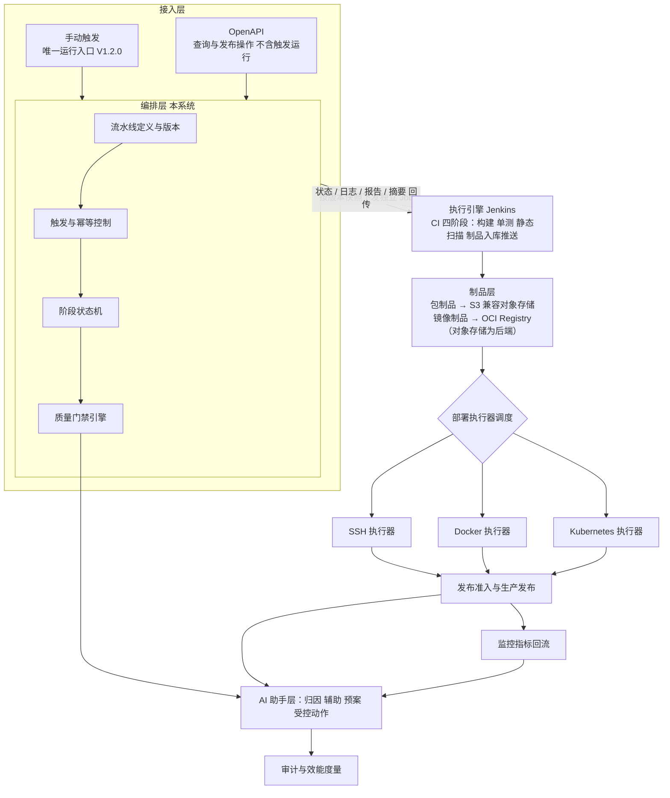
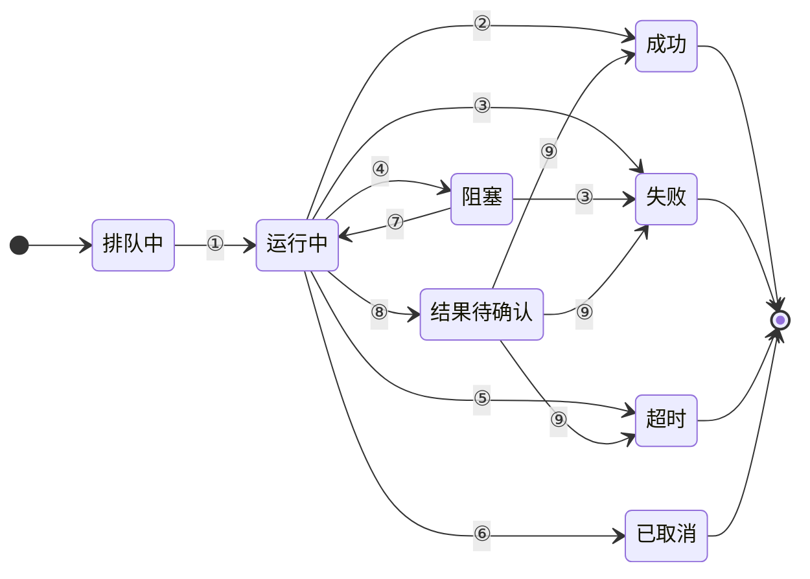
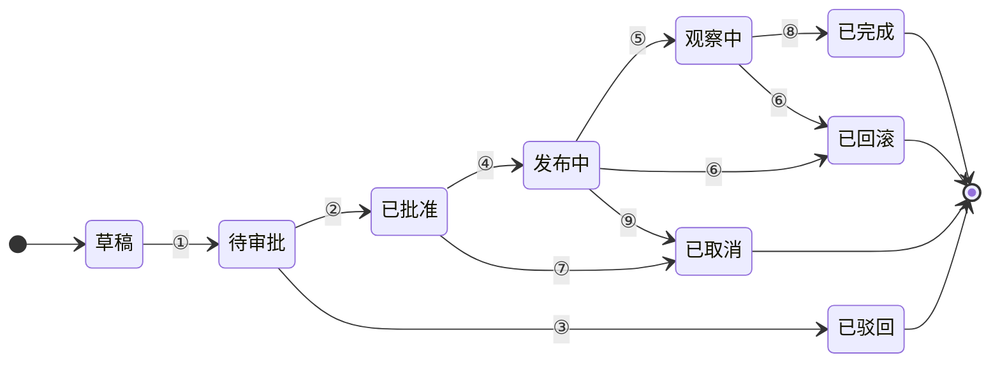
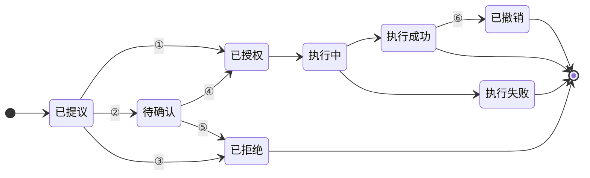

# PRD-渡口 Ferry

**一、修订记录（必填）**

| **版本号/序号** | **修改人** | **修改日期** | **修改内容** | **备注（补充说明、特殊说明、变更图片）** |
| :---: | :---: | :---: | :--- | :--- |
| V1.0.0 |  | 2026-10-29 | 初版创建：输出渡口 PRD 完整内容，含修订记录、文档目录、名词解释、需求背景与目标、项目价值、功能清单、具体功能描述（流水线管理、质量门禁、制品管理、环境与部署、发布准入、生产发布、AI 助手、系统管理、效能看板共 34 项功能）、交互&UI设计稿、数据复盘、非功能需求、验收标准、关联方、待确认问题 | 需求来源：持续交付智能助手立项（CI 基于 Jenkins，CD 支持 SSH、Docker、Kubernetes 三种部署目标）；产品定名：渡口（Ferry） |
| V1.1.0 |  | 2026-10-30 | ① 新增「应用管理」子模块（功能 35–37）；② 补齐 6 个缺失模块（功能 38–43）；③ 新增手动触发（功能 4.1）；④ **移除 CMDB 依赖，改为 GitLab / GitHub / Gitee 三平台能力对等**；⑤ **移除代码平台群组批量导入，应用改为纯手工建档**；⑥ 平台项目 ID 改为手工填写 | 需求来源：评审反馈。关注点：应用主数据归属、三平台适配边界、公网 webhook 可达性 |
| V1.2.0 |  | 2026-11-09 | ① **移除 push、合并请求、定时、OpenAPI 四种触发方式，系统唯一运行入口改为手动触发**（原功能 4 重写，新增 4.1 历史触发兼容）；② 代码仓库信息统一在应用管理填写（0.2/0.3），触发弹窗按应用带出预填；③ 代码平台适配器契约由四方法收敛为两方法（pushCommitStatus / commentOnMR，出站回写保留）；④ OpenAPI 触发接口移除，接口目录 9 个减为 8 个（功能 32/42）；⑤ 顺带消除 V1.1 残留矛盾三处（0.3.1"批量导入"表述、0.4 向导"群组自动填充"、验收 0.18"导入入口"）；⑥ 待确认问题 #15（公网 webhook 中转）随本次变更关闭，#16/#17 影响收窄；⑦ "运行新鲜度校验"经评审决定本期不做，记入后续版本池（新增待确认 #19） | 需求来源：产品负责人变更决策（2026-11-09）。变更收益：消除公网 webhook 中转依赖与三平台事件解析差异、工期收敛；变更代价：失去合入即验证能力，门禁时效依赖人工触发纪律 |
| V1.3.0 |  | 2026-11-09 | ① **将隐含假设显式化：CI 四阶段（构建、单元测试、静态扫描、制品入库/推送）的任务级执行明确由 Jenkins 承担**，CD 段不下发 Jenkins Job，消除功能 6"每个阶段拆为独立 Job"的字面歧义；② 新增《CI 执行归属与 Jenkins 结果回传契约》（定义权/判定权/制品主权/幂等绑定/日志五约束 + 三条回传通道 + 度量数据 schema + 异常矩阵）；③ 功能 5 补状态双通道、超时兜底、Jenkins 侧原文保留与 masking、日志截断判定；④ 功能 7 新增"数据获取失败（阻断、不可豁免）"结论，防止"报告回传失败被判不适用"造成静默放行；⑤ 功能 11 入库五步链按职责拆分（渡口前置校验 → Jenkins 构建/摘要/推送 → 渡口反查复核/写表）并补部分成功补偿；⑥ 关联方 Jenkins 行、非功能可靠性与可观测性、四组验收标准同步补齐；⑦ 待确认 #3 升级为阻塞级六项预研检查单 | 需求来源：Jenkins 职责边界评审结论（2026-11-09）。性质说明：原架构图与功能 6 已隐含该分工，本次为**显式化 + 补齐结果回传契约**，不推翻既有架构；变更收益：门禁与 AI 归因获得可解析输入、消除静默放行旁路 |
| V1.4.0 |  | 2026-11-09 | ① **定稿"方案 A：职责分离"制品存储与镜像分发架构**：控制面在渡口（元数据/晋级/审计/反查），数据面由 S3 兼容对象存储（包制品）+ 开源 OCI Registry（镜像制品，S3 为存储后端）承担；**明确渡口不实现 OCI Registry HTTP API V2、不代理镜像 blob 流量**；② 新增《制品存储与镜像分发架构》章节（组件选型、协议边界、存储布局、不可变机制、凭据、清理、演进触发条件）；③ 全文移除 Nexus / Harbor / skopeo 作为必需组件的假设，改按对象存储 + OCI Registry 口径重写功能 11/14/18、能力矩阵、关联方表；④ 摘要获取改为"包制品 sha256sum + S3 HeadObject / 镜像制品 HEAD manifest 读 Docker-Content-Digest"，无需额外客户端工具；⑤ 修正制品列表"构建镜像版本 build-jdk17"示例与项目 Java 21 口径不一致；⑥ 功能 12 清理策略补对象存储生命周期联动；⑦ 非功能容量/可靠性、四组验收标准、待确认 #3 第 ⑤ 项口径同步；⑧ 新增待确认 #20（对象存储实现选型、Registry 实现、静态扫描工具链、构建镜像 JDK 口径） | 需求来源：组件约束（团队无 Nexus / Harbor / skopeo）与架构评审结论（2026-11-09 产品负责人拍板取方案 A）。选型理由：避免渡口进入生产拉镜像关键路径（编排服务 99.9% 可用性不足以承载基础设施数据面）；代价：需新增 1 个 OCI Registry 容器 + 1 个对象存储服务 |
| V1.5.0 |  | 2026-11-16 | ① **统一功能编号**：功能清单收敛为 43 项，原功能 44 并入功能 34；正文应用管理改为 35–37，模板/变更单/通知渠道/存储策略/开放 API/技术债改为 38–43，导出回归 34 并前移；② **新增《统一状态与结论枚举》**，重绘运行、发布单、AI 动作状态机，补齐“结果待确认”“观察中”等状态；③ **裁决五处口径**：观察期默认值改为 SSH 30 / Docker 10 / Kubernetes 5 分钟、断点重跑一律新建运行、发布单增加“观察中”并移除“已关闭”、负责人变更即时生效不需审批、发布单目标环境收敛为生产；④ **补四个入口**：流水线启停、封网期与发布策略、环境配置纳入接入向导、终止发布后的状态流转；⑤ 修正数量词、交叉引用、双人确认口径与门禁“数据获取失败”的筛选/告警遗漏 | 需求来源：需求文档连贯性评审（2026-11-16）。变更性质：口径收敛与文档自洽修复，不新增业务能力；代价：预发不再走发布单、SSH 观察期变长，需在试点期校准。历史修订记录中的旧章节号（0.x）保留原样，对应新编号见正文 |

---

# **二、文档目录（必须生成）**

+ **一、修订记录**
+ **二、文档目录**
+ **三、名词解释**
+ **四、需求背景与目标**
    - 【背景】
    - 【目标】
    - 【特殊说明】
+ **五、项目价值**
+ **六、功能清单**
+ **七、具体功能描述**
    - 【整体架构(若有)】
    - 【功能描述】
+ **八、交互****&****UI设计稿**
+ **九、数据复盘**
+ **十、非功能需求**
+ **十一、验收标准**
+ **十二、关联方**
+ **十三、待确认问题**

---

# **三、名词解释（选填）**

| **术语** | **定义** |
| --- | --- |
| 渡口（Ferry） | 面向研发交付过程的管理类系统，以应用维度串联"代码提交→构建→测试→扫描→制品→部署→准入→生产发布"全链路，提供流水线编排、质量门禁、制品晋级、多形态部署、发布准入、生产发布管控与 AI 辅助能力；模块下分为"流水线管理""制品管理""环境与部署""发布准入""生产发布""系统管理""效能看板"七个子模块 |
| 应用（App） | 交付管理的最小对象单位，一个可独立部署的服务或程序；所有流水线、制品、环境、发布单均归属到具体应用 |
| 代码托管平台 | 应用代码的来源平台，枚举：GitLab、GitHub、Gitee；三者能力对等（拉取代码、合并请求结果回写）；V1.2.0 起系统不接收代码平台 webhook 自动触发，所有运行均由手动触发产生，差异由统一代码平台适配器屏蔽 |
| 代码平台适配器 | 屏蔽 GitLab / GitHub / Gitee 差异的统一接口，须实现 pushCommitStatus、commentOnMR 两个方法（V1.2.0：随 webhook 自动触发移除，verifyWebhook / parseEvent 不再要求） |
| 流水线（Pipeline） | 由阶段组成的可版本化交付流程定义，是本系统对交付流程的唯一管理载体；流水线定义为平台侧维护，Jenkins 仅作为执行引擎接收任务下发 |
| 阶段（Stage） | 流水线中的逻辑分段。本系统固定八种阶段类型：构建、单元测试、静态扫描、制品入库、部署非生产、集成测试、准入、生产发布；流水线按顺序启用其中若干种，不支持自定义类型。前四个 CI 阶段由 Jenkins 独立 Job 执行，后四个 CD 阶段由本系统编排器与部署执行器执行（V1.3.0 定稿，V1.5.0 明确可启用范围） |
| 任务（Task） | 阶段内可独立执行、可重试的最小执行单元；CI 阶段内为 Jenkins Job 内的执行步骤，随阶段 Job 一并下发，不单独对应 Job |
| 运行（Run） | 流水线的一次执行实例，由手动触发产生；同一应用在满足幂等条件时不重复产生运行 |
| 制品（Artifact） | 构建产出的不可变交付物，以内容摘要唯一标识；分"包制品"与"镜像制品"两种形态；摘要口径：包制品为文件 sha256，镜像制品为 OCI manifest digest（V1.4.0） |
| 制品形态 | 制品的存在形式，枚举：包制品（tar、jar、zip，用于 SSH 部署）、镜像制品（镜像摘要，用于 Docker 与 Kubernetes 部署） |
| S3 兼容对象存储 | 包制品的实际存储载体，同时作为 OCI Registry 的镜像层存储后端；按内容寻址组织对象，需支持版本控制 / 对象锁、生命周期规则、HeadObject 反查与预签名访问（V1.4.0；具体实现见待确认 #20） |
| OCI Registry | 镜像制品的标准分发组件，实现 OCI Distribution Spec / Docker Registry HTTP API V2，供 Docker 与 Kubernetes 节点按摘要拉取；以 S3 兼容对象存储为后端，本期采用开源单容器实现（V1.4.0） |
| 制品晋级（Promotion） | 同一制品在不同环境间流转的操作，仅变更环境标记，不重新构建 |
| 部署目标类型 | 应用在某个环境的部署方式，枚举：SSH、Docker、Kubernetes；一个应用在一个环境仅允许绑定一种 |
| 部署执行器（Deployer） | 屏蔽三种部署目标类型差异的统一执行接口，实现 prepare、deploy、observe、rollback、status 五个动作 |
| 批次（Batch） | 灰度发布的最小放量单元，实际粒度随部署目标类型不同（SSH 为主机组、Docker 为实例、Kubernetes 为 Pod 比例或流量比例） |
| 质量门禁（Gate） | 制品或发布单进入下一阶段前必须满足的规则集合；结论枚举：通过、不通过、不适用、已豁免、数据获取失败（V1.3.0 新增，阻断且不可豁免） |
| 门禁豁免（Exemption） | 在授权范围内临时跳过单条门禁规则的操作，须填写理由与有效期，有效期最长 72 小时，到期自动失效 |
| 存量基线 | 应用首次接入时以当次扫描结果生成的问题集合快照；后续门禁仅对"新增问题"判定，存量问题不阻塞交付 |
| 发布单（RC） | 一组待发布制品与变更的集合，是准入评审与生产发布的载体对象；提交准入后所锁定的制品不可替换 |
| 发布候选状态 | 发布单在本系统中的流转状态，枚举：草稿、待审批、已批准、发布中、观察中、已完成、已回滚、已驳回、已取消；其中已完成、已回滚、已驳回、已取消为关闭终态（V1.5.0） |
| 变更影响面 | 本次变更所影响的服务、接口、下游系统与数据表集合，由变更文件清单与服务依赖拓扑推导生成 |
| 风险评级 | 发布单的综合风险等级，枚举：低、中、高；由变更文件数、影响服务数、是否核心链路、应用近 90 天失败率、发布时间窗口五因子加权计算 |
| 准入检查清单 | 发布单审批页固定展示的六项检查内容：门禁状态、影响面、回滚方案、监控覆盖、变更单、值班确认 |
| 健康检查 | 生产发布过程中依据客观指标判定发布是否通过的机制，检查维度：实例存活、接口成功率、P95 延迟、错误日志增长率、核心业务指标 |
| 自动熔断 | 健康检查任一项超出阈值时，系统自动停止后续批次放量并触发告警的机制 |
| 观察期 | 发布完成后保留的可快速回退窗口，默认时长随部署目标类型不同（SSH 30 分钟、Docker 10 分钟、Kubernetes 5 分钟），且不得低于该类型回滚时效承诺的 2 倍（V1.5.0 修正 SSH 默认值） |
| 回滚 | 将目标环境恢复至最近一个健康版本的操作，不重新构建；回滚时效承诺随部署目标类型不同（Kubernetes ≤2 分钟、Docker ≤5 分钟、SSH ≤15 分钟） |
| 配置漂移 | 目标环境实际运行版本或配置与本系统记录不一致的状态，由部署执行器 status 动作检测 |
| 归因（Attribution） | AI 对流水线失败或生产异常给出根因假设及支撑证据的过程，输出含根因类别、结论、证据列表、置信度、建议动作 |
| 证据链 | 支撑 AI 归因结论的可溯源引用，枚举类型：日志（带行号）、指标（带时间窗）、变更（带文件与行号）；AI 结论无证据时系统直接丢弃 |
| 置信度 | AI 结论可靠程度标识，枚举：高（不少于 3 条独立证据互相印证）、中（1 条强证据）、低（弱相关）；由服务端按证据数量与类型计算，不由模型自行给出 |
| 动作分级（L0-L3） | AI 可执行动作的风险等级：L0 只读、L1 低危可逆（AI 可执行）、L2 中危需确认（须人工二次确认）、L3 高危禁止（永不执行） |
| 动作目录 | 系统预置的可执行动作白名单，含动作 ID、级别、参数 Schema、前置条件、撤销方式、频次限制；模型仅可选择目录内动作，不得生成命令或脚本 |
| 一键撤销 | **可撤销的** L1 动作执行后 10 分钟内可恢复执行前状态的能力；幂等动作（如重跑）不提供撤销，界面标注“无需撤销” |
| DORA 指标 | 交付效能四项通用指标：部署频率、变更前置时间、变更失败率、平均恢复时长（MTTR） |
| 数据权限 | 数据可见与可操作范围控制，按「应用-环境」二元组授权；生产环境操作需单独授权 |

---

# **四、需求背景与目标（必填）**

## 【背景】

依据研发交付整体业务架构，代码由 GitLab 托管，经 Jenkins 执行编译、单元测试与静态扫描，产出制品（包制品存 S3 兼容对象存储、镜像制品推 OCI Registry，后者同样以对象存储为后端），再由部署执行器发布至测试、预发与生产环境。当前已规划建设 Jenkins 流水线工程、对象存储与 OCI Registry、Kubernetes 与 Docker 部署通道、监控告警等基础能力（V1.4.0：本期不建设 Nexus / Harbor），在此基础上，研发、测试、发布经理与 SRE 在交付执行过程中缺乏统一的流程管理与过程干预入口，存在以下痛点：

1. **流水线能跑，失败靠人查**：构建或测试失败后，工程师需登录 Jenkins 翻查数千行控制台日志，凭经验判断是代码变更、依赖冲突、环境异常还是用例不稳定，平均排障时间不可控；
2. **准入决策凭印象**：发布经理判断"这批变更能不能上"时，缺少结构化的变更影响面与历史失败率依据，只能拉群询问、翻提交记录，"全批"与"全卡"之间没有中间态，且决策过程无留痕；
3. **发布风险不可见**：回滚方案靠记忆、灰度策略靠习惯，上线前无人输出书面预案；且三种部署方式（SSH、Docker、Kubernetes）的回滚耗时相差一个数量级，审批人对实际风险敞口普遍判断错误；
4. **生产异常与发布事件脱节**：健康检查告警后，值班人员往往不知道前 30 分钟内刚发生过发布，MTTR 中大量时间消耗在"是不是刚才发布引起的"这类确认动作上；
5. **制品与环境对应关系失控**：预发验证通过的包与生产实际部署的包可能是两次构建产物，测试结论对生产不具备证明力；
6. **重复性运维动作占用人力**：失败重跑、测试环境重试部署、偶发用例隔离等低价值动作依赖人工逐条操作，且无统一操作记录。

为解决上述痛点，需建设渡口，以应用维度展示交付全链路数据，提供流水线编排、质量门禁、制品晋级、多形态部署、发布准入、生产发布管控等管理能力，并叠加 AI 归因与受控动作执行能力。

## 【目标】

1. 提供"流水线管理"子模块，以应用维度展示流水线定义与运行数据，支持流水线版本化管理、模板派生、手动触发（V1.2.0 起为唯一运行入口，仓库地址、分支、提交 ID 等代码源信息在应用管理中填写）、运行详情（阶段时序+任务日志+门禁结果）、断点重跑与运行干预，页面受数据权限管控；
2. 提供"质量门禁"能力，支持按组织/应用/分支三级作用域配置门禁规则、门禁结果可视化、单条规则豁免（须理由与有效期、到期自动失效）、存量问题基线，保证不合格制品不进入下一环节且紧急场景有受控通道；
3. 提供"制品管理"子模块，支持制品入库（不可变、同名覆盖拒绝）、制品晋级（不重新构建）、制品追溯（摘要反查提交与变更人）、清理策略，保证"测试过的就是要上线的"成立；
4. 提供"环境与部署"子模块，支持环境绑定部署目标类型（SSH、Docker、Kubernetes），由统一部署执行器接口屏蔽差异，支持灰度发布、回滚、部署前校验与部署锁；三种部署方式的灰度粒度、健康检查手段与回滚时效差异在产品内显性呈现；
5. 提供"发布准入"子模块，支持发布单创建与制品锁定、变更影响面分析、风险评级、准入检查清单、审批流（高风险强制多级）、驳回与退回，使"能不能上"具备可追溯的事实依据；
6. 提供"生产发布"子模块，支持发布编排（批次、窗口、暂停点）、健康检查、自动熔断、发布后观察期与发布记录，控制生产变更的爆炸半径；
7. 提供"AI 助手"能力，覆盖失败归因、准入辅助、发布预案、生产异常归因四类智能能力，输出强制携带证据链与置信度；提供 AI 动作执行引擎，按 L0-L3 分级管控 AI 可执行动作范围，L1 动作可执行且 10 分钟内可一键撤销，L3 动作永久禁止；
8. 提供"系统管理"与"效能看板"子模块，支持角色与数据权限管控、操作审计日志（只插不改、留存≥1年）、通知与开放 API、DORA 四指标与 AI 效能度量，支撑管理决策与合规取证。

## 【特殊说明】

1. 本系统定位为交付链路的**编排层与增强层**，不替代 GitLab、Jenkins、S3 兼容对象存储、OCI Registry、Kubernetes、Docker 等既有或本期新建的基础设施；本系统只承担四件事：编排流程、守住门禁、记录全程、增强智能；**不承担制品字节的存储与分发**（V1.4.0 方案 A）；
2. 流水线定义以本系统为唯一真相源，**不支持以代码仓库内 Jenkinsfile 作为主定义**，避免门禁、准入与审计被绕过；
3. 三种部署目标类型的能力差异不做虚假统一：凡该类型不支持的能力（如 SSH 不支持按流量切分），界面必须明确标注"不支持"，不得展示无效选项；
4. AI 能力边界固定为"承担读取与判断的成本，不获得写入与执行的权力"（L1 低风险可逆动作除外）；L3 动作在任何情况下不得执行，且不得输出可执行步骤或变通路径；
5. 制品一经入库即不可变，同版本号覆盖推送一律拒绝；制品晋级不重新构建；生产环境仅接受经预发晋级且形态与部署目标类型匹配的制品；
6. 各子模块均受数据权限管控，仅可见与可操作数据权限范围内的应用与环境；生产环境操作需在「应用-生产」维度单独授权，且强制双人确认（操作人与确认人非同一人，V1.5.0 统一口径）；
7. 本系统首期服务内部研发团队，系统管理域表保留 tenant_id 字段并固定写入默认值，devops 业务表不参与租户隔离；多租户自助注册、计费、租户管理后台本期不建设；
8. 三种部署目标类型不并行建设，按存量占比与风险程度分期接入，未接入的类型在界面明确标注"暂不支持"；
9. **CI 执行归属定稿（V1.3.0）**：八个阶段中仅「构建、单元测试、静态扫描、制品入库/推送」四个 CI 阶段的任务级执行由 Jenkins 承担；CD 段（部署非生产、集成测试、准入、生产发布）由本系统编排器与部署执行器承担，**不下发 Jenkins Job**。Jenkins 仅接收按流水线版本快照下发的独立 Job，不保存业务规则、不判定门禁、不写本系统业务表；渡口通过三条回传通道获取执行结果，具体契约见第七章整体架构《CI 执行归属与 Jenkins 结果回传契约》。
10. **制品存储与镜像分发定稿为方案 A：职责分离（V1.4.0）**：控制面在渡口（制品元数据、晋级标记、审计、摘要反查复核），数据面由 **S3 兼容对象存储**（包制品）与**开源 OCI Registry**（镜像制品，以对象存储为后端）承担。本系统**不实现 OCI Registry HTTP API V2、不代理镜像 blob 流量、不提供自定义拉取 API 给 kubelet/containerd**；节点按摘要直接从 OCI Registry 拉取。理由：编排服务可用性目标 ≥99.9% 属管理面等级，进入生产拉镜像关键路径会使 Pod 自愈、扩容与回滚同时受制于渡口；完整组件选型、协议边界与演进条件见第七章整体架构《制品存储与镜像分发架构》。本期不建设 Nexus、Harbor，也不引入 skopeo 等额外客户端工具。

---

# **五、项目价值（必填）**

| **价值类型** | **价值说明** | **对应功能** |
| --- | --- | --- |
| 业务价值 | 流水线失败后由 AI 直接给出根因假设与可点击的证据链，将"翻数千行日志"压缩为"读一条结论"，缩短排障时长并降低对个人经验的依赖 | AI 失败归因、任务日志分段 |
| 业务价值 | 制品不可变与晋级不重建机制，保证预发验证结论对生产具备证明力，消除"测过的和上线的不是同一个东西"这一类高危隐患 | 制品入库、制品晋级、部署前校验 |
| 业务价值 | 发布单将变更影响面、风险评级、回滚预案结构化呈现，使准入决策从"凭印象"转为"看证据"，审批过程全程留痕可追责 | 发布单管理、影响面分析、准入检查清单、审批流 |
| 业务价值 | 生产发布按批次放量并绑定健康检查自动熔断，把故障暴露时间从"用户投诉后"提前到"发布过程中"，直接压缩变更失败的影响半径 | 灰度发布、健康检查、自动熔断 |
| 业务价值 | 三种部署方式的灰度粒度与回滚时效在产品内显性呈现，审批人可在准入页直接看到"本应用回滚预计耗时不超过 N 分钟"，避免风险敞口误判 | 部署目标类型绑定、能力矩阵展示、回滚 |
| 业务价值 | 门禁豁免通道使紧急修复有路可走，替代"为了上线而私自绕过流程"，同时豁免次数与豁免后故障形成关联分析 | 门禁豁免、存量基线 |
| 用户价值 | 研发工程师在触发运行后无需登录 Jenkins，在统一页面即可看到阶段时序、失败任务与归因结论，失败可一键断点重跑 | 运行详情、断点重跑、AI 失败归因 |
| 用户价值 | 发布经理通过发布单一次性掌握全部制品的门禁状态、影响面与回滚清单，无需跨系统拼装信息 | 发布单管理、AI 发布预案 |
| 用户价值 | SRE 在生产告警时自动获得"疑似由发布 #123 引入"的关联提示与止损建议，缩短故障定位时间 | AI 生产异常归因、发布记录 |
| 用户价值 | 低危重复动作（重跑、重试部署、隔离偶发用例、建单）可由 AI 代执行；可撤销动作支持 10 分钟内一键撤销，幂等动作标注“无需撤销”，减少人工重复操作 | AI 动作执行引擎、一键撤销 |
| 用户价值 | 各子模块支持按应用、状态、时间等多维筛选并导出，满足线下复盘与汇报场景 | 各子模块筛选与导出 |
| 业务价值 | DORA 四指标、流水线效率、AI 效能与门禁健康度形成可持续跟踪的度量体系，使交付效能改进有据可依 | 效能看板 |

---

# **六、功能清单（必填）**

| **序号** | **所属系统/模块/业务** | **功能名称** | **优先级** | **备注** |
| :---: | :---: | :---: | :---: | :--- |
| 1 | 渡口/流水线管理/流水线列表 | 流水线列表与筛选 | 高 | 以应用维度展示流水线数据，受数据权限管控；页面上方显示 5 个数据指标卡（运行中、今日失败、门禁阻塞、待准入、发布观察中），支持点击过滤，默认选中"运行中"；筛选区支持 11 项字段（V1.2.0："触发方式"枚举收敛为"手动"，保留字段用于历史数据筛选）；列表默认 30 条/页，支持复选 |
| 2 | 渡口/流水线管理/流水线定义 | 流水线定义与版本管理 | 高 | 平台侧表单与 YAML 双模式定义，保存即生成不可变版本快照；运行时仅读快照；支持任意两版 diff 对比与版本回退；支持启用/停用（停用后不可触发）；启用阶段类型不超过八种；本系统不支持仓库内 Jenkinsfile 作为主定义 |
| 3 | 渡口/流水线管理/流水线定义 | 流水线模板 | 高 | 分组织级与团队级模板；应用从模板派生独立副本（非引用），模板更新不自动影响已派生流水线，仅提示可比对合并 |
| 4 | 渡口/流水线管理/触发管理 | 手动触发（唯一触发方式，V1.2.0 变更） | 高 | 移除 push、合并请求、定时、OpenAPI 四种触发，保留手动：用户在页面填写仓库地址、分支、提交 ID（或 Tag/Ref）发起运行，仓库等代码源信息预先在应用管理（功能 35–37）填写并由弹窗自动预填；提交前执行五项预校验（仓库信息完整、分支已指定、提交格式合法、定义匹配、幂等检查），校验结果随运行落库；幂等键（应用、commit、流水线版本）命中进行中运行即合并、命中成功运行即复用制品；运行结果以出站方式回写合并请求；支持从列表行尾、列表右上角与应用详情页三个入口进入；历史触发配置的停用与兼容见 4.1 |
| 5 | 渡口/流水线管理/运行详情 | 运行详情与任务日志 | 高 | 页面含运行概要、阶段时序、任务详情与门禁结果面板；任务日志按任务分段、带行号、支持关键词跳转；日志保留 30 天，入库前自动脱敏 |
| 6 | 渡口/流水线管理/运行详情 | 断点重跑与运行干预 | 高 | 仅重跑失败阶段及后续阶段，前置阶段结果复用并标注"已复用"；支持暂停、继续、中止（中止需二次确认并填原因） |
| 7 | 渡口/流水线管理/质量门禁 | 门禁规则配置与结果展示 | 高 | 作用域优先级 分支规则＞应用规则＞组织默认规则；维度含单元测试通过率、行覆盖率、分支覆盖率、阻断级漏洞数、高危依赖漏洞数、许可证黑名单；结果面板逐条展示当前值、阈值、结论、证据链接 |
| 8 | 渡口/流水线管理/质量门禁 | 门禁豁免 | 高 | 豁免粒度为单条规则；必填理由与有效期（最长 72 小时），到期自动失效；需豁免权限；该次运行标记"带豁免发布"并在发布单与审计中高亮 |
| 9 | 渡口/流水线管理/质量门禁 | 存量问题基线 | 中 | 首次接入以当次扫描结果生成基线快照，后续门禁仅判定新增问题；基线可人工重设，重设需审批并留痕 |
| 10 | 渡口/制品管理/制品列表 | 制品列表与追溯 | 高 | 展示制品形态、摘要、所处环境、晋级链路、生产使用状态；支持输入摘要反查 commit、提交人、关联需求单、每次部署与回滚 |
| 11 | 渡口/制品管理/制品列表 | 制品入库与晋级 | 高 | 入库后不可变，同版本号覆盖推送一律拒绝；晋级仅改环境标记不重新构建；生产仅接受经预发晋级且形态与部署目标类型匹配的制品 |
| 12 | 渡口/制品管理/制品策略 | 制品清理策略 | 中 | 保留"最近 N 个 + 被生产使用过的全部"；清理为软删除，30 天内可恢复；执行前生成待删清单发管理员确认 |
| 13 | 渡口/环境与部署/环境管理 | 环境管理与部署类型绑定 | 高 | 环境分测试、预发、生产三类；每个环境必须绑定一种部署目标类型，变更需走变更单并清理该环境历史版本指针；生产环境打保护标记 |
| 14 | 渡口/环境与部署/部署执行 | 部署执行（SSH / Docker / Kubernetes） | 高 | 调度器按环境绑定的部署目标类型选执行器，统一调用 prepare→deploy→observe→status；全过程写部署记录；三种方式的具体执行步骤详见功能描述 |
| 15 | 渡口/环境与部署/部署执行 | 灰度发布 | 高 | 灰度档位由部署目标类型能力决定，前端仅渲染该类型支持的档位；每批次可设间隔与观察时长，批次观察期间可暂停；执行前输出"本次影响实例清单" |
| 16 | 渡口/环境与部署/部署执行 | 回滚 | 高 | 回滚目标取最近一个健康版本，使用历史制品不重新构建；独立于流水线，可从部署记录、环境详情或发布单触发；生产回滚前展示该类型预计耗时并要求确认；观察期结束后回滚须新建发布单；回滚后写实际耗时 |
| 17 | 渡口/环境与部署/部署执行 | 部署前校验与部署锁 | 高 | 五项校验：制品存在且已晋级、形态与部署类型匹配、目标环境无进行中部署、依赖版本兼容、变更单已登记；以「应用+环境」加分布式锁，TTL 30 分钟靠心跳续约 |
| 18 | 渡口/环境与部署/配置管理 | 配置管理 | 高 | 配置按环境独立存储带版本号，下发方式随部署类型不同；敏感配置明文存储（内部系统使用），读取时返回掩码；日志入库前正则脱敏 |
| 19 | 渡口/发布准入/发布单 | 发布单管理 | 高 | 一个发布单聚合多应用制品，目标环境仅生产；创建时校验每个制品来自已通过门禁且已晋级至预发的运行；提交准入后制品锁定，替换需退回草稿并重建；准入、发布、回滚均挂在发布单下 |
| 20 | 渡口/发布准入/影响面 | 变更影响面分析与风险评级 | 高 | 影响面三层推导（变更文件→被调用服务→对外接口与数据表）；风险评级按五因子加权映射低/中/高，高风险强制多级审批且回滚方案必填 |
| 21 | 渡口/发布准入/准入审批 | 准入检查清单与审批流 | 高 | 六项固定检查清单，系统自动带出结论，人工仅可改结论与备注不可删项；审批人按应用负责人与风险等级自动匹配，高风险强制双人；多应用发布单需各应用负责人全部通过；审批意见必填 |
| 22 | 渡口/生产发布/发布执行 | 生产发布编排与发布窗口 | 高 | 审批通过进入“已批准”，不自动执行；按批次序列执行，批次间可设自动继续或需人工确认；发布窗口与封网期管控，窗口外启动按钮禁用；含发布策略配置（22.1） |
| 23 | 渡口/生产发布/健康检查 | 健康检查与自动熔断 | 高 | 五项检查按配置间隔采样（默认 30 秒），连续 N 次超阈值判定不通过并停止后续批次；该部署类型不支持的检查项标注“不支持”而非跳过；熔断后按类型给差异化止损建议 |
| 24 | 渡口/生产发布/健康检查 | 发布记录与观察期 | 中 | 默认观察期 SSH 30 分钟、Docker 10 分钟、Kubernetes 5 分钟，且不得低于回滚时效承诺的 2 倍；期间回滚入口置顶；观察期结束发布单置“已完成”；发布记录含部署类型、批次、健康检查快照 |
| 25 | 渡口/AI助手/失败归因 | AI 失败归因 | 高 | 规则先匹配已知模式，未命中再走模型推理；输出根因类别、结论、证据列表、置信度、建议动作；无证据的结论服务端直接丢弃 |
| 26 | 渡口/AI助手/准入辅助 | AI 准入辅助与发布预案 | 中 | 准入辅助输出卡点解释、影响面摘要、相似历史变更发布结果；发布预案输出影响服务清单、建议灰度批次、回滚步骤、重点观察指标四项，可导出为发布单附件 |
| 27 | 渡口/AI助手/异常归因 | AI 生产异常归因 | 中 | 输入告警事件与配置时间窗（默认前 60 分钟）内的发布记录，输出疑似关联发布、原因假设与止损建议；无关联时明确输出"未发现关联发布" |
| 28 | 渡口/AI助手/动作执行 | AI 动作执行引擎 | 中 | 动作目录白名单；模型仅可选 action_id 并填受限参数，不得生成命令或脚本；服务端六项依次校验；L2 转人工确认页，L3 拒绝并记违规；一次仅执行一个动作不允许串联 |
| 29 | 渡口/AI助手/质量闭环 | AI 反馈与质量看板 | 中 | 每条输出带"有帮助/没帮助"与正确答案回填；记录 model_version、prompt_version、rule_version；低分样本进评测集；看板含采纳率、低置信占比、拒答率、动作成功率与撤销率 |
| 30 | 渡口/系统管理/权限 | 角色与权限管理 | 高 | RBAC 两层授权：功能权限 + 数据权限（「应用-环境」二元组）；生产环境操作单独授权且强制双人确认 |
| 31 | 渡口/系统管理/审计 | 操作审计日志 | 高 | 全量写操作与导出、日志下载等敏感读操作记录操作人、时间、对象、动作、变更前后值、来源 IP、关联单号；表只插不改不删，留存≥1 年，超期归档；支持带水印导出 |
| 32 | 渡口/系统管理/集成 | 通知与开放 API | 中 | 九类事件通知，IM 卡片带关键信息与直达链接，支持免打扰（紧急事件除外）；开放 8 个核心 API（V1.2.0 移除"触发运行"接口），按应用鉴权与限流；Webhook 失败重试 3 次，连续失败 10 次自动停用 |
| 33 | 渡口/效能看板/交付效能 | DORA 指标与流水线效率 | 中 | 四项 DORA 指标固定口径并在页面注明；每日凌晨跑批；支持按应用、团队、时间对比与下钻；同页含门禁健康度与 AI 效能（采纳率、撤销率等） |
| 34 | 渡口/各子模块 | 导出 | 高 | 勾选状态下导出勾选数据，未勾选导出列表筛选数据，导出数据与列表保持一致（字段、口径一致），受数据权限管控；超过 1 万条转异步队列，失败重试 3 次，下载链接有效期 7 天 |
| 35 | 渡口/应用管理/应用档案 | 应用列表与应用建档 | 高 | 交付最小对象的主数据入口：应用编码、名称、负责人、所属团队、代码平台与仓库路径；应用来源为**手工逐个建档**，不做代码平台群组批量导入（V1.1 变更）；应用编码创建后不可改 |
| 36 | 渡口/应用管理/应用档案 | 应用属性与代码源配置 | 高 | 维护功能 3、4、17、20、21、23 引用的应用属性：仓库地址与默认分支、对象存储路径与 OCI Registry 仓库名、核心链路标记、应用负责人（审批流据此匹配）、值班与监控信息、依赖服务清单；核心链路变更需审批，负责人变更即时生效并通知双方 |
| 37 | 渡口/应用管理/应用档案 | 应用接入向导与详情聚合 | 高 | 三步向导（基本信息 → 代码源 → 环境与部署目标 → 完成）；应用详情页按「概览/流水线/制品/环境/发布单/门禁/审计」七个标签聚合该应用全部数据，作为"这个应用现在什么状态"的唯一入口 |
| 38 | 渡口/流水线管理/流水线定义 | 流水线模板管理 | 高 | 组织级与团队级模板的增删改停与版本管理，含占位变量定义与派生关系统计；本功能为功能 3 的前置依赖，PRD V1.0.0 仅在功能 3 中出现"从模板创建"入口而无模板维护页面 |
| 39 | 渡口/系统管理/集成 | 变更单与工单协同 | 中 | 生产部署校验所需的变更单在本产品内维护与查询（编号、类型、关联应用、计划窗口、状态），支持与外部变更管理系统双向同步；同时承载 AI 动作 ACT-CREATE-TICKET 的缺陷工单创建与状态回写；PRD V1.0.0 中功能 17、21、22 均强依赖变更单，但无维护入口 |
| 40 | 渡口/系统管理/配置 | 通知渠道与通知模板管理 | 中 | 维护企业 IM / 邮件 / Webhook 三类渠道连接、消息模板与免打扰时段、升级催办规则；功能 32 描述"通知配置"但未定义渠道连接与模板的可维护入口 |
| 41 | 渡口/系统管理/配置 | 存储与保留策略管理 | 中 | 补齐功能 12 引用的“系统管理-存储策略”页：制品保留策略（最近 N 个 ∪ 生产使用过的）、软删除保留天数、清理任务执行时间、日志与审计归档策略 |
| 42 | 渡口/系统管理/集成 | 开放 API 与 Token 管理 | 中 | 功能 32 声称开放 8 个核心 API 但未给出接口清单；本功能补齐：接口目录（查询运行状态、查询制品、查询环境、晋级制品、创建发布单、查询发布状态、回滚、健康检查查询；V1.2.0 移除"触发运行"接口）、应用级 Token 签发与轮换、配额与调用明细 |
| 43 | 渡口/流水线管理/质量门禁 | 技术债看板 | 低 | 补齐功能 9 引用的技术债看板：存量问题清单（不参与门禁）、按严重级别与规则筛选、导出、修复趋势追踪 |

> 本清单共 43 项功能；V1.5.0 将原功能 44（导出补充）并入功能 34。

---

# **七、具体功能描述（必填）**

## 【整体架构(若有)】

**系统分层架构：**



**CI 执行归属与 Jenkins 结果回传契约（V1.3.0 新增，架构层强制约束）：**

八个阶段中，**仅 CI 四阶段（构建、单元测试、静态扫描、制品入库/推送）** 的任务级执行由 Jenkins 承担；CD 段（部署非生产、集成测试、准入、生产发布）由本系统编排器与部署执行器承担，不下发 Jenkins Job。Jenkins 只作为执行引擎，不保存业务规则、不判定门禁、不写本系统业务表。

| 约束 | 内容 | 违反后果 |
| --- | --- | --- |
| 定义权 | 不允许仓库 Jenkinsfile 作主定义；Job 规格由渡口按流水线版本快照生成并下发，附 run_id、阶段、任务规格、构建镜像摘要、仓库令牌 | 门禁、准入、审计被绕过 |
| 判定权 | Jenkins 只回传 exit code 与产物，不判门禁；三级规则、规则快照、豁免、存量基线全在渡口 | 质量口径分裂、豁免留痕丢失 |
| 制品主权 | 版本号冲突在 Job 下发前由渡口校验；仓库侧启用 immutable tag；摘要由渡口反查复核后写 artifact 表 | "制品不可变"落不住 |
| 幂等绑定 | run_id ↔ Jenkins build number 一一映射；重跑不重复入库 | 同一 commit 产生两份制品 |
| 日志边界 | 按任务分段带行号；渡口入库前脱敏；Jenkins 侧原文保留期与 masking 责任见功能 5 | 敏感信息经 Jenkins UI 泄露 |

**三条结果回传通道（缺一不可）：**

| # | 回传内容 | 通道 | 渡口落库点 |
| --- | --- | --- | --- |
| 1 | 任务状态、退出码、开始/结束时间、耗时 | 构建完成回调（主）+ Jenkins REST API 主动查询（兜底：5 分钟无回传触发） | 阶段状态表、运行记录 |
| 2 | 控制台日志（分段、分页、带行号） | 按 build 的日志接口拉取，单次上限 2000 行 | 分段日志（脱敏后入库） |
| 3 | JUnit XML / 覆盖率 XML / 扫描报告、制品摘要与 push 退出码 | 归档产物拉取，或构建脚本回调 POST 至渡口接收接口 | gate_result 输入、artifact 表 |

**度量数据 schema（门禁输入，V1.3.0 定稿）：**

| 报告 | 格式 | 必取字段 | 对应门禁维度 |
| --- | --- | --- | --- |
| 单元测试 | JUnit XML | tests、failures、errors、skipped | 单元测试通过率 |
| 覆盖率 | JaCoCo 或 Cobertura XML | line-covered / line-missed、branch-covered / branch-missed | 行覆盖率、分支覆盖率 |
| 依赖与漏洞扫描 | SARIF 或扫描工具原生 JSON | ruleId、severity、location、package、advisoryId、license | 阻断级漏洞数、高危依赖漏洞数、许可证黑名单 |

> 口径：单测通过率 =（tests − failures − errors）÷ tests，分母为 0 时判"数据获取失败"；行覆盖率按指令行计，分支覆盖率按分支计；黑名单类按 license 字段精确匹配。报告字段缺失、解析失败、格式不符统一按"数据获取失败"处置。

**异常矩阵（防止静默放行，V1.3.0 定稿）：**

| 场景 | 判定 | 处置 |
| --- | --- | --- |
| 任务明确未产出该类报告 | "不适用" | 计入通过统计，面板注明原因（沿用功能 7 规则 4） |
| 报告已产出但回传失败 / 解析失败 / 字段缺失 | **"数据获取失败"** | 阻断运行、**不可豁免**、不计入"全部通过"，推告警给平台管理员与发起人 |
| 状态回调丢失 | 5 分钟转主动查询 | 仍无结果则运行标记"结果待确认"并告警，禁止自动置成功 |
| 回传状态与本系统状态不一致 | 以本系统状态为准 | 记告警并触发一次复核任务 |
| 制品 push 成功但写表失败（或反之） | 以仓库实际状态为准 | 补偿重试，元数据一致前禁止晋级；连续 3 次失败告警并标记"制品待确认" |
| 日志拉取截断 | 标注"日志已截断" | AI 归因不得基于截断日志给出高置信度结论（见边界验收 9.6） |
| Jenkins 整体不可用 | 运行置"排队中"或"结果待确认" | 不丢运行记录，恢复后按 run_id 补查结果；不得置成功 |

> 待确认问题 #3 按本契约升级为六项预研检查单（阻塞级），MVP 启动前须逐项给出结论；任一项不具备时按各功能降级口径处理。

**制品存储与镜像分发架构（V1.4.0 定稿，方案 A：职责分离）：**

三个候选方案的裁决记录（选型留痕，避免后续反复）：

| 方案 | 思路 | 裁决 | 理由 |
| --- | --- | --- | --- |
| **A 职责分离** | 控制面在渡口，数据面由 S3 兼容对象存储 + 开源 OCI Registry 承担；节点按摘要直接拉取 | **采纳** | 渡口不进入生产拉镜像关键路径；组件均为成熟开源实现，无自研协议成本；与特殊说明第 1、10 条一致 |
| B 渡口全量代理 | 渡口实现 OCI Registry HTTP API V2，节点拉镜像经渡口，渡口再从对象存储取 blob | 拒绝 | 渡口可用性目标 ≥99.9% 属管理面等级，进入关键路径后其抖动会同时阻断 Pod 自愈、扩容、灰度与回滚；且 GB 级 blob 并发流量与"500 应用 / 日均 3000 运行"的管理面容量不匹配 |
| C manifest 拦截 + blob 重定向 | 渡口只处理 manifest 请求做鉴权 / 晋级校验，blob 返回 302 预签名直连 | 记入后续版本池 | 可把"生产仅接受经预发晋级制品"从流程约束升级为技术强拦截，价值明确；但需实现部分 V2 语义、Bearer token 握手与节点侧 TLS/凭据配置，本期不建设。**触发条件**：出现未晋级制品被直接拉取的线上事件，或合规要求按发布单维度审计 pull 行为 |

**组件选型与职责边界：**

| 组件 | 承担 | 不承担 | 部署形态 |
| --- | --- | --- | --- |
| **S3 兼容对象存储** | 包制品（tar/jar/zip）字节存储；OCI Registry 的镜像层后端；版本控制 / 对象锁（不可变）；生命周期规则（清理） | 不提供 Maven 仓库语义（本期制品用于部署，不作为二方库被依赖解析）；不对外提供 OCI Registry V2 协议 | 单服务；实现选型见待确认 #20（MinIO 社区版 2026 已归档且官方镜像下架，需核实并优先评估 Apache 2.0 许可的 S3 兼容实现） |
| **OCI Registry** | 实现 OCI Distribution Spec / Docker Registry HTTP API V2；manifest、blob、tag 管理；供 Docker / containerd / kubelet 按摘要拉取 | 不做门禁判定、不做晋级、不做审计留痕（均由渡口控制面负责） | 开源单容器实现（如 distribution/distribution `registry:2`），`storage` 驱动指向上述对象存储；具体版本见待确认 #20 |
| **渡口（控制面）** | 制品元数据、版本号冲突前置校验、摘要反查复核、晋级标记、门禁、审计、清理策略下发 | **不实现 V2 协议、不代理 blob 字节、不给节点提供自定义拉取 API** | 现有编排服务（devops 模块，见待确认 #3 承接方） |

**存储布局与摘要口径（V1.4.0 定稿）：**

| 制品形态 | 对象 / 引用键 | 摘要来源 | 渡口反查方式 |
| --- | --- | --- | --- |
| 包制品 | `{bucket}/{app}/{version}/{artifact}-{version}.{ext}`，对象 metadata 记录 sha256、run_id、commit | `sha256sum` 计算，写入对象 metadata | S3 `HeadObject` 读 metadata 并与 artifact 表比对 |
| 镜像制品 | OCI 内容寻址：`blobs/sha256/{digest}`（层与 config）+ manifest，tag→digest 映射由 Registry 维护 | OCI manifest digest（sha256:…） | `HEAD /v2/{name}/manifests/{tag}` 读 `Docker-Content-Digest` 响应头；或 `GET /v2/{name}/manifests/{digest}` |

> 无需 skopeo / crane / regctl 等额外客户端工具：镜像摘要由标准 V2 的响应头提供，包制品摘要由构建侧 `sha256sum` 与对象 metadata 提供；渡口以 Java HTTP 客户端直接调用。

**不可变与清理（与功能 11、12 联动）：**

1. 对象存储开启 **bucket versioning + 对象锁**（或至少开启版本控制并禁止覆盖同名对象），与渡口 Job 下发前的版本号冲突校验构成双层防线；镜像侧 Registry 启用 immutable tag / 禁止覆盖推送策略，部署一律按 digest 引用，禁用 `latest`；
2. 清理策略（功能 12）在渡口侧计算待删集合，软删除先写 `deleted_at` 与对象标记，物理删除由独立任务在恢复天数后执行；对象存储侧同步配置生命周期规则作为兜底，两侧清单不一致时以渡口 artifact 表为准并告警；
3. 被未关闭发布单引用的制品不进入待删集合（功能 12 规则 2 不变）。

**访问凭据与权限：**

| 凭据类型 | 使用方 | 要求 |
| --- | --- | --- |
| 对象存储 AK/SK | Jenkins 推送 Job、渡口反查、Registry 后端 | 通过 Jenkins 凭据注入，不下发明文；写入权限仅授予构建 Job，节点侧只读或经预签名访问 |
| OCI Registry 账号 / TLS 证书 | Jenkins 推送、Docker / Kubernetes 节点拉取 | 节点侧配置 imagePullSecret / containerd registry 配置；HTTPS 证书须在各节点信任链内 |
| SSH 密钥 | SSH 部署 | 由部署执行器注入，禁止明文落盘 |

**演进路径**：本期 A → 后续按需评估 C（触发条件见上表）。若未来启用 C，只允许渡口接管 manifest 请求，blob 必须保持 302 预签名直连，不得把大流量字节引入编排服务。

**统一状态与结论枚举（V1.5.0 定稿，全文唯一口径）：**

| 对象 | 枚举值 | 说明 |
| --- | --- | --- |
| 运行状态 | 排队中、运行中、阻塞、成功、失败、超时、已取消、结果待确认 | 成功、失败、超时、已取消为终态；结果待确认在补查后转成功/失败/超时 |
| 阻塞原因 | 门禁不通过、门禁数据获取失败、人工暂停 | 仅运行状态为阻塞时有值 |
| 阶段状态 | 未开始、进行中、成功、失败、阻塞、跳过、超时、已复用、已取消 | 跳过指因上游失败或条件不满足未执行；已复用仅出现在断点重跑的新运行中 |
| 发布单状态 | 草稿、待审批、已批准、发布中、观察中、已完成、已回滚、已驳回、已取消 | 已完成、已回滚、已驳回、已取消为关闭终态；未关闭指草稿/待审批/已批准/发布中/观察中 |
| 批次状态 | 未执行、执行中、观察中、成功、失败、已回滚、已取消 | — |
| 门禁结论 | 通过、不通过、不适用、已豁免、数据获取失败 | 数据获取失败阻断且不可豁免 |
| 准入检查项结论 | 通过、不通过、不适用、已知悉 | 已知悉仅门禁状态与监控覆盖可改，须填备注；已知悉不阻塞审批 |
| AI 动作状态 | 已提议、待确认、已授权、执行中、执行成功、执行失败、已撤销、已拒绝 | — |

**流水线运行状态机：**



| 编号 | 流转条件 |
| --- | --- |
| ① | 触发成功后进入队列，执行器空闲时开始执行 |
| ② | 全部阶段执行完成且门禁全部通过 |
| ③ | 任一阶段执行失败，或阻塞状态下豁免到期仍未通过 |
| ④ | 阶段完成但门禁存在“不通过”结论，等待人工豁免或修复；或因人工暂停停在阶段边界，阻塞原因记为“人工暂停” |
| ⑤ | 阶段执行时长超过配置的超时时间 |
| ⑥ | 人工点击中止并确认 |
| ⑦ | 门禁豁免生效或人工点击继续 |
| ⑧ | 状态回调丢失且 5 分钟主动查询仍无结果 |
| ⑨ | 按 run_id 补查到 Jenkins 结果后转入对应终态，禁止直接置成功 |

注：断点重跑**不改变原运行状态**，而是创建新运行实例并通过“重跑自”关联，原运行保持失败/超时终态；阶段状态由本系统自行维护，不采用 Jenkins 原生流水线整体状态（原因见功能 6）。

**发布单状态机：**



| 编号 | 流转条件 |
| --- | --- |
| ① | 创建发布单并提交准入（系统自动生成六项系统结论） |
| ② | 审批流全部通过（高风险需双人） |
| ③ | 审批人驳回并填写原因、指定退回环节 |
| ④ | 在发布窗口内人工点击启动（审批通过不自动执行） |
| ⑤ | 全部批次发布完成且健康检查通过，进入观察期 |
| ⑥ | 发布中或观察中人工或 AI（经确认）执行回滚 |
| ⑦ | 发布前人工取消并填原因 |
| ⑧ | 观察期结束且无异常，置“已完成”（关闭终态） |
| ⑨ | 发布过程中人工终止，置“已取消”（不触发回滚） |

注：状态单向流转不回跳；“已回滚”后不可直接进入“发布中”，需新建发布单；“已完成、已回滚、已驳回、已取消”均为关闭终态，“未关闭发布单”指草稿、待审批、已批准、发布中、观察中。

**AI 动作状态机：**



| 编号 | 流转条件 |
| --- | --- |
| ① | L1 动作通过服务端六项校验后自动转已授权 |
| ② | L2 动作校验通过后转待确认，推送人工确认页 |
| ③ | L3 动作、校验不通过或触发频控熔断 |
| ④ | 人工在确认页核对影响面后确认 |
| ⑤ | 人工在确认页拒绝 |
| ⑥ | **可撤销的** L1 动作执行成功后 10 分钟内人工点击一键撤销；幂等动作（如 ACT-RERUN）执行成功直接进入终态，不出现撤销入口 |

注：动作是否可撤销由动作目录的“撤销方式”决定；不可撤销动作在界面标注“无需撤销”，不计入撤销率分母。

**三种部署目标类型能力矩阵（产品内固定展示）：**

| 能力项 | SSH | Docker | Kubernetes |
| --- | --- | --- | --- |
| 制品形态 | 包制品（tar、jar、zip，存对象存储） | 镜像制品（存 OCI Registry，后端为对象存储） | 镜像制品（存 OCI Registry，可附 Helm 或 YAML 清单） |
| 部署单元 | 主机或主机组 | 容器实例 | Pod 与 Deployment |
| 灰度粒度 | 主机组，按台数放量 | 实例数，按实例比例放量 | Pod 比例或流量比例 |
| 灰度档位示例 | 2 台 / 5 台 / 10 台 | 1/3 实例、1/2 实例 | 1% / 5% / 10% / 25% / 50% |
| 按流量切分 | 不支持 | 不支持（需依赖外部代理） | 支持 |
| 健康检查手段 | 自定义脚本、端口探活、日志关键字、接口成功率 | 容器健康检查、端口探活、日志关键字、接口成功率、P95 延迟 | 就绪与存活探针、接口成功率、P95 延迟、核心业务指标 |
| 回滚机制 | 重新分发上一版本包并重启服务 | 重建上一版本容器 | 回滚至上一版本工作负载 |
| 回滚时效承诺 | ≤15 分钟 | ≤5 分钟 | ≤2 分钟 |
| 默认观察时长（批次与发布后共用） | 30 分钟 | 10 分钟 | 5 分钟 |
| 配置管理方式 | 配置文件下发 | 环境变量或配置文件挂载 | ConfigMap 与 Secret |
| 状态幂等强度 | 弱，依赖部署脚本自身保证 | 中，以镜像摘要为准 | 强，声明式收敛 |
| 配置漂移检测 | 需自建比对机制 | 需自建比对机制 | 声明式机制天然可检测 |

**门禁判定流程：**

```
阶段执行完成（CI 阶段由 Jenkins Job 回传状态与产物，V1.3.0）
  → 经回传通道 3 拉取该阶段产出的度量数据：
       单元测试 → JUnit XML；覆盖率 → JaCoCo/Cobertura XML；扫描 → SARIF/原生 JSON
  → 校验报告完整性与 schema：
       任务明确未产出 → 结论"不适用"；
       已产出但回传失败 / 解析失败 / 字段缺失 → 结论"数据获取失败"（阻断、不可豁免、不计入通过）
  → 加载规则：分支规则 ＞ 应用规则 ＞ 组织默认规则
  → 逐条判定：取当前值与阈值比较，得结论（通过 / 不通过 / 不适用 / 数据获取失败）
  → 若存在未过期豁免记录，该条结论改写为"已豁免"（"数据获取失败"不可豁免）
  → 汇总：全部通过或"不适用" → 阶段成功；
           存在"不通过"或"数据获取失败" → 运行置"阻塞"等待人工
  → 写 gate_result 表（含报告来源、schema 版本、原始报告引用），推通知
```

## 【功能描述】

_**形式二：文字展示（常用于内容较多、细节较多的大版本/大需求）**_

### 35–37、应用管理（应用列表、应用建档、应用属性、接入向导、详情聚合）

● 业务相关：解决"新服务怎么接入"和"这个应用现在什么状态"两个高频问题。V1.0.0 缺失应用主数据维护入口，导致流水线、制品、环境、发布单、数据权限、审批流全部失去挂载点；本功能为全部下游功能的前置依赖。

● 系统相关：应用（App）是交付管理的最小对象单位，应用档案存于本系统并作为唯一引用源；代码托管平台（GitLab / GitHub / Gitee）仅提供仓库与提交数据，不反向覆盖本系统已确认的研发侧属性。所有下游表通过应用编码外键引用，应用编码创建后不可修改。

● 描述

**前置条件：** 用户具备“应用管理”功能权限（建档、属性编辑需分别授权；核心链路标记变更仅平台管理员可审批；负责人变更即时生效，但需通知原负责人与新负责人）；

#### 35.1 应用列表

**页面元素与交互：**

1. **数据指标卡**（4 个，横排，默认选中“待完善”）：全部应用数、待完善（代码源或环境未配齐）、无环境绑定、近 30 天无运行；
2. **筛选区**（7 项字段）：

| 字段 | 组件样式 | 逻辑 |
| --- | --- | --- |
| 应用编码 / 名称 | 输入框 | 模糊搜索，支持粘贴编码精确命中 |
| 所属团队 | 下拉多选 | 取组织架构团队树 |
| 应用负责人 | 下拉多选 | 支持模糊搜索 |
| 代码托管平台 | 下拉多选 | 枚举：GitLab、GitHub、Gitee；与仓库地址域名联动校验 |
| 核心链路 | 下拉单选 | 是 / 否 |
| 部署目标类型（生产） | 下拉多选 | SSH / Docker / Kubernetes，逐环境展示 |
| 最近运行时间 | 日期范围 | 默认近 30 天 |

3. **应用列表**（默认 30 条/页，支持复选）字段：应用编码、应用名称、所属团队、应用负责人、仓库地址、默认分支、核心链路标记、生产部署类型、流水线数、最近运行状态、最近运行时间、操作；
4. 行尾操作：详情 / 编辑属性 / 接入向导 / 删除；
5. 列表右上角：新建应用、导出。**不提供代码平台群组批量导入入口**（V1.1 变更）。

**逻辑规则：**

1. 列表仅展示用户数据权限范围内的应用；平台管理员可见全部；
2. 应用编码规则：小写字母、数字、中划线，2–40 位，全局唯一，**创建后不可修改**（下游全部外键引用）；
3. 应用删除为逻辑删除，列表中不再展示，历史数据仍可查；存在进行中运行、进行中部署或未关闭发布单时不可删除，提示阻塞项；
4. 已删除应用的制品仍受“被生产使用过”清理保护约束（功能 12）；

#### 35.2 应用建档（新建应用）

**页面元素与交互：**

新建应用弹窗/页面字段：

| 字段 | 组件样式 | 逻辑 | 备注 |
| --- | --- | --- | --- |
| 应用编码 | 输入框 | 必填，格式与唯一性即时校验 | 创建后不可改 |
| 应用名称 | 输入框 | 必填，支持中文 | — |
| 所属团队 | 树状单选 | 必填，取组织架构 | 审批流向上寻找负责人时依赖此字段 |
| 应用负责人 | 人员选择器 | 必填，1–3 人 | 功能 21 审批流按此匹配 |
| 备份负责人 | 人员选择器 | 选填 | 负责人缺位时优先取此字段 |
| 核心链路 | 开关 | 默认关闭 | 打开影响功能 20 风险评级 30% 权重 |
| 代码托管平台 | 下拉单选 | 必填，枚举：GitLab、GitHub、Gitee | 与仓库地址域名联动校验（36.1 规则 5） |
| 仓库路径 | 输入框 | 平台内的 group/project 路径，如 rdc/order-service | 与平台拼成完整 Git 地址 |
| Commit ID | 输入框 | 选填，7–40 位十六进制；可在向导第二步或应用属性中补填 | 指定构建使用的提交，并作为手动触发的默认提交 ID；留空表示取默认分支最新提交 |
| 描述 | 多行输入 | 选填 | — |

**逻辑规则：**

1. 应用编码重复时立即报错并提示"编码已存在，请更换"；
2. 核心链路变更需走审批，审批通过后生效，变更记录写审计（依据功能 20 规则 3）；
3. 负责人变更**立即生效**且不需要审批，但需通知原负责人与新负责人，并写审计；

#### 36.1 应用属性与代码源配置

字段定义（功能 3、4、17、20、21、23 均引用下列属性）：

| 属性 | 字段 | 被谁引用 | 变更影响 |
| --- | --- | --- | --- |
| 代码源 | 代码托管平台（GitLab / GitHub / Gitee）、仓库地址（Git URL）、仓库路径、默认分支、Commit ID、仓库令牌 | 功能 3 占位变量替换、功能 4 手动触发预填、流水线执行来源 | 变更后新触发的运行使用新地址，历史运行不受影响；平台变更需重新填写仓库令牌（V1.2.0：不再有 webhook 配置动作） |
| 制品 | 对象存储 bucket / 路径、OCI Registry 仓库名 | 功能 3 占位变量替换、功能 11 入库 | 需与实际存储配置一致，错误将导致入库失败（V1.4.0：本期制品用于部署，不作为二方库被 Maven 依赖解析，无需 maven-metadata.xml 语义） |
| 风险属性 | 核心链路标记 | 功能 20 风险评级 | 影响审批层级，需审批 |
| 审批属性 | 应用负责人、备份负责人 | 功能 21 审批流 | 影响审批人匹配；技术负责人按组织架构上溯（待确认 #14），不在应用属性中维护 |
| 值班属性 | 值班人、值班时段 | 功能 21 值班确认、功能 22 批次确认通知 | — |
| 监控属性 | 监控系统类型、监控大盘地址、告警规则组 | 功能 21 监控覆盖检查、功能 23 健康检查数据源 | 未配置时准入页“监控覆盖”判定为不通过 |
| 依赖属性 | 依赖服务清单与版本范围 | 功能 17 依赖版本兼容校验、功能 20 影响面第二层 | 支持手工维护，或从 pom.xml / package.json / go.mod 解析后人工确认 |

**逻辑规则：**

1. 仓库地址变更后，已存在的手动触发记录与历史运行仍保留原地址快照，不做回填；
2. 一个应用允许多个仓库（如多模块仓库），但需指定一个"主仓库"用于流水线默认拉取；
3. 监控属性未配置时，功能 21 的“监控覆盖”自动给出“不通过”并阻断审批；处理方式仅可改为“已知悉”并填备注，不允许改为“通过”（结论枚举见整体架构）；
4. **三平台能力对等**：GitLab、GitHub、Gitee 均支持拉取代码、合并请求（MR/PR）结果回写两类能力（V1.2.0：webhook 自动触发已移除，不再要求平台支持入站事件），系统通过统一的「代码平台适配器」接口屏蔽差异，适配器须实现 `pushCommitStatus / commentOnMR` 两个方法；
5. **平台与地址一致性校验**：仓库地址域名必须与所选代码托管平台匹配（GitLab 默认自建域名、GitHub 为 github.com 或 GitHub Enterprise 域名、Gitee 为 gitee.com 或私有化域名）；不一致时保存报错并定位字段；
6. **仓库令牌独立**：仓库令牌保存在应用代码源（`repo_token`，明文，内部系统使用），前端以密码框展示；不跨应用共享，平台变更后需重新填写；
7. **能力差异显性提示**：Gitee 与 GitHub 的部分企业版权限模型不同，若某平台不支持"提交状态回写或合并请求评论回写"，在应用详情页明确标注"该平台不支持结果回写"，不得静默忽略；

#### 36.2 三平台能力与适配要求

| 能力 | GitLab | GitHub | Gitee | 系统要求 |
| --- | --- | --- | --- | --- |
| 拉取代码（Git 协议） | 支持 | 支持 | 支持 | 统一按 commit 拉取 |
| MR / PR 评论回写 | 支持（MR） | 支持（PR） | 支持（PR） | 统一抽象为"合并请求评论" |
| 提交状态回写（成功/失败） | 支持 | 支持 | 支持 | 运行结果回写至合并请求页 |
| 变更文件清单 | 支持 | 支持 | 支持 | 影响面分析第一层的数据来源 |

#### 37.1 接入向导（三步）

| 步骤 | 内容 | 可跳过 | 完成判定 |
| --- | --- | --- | --- |
| 第一步 基本信息 | 应用编码、名称、团队、负责人、核心链路 | 否 | 必填项齐全 |
| 第二步 代码源 | 仓库地址（手工填写，V1.2.0 变更：不做群组/项目选择自动填充，系统仅校验域名与平台匹配、仓库信息完整且分支已指定）、默认分支、对象存储路径与 OCI Registry 仓库名 | 是（暂存） | 仓库信息完整且分支已指定 |
| 第三步 环境与部署目标 | 至少配置一个测试环境：环境名称、部署目标类型、目标资源；生产环境可暂不配置 | 是（暂存） | 至少一个测试环境的目标资源校验通过 |
| 完成 | 展示接入摘要：已完成的项、跳过的项、下一步建议入口 | — | — |

**逻辑规则：**

1. 点击“下一步”自动保存当前步骤，退出后可从中断处继续；
2. 跳过第二步或第三步时，应用标记为“待完善”，允许创建流水线，但手动触发与生产发布单创建对缺失项给出阻断提示与补齐入口；

#### 37.2 应用详情聚合页

**七个标签页：**

| 标签 | 内容 |
| --- | --- |
| 概览 | 基础属性卡、当前生产生效制品与摘要、生产环境部署类型、最近 5 次运行与发布、未关闭阻塞项（门禁阻塞 / 待审批 / 观察中） |
| 流水线 | 该应用全部流水线与最近运行，附"新建流水线""手动触发"入口 |
| 制品 | 该应用制品列表（复用功能 10），默认按构建时间倒序 |
| 环境 | 该应用各环境与部署目标类型、当前生效制品、配置版本（复用功能 13） |
| 发布单 | 该应用参与的发布单（含多应用发布单），按状态分组 |
| 门禁 | 该应用门禁规则、存量基线与技术债（跳转功能 9 与功能 43） |
| 审计 | 该应用维度的操作审计流水（复用功能 31，自动带应用过滤） |

**后置操作：** 应用建档完成后，可被功能 13 环境管理、功能 19 发布单、功能 30 数据权限引用。

---

### 1、流水线列表与筛选

● 业务相关：研发工程师、发布经理与平台管理员以应用维度查阅交付流程的整体运行情况，通过指标卡快速发现失败与阻塞数据，通过筛选区定位目标应用。

● 系统相关：页面数据受数据权限管控，仅查询权限范围内应用的流水线数据；指标卡点击后对列表按对应条件过滤，与筛选区条件叠加生效。

● 描述

**前置条件：** 用户已登录本系统并具备"流水线管理"子模块访问权限；用户在数据权限范围内存在至少 1 条流水线数据。

**页面元素与交互：**

1. 页面上方显示**数据指标卡**，依次显示指标标题与数值，支持点击按条件过滤列表，默认选中"运行中"。各指标口径如下：

| 指标 | 过滤条件 |
| --- | --- |
| 运行中 | 运行状态＝运行中或排队中，或阻塞原因为人工暂停的数据数（门禁类阻塞不计入） |
| 今日失败 | 运行状态＝失败 且 结束时间在今日 00:00 之后的数据数 |
| 门禁阻塞 | 运行状态＝阻塞 且 阻塞原因属于门禁类（门禁不通过、门禁数据获取失败）的数据数（人工暂停不计入） |
| 待准入 | 关联发布单状态＝待审批的数据数 |
| 发布观察中 | 关联发布单处于发布中或观察中的数据数 |

2. **筛选区**：指标卡下方为筛选区域，可按以下字段对列表进行筛选：

| 字段 | 组件样式 | 逻辑 | 备注 |
| --- | --- | --- | --- |
| 应用 | 下拉多选 | 1、点击下拉显示数据权限范围内的全部应用；2、支持模糊搜索；3、选中后以标签形式展示 | — |
| 流水线名称 | 输入框 | 支持按流水线名称模糊搜索 | — |
| 运行状态 | 下拉多选 | 枚举：排队中、运行中、阻塞、成功、失败、超时、已取消、结果待确认 | 按最近一次运行状态过滤 |
| 分支 | 下拉多选 | 取该应用历史运行出现过的分支，支持模糊搜索 | — |
| 触发方式 | 下拉多选 | 枚举：手动 | V1.2.0 起仅"手动"；保留字段用于历史运行数据筛选 |
| 部署目标类型 | 下拉多选 | 枚举：SSH、Docker、Kubernetes | 取应用在生产环境绑定的类型 |
| 门禁结论 | 下拉多选 | 枚举：全部通过、存在不通过、存在豁免、存在数据获取失败 | — |
| 是否存在豁免 | 下拉单选 | 枚举：是、否 | — |
| 制品形态 | 下拉多选 | 枚举：包制品、镜像制品 | — |
| 负责人 | 下拉多选 | 支持模糊搜索，候选仅限数据权限范围内人员 | — |
| 最近运行时间 | 日期范围选择 | 选择开始与结束日期范围，具体到日 | 默认近 7 天 |

3. **流水线列表**：下方展示流水线列表，默认 30 条/页，可选 30/100/200/500/1000，支持复选。展示字段如下：

| 字段 | 示例 | 备注 |
| --- | --- | --- |
| 流水线ID | PL-20261029-0007 | — |
| 应用 | order-service | — |
| 流水线名称 | 订单服务主干流水线 | — |
| 当前版本 | V12 | 点击可查看版本 diff 与回退入口（功能 2） |
| 默认分支 | main | — |
| 部署目标类型 | Kubernetes | 取生产环境绑定值；多环境不同时展示"生产：Kubernetes，测试：Docker" |
| 触发方式 | 手动 | 展示该流水线最近一次运行的触发方式（V1.2.0 起固定为"手动"；历史遗留数据可能展示旧枚举） |
| 最近运行状态 | 阻塞 | 枚举同筛选区；失败与阻塞时行首显示色点 |
| 最近运行 Commit | a3f9c21 | 点击跳转该应用代码托管平台的提交页（GitLab / GitHub / Gitee） |
| 提交人 | 张三 | — |
| 开始时间 | 2026-10-29 09:12:33 | — |
| 耗时 | 4分12秒 | — |
| 门禁结论 | 存在不通过 | 点击展开逐条规则结果（功能 7） |
| 最近制品 | sha256:7d2f…e9 | 点击进入制品详情（功能 10） |
| 负责人 | 李四 | — |
| 更新时间 | 2026-10-29 09:16:45 | — |

4. 列表最末尾展示操作列，含“查看运行”“手动触发”“编辑定义”三个入口；列表右上角显示“手动触发”与“导出”按钮。

**逻辑规则：** 指标卡点击过滤与筛选区条件为叠加关系（同时生效）；切换指标卡时筛选区条件保留不清空；无数据权限的应用不出现在下拉候选也不出现在列表。

**后置操作：** 点击"查看运行"进入运行详情（功能 5）；点击"手动触发"按功能 4 的幂等规则创建运行。

---

### 2、流水线定义与版本管理

● 业务相关：流程调整（增加扫描阶段、调整超时、改并行结构）需要可追溯、可回退，避免"改了一个配置全组受影响"。

● 系统相关：定义数据存于本系统，运行时下发任务给 Jenkins；版本快照不可变，运行记录绑定版本号。

● 描述

**前置条件：** 用户具备该应用"流水线编辑"功能权限，且该应用已存在。

**页面元素与交互：**

1. 点击"编辑定义"进入定义页，提供两种编辑模式，二者内容实时互转：
    1. **表单模式**：按阶段逐一配置，可在八种阶段类型中启用/停用并调整顺序（同一类型最多一个），每个阶段配置包含阶段名称、任务列表、超时时间、产出物声明；
    2. **YAML 模式**：直接编辑结构化定义文本，提供语法校验与错误行定位，校验不通过时"保存"按钮禁用。
2. 保存时弹窗展示本次改动摘要（新增/删除/修改的阶段与字段），需填写变更说明后确认；确认后生成新版本号（自增）与内容 hash。
3. 定义页右上角"版本历史"入口，展示版本号、变更人、变更时间、变更说明；支持任选两个版本做 diff 对比（左右分栏，差异行高亮）。
4. 版本历史中每个非当前生效版本提供“回退到此版本”按钮，点击二次确认后，以该版本内容生成一个新版本号（不删除历史，不回滚指针）。
5. 定义页右上角提供“启用/停用”开关：停用需填写原因；停用后手动触发入口禁用，进行中的运行不受影响。

**逻辑规则：**

1. 版本快照一经生成不可修改；正在运行的运行实例继续按其绑定的版本执行完毕，不受新保存版本影响；
2. 本系统不接受代码仓库内 Jenkinsfile 作为流水线主定义。若检测到仓库根目录存在 Jenkinsfile，定义页顶部展示提示条"检测到仓库内存在 Jenkinsfile，该文件不会生效，请以本系统定义为准"；
3. 启用阶段类型不超过八种（同一类型最多一个），单阶段任务数量上限 30，超出时保存报错并提示具体超限项；
4. 回退操作等价于新建版本，操作人、时间、来源版本号写入版本记录与审计日志；
5. 启用/停用写审计；停用不删除定义与历史运行，重新启用后恢复可触发状态。

**后置操作：** 新版本保存后，后续手动触发按新版本生成运行；页面提示"新版本已生效，进行中的运行仍使用旧版本"。

---

### 3、流水线模板

● 业务相关：新应用接入从数天缩短到小时级，同时保证组织内流程口径一致。

● 系统相关：模板与应用流水线为"派生副本"关系而非引用关系。

● 描述

**前置条件：** 用户具备“模板管理”权限（组织级模板仅平台管理员可建，模板维护页见功能 38）；创建流水线时选择“从模板创建”。

**页面元素与交互：**

1. 模板列表分"组织级""团队级"两个标签页，展示模板名称、适用场景、阶段数、创建人、更新时间、被派生流水线数；
2. 新建应用流水线时，定义页提供"从模板创建"入口，选择模板后系统按模板生成一份**独立副本**，并将模板中的占位变量（应用名、仓库地址、对象存储路径 / OCI Registry 仓库名）替换为实际值；替换结果在预览页逐条列出，可人工修改后确认；
3. 模板更新后，所有由该模板派生的流水线在列表行内展示提示标记"有新版本模板"，点击可查看与该流水线当前定义的差异，用户可选择逐条合并或忽略；
4. 模板支持"停用"，停用后不可被新的流水线选用，已派生流水线不受影响。

**逻辑规则：** 派生为副本，模板变更**不自动**影响已派生流水线；合并操作由人工逐条确认，不做批量覆盖；组织级模板可见范围全员，团队级模板仅本团队成员可选。

**后置操作：** 合并完成后按功能 2 生成新的流水线版本。

---

### 4、手动触发（唯一触发方式，V1.2.0 变更）

● 业务相关：V1.2.0 移除 push、合并请求、定时、OpenAPI 四种触发方式，仅保留页面手动触发：用户在应用管理中填写仓库地址、默认分支、仓库令牌等代码源信息后，在流水线列表或应用详情页选择应用、分支与提交 ID（或 Tag/Ref）主动发起运行。该变更消除公网 webhook 中转入网依赖与三平台事件格式解析差异，代价是失去"提交即构建"的自动化能力，需以发布纪律（发版前必跑）与准入拦截弥补，运行新鲜度校验经评审决定本期不做、记入后续版本池（待确认问题 19）。

● 系统相关：手动触发参数（仓库地址、分支、提交 ID）作为运行入参随运行落库，与代码平台间不再有入站事件接口，仅保留**出站**能力（按 commit 拉取代码、状态回写、MR 评论）；平台间差异统一由代码平台适配器屏蔽，适配器方法收敛为 pushCommitStatus、commentOnMR 两个（见 36.1）。

● 描述

**前置条件：** 流水线已创建且处于启用状态；目标应用已在应用管理中登记代码源信息（代码托管平台、仓库地址、仓库令牌）。

**页面元素与交互：**

1. **触发弹窗**：入口三处（流水线列表右上角不带上下文、列表行尾操作列带行上下文预填、应用详情页“流水线”标签，见 37.2），弹窗字段：

| 字段 | 组件样式 | 逻辑 | 备注 |
| --- | --- | --- | --- |
| 目标应用 | 下拉单选 | 仅列数据权限范围内**已建档且已配置代码源**的应用 | 必填 |
| 仓库地址 | 只读 | 取应用代码源登记的仓库地址，不可修改（修改须回应用管理变更并留痕） | V1.2.0 变更：不允许运行时临时改写仓库地址，防止越权拉取未登记仓库 |
| 分支 | 下拉单选 + 候选列表 | 候选为该应用代码平台的实时分支列表（系统按需查询，不做缓存超 5 分钟）；默认取应用登记的默认分支 | 必填 |
| 提交 ID | 输入框 + 最近提交候选 + 引用类型切换 | 默认取应用登记的 Commit ID；未登记或不可达时展示所选分支最新 10 条提交（短 SHA、提交人、时间），可点选或手输；引用类型为 Commit 时校验 7–40 位十六进制，为 Tag/Ref 时校验 Git ref 命名（1–100 字符） | 必填；非该分支可达提交时报错“提交 xxxx 不属于分支 yyyy” |
| 触发说明 | 多行输入 | 选填，不少于 10 字时展示引导提示；随运行落库供追溯 | — |

2. **预校验**：点击"校验"执行五项预校验并逐条展示结论：仓库信息完整、分支已指定、提交格式合法、流水线定义匹配（命中分支级门禁规则）、幂等检查（是否将合并或复用）；预校验结果随运行落库，形成"当时以什么入参、什么结论放行"的快照；
3. **最近 20 条触发记录**：触发时间、应用、分支、Commit、触发人、结果（已创建运行 / 复用运行 / 已合并 / 已拒绝），可跳转对应运行；
4. 必填项未完整或格式错误时"开始运行"禁用；提交成功后在弹窗展示运行 ID、应用、分支、提交 ID 与幂等判定结论，并提供"查看运行详情"入口。

**逻辑规则：**

1. **幂等判定**：以（应用、commit、流水线版本）为幂等键。触发到达时先查该键：存在"运行中/排队中/阻塞"的运行则直接返回其 run_id，新触发标记为"已合并"；存在"成功"的运行则提供"复用其制品"选项（用户确认后标记"复用运行"，不重新构建）；均不存在才新建运行；
2. **入队与状态**：校验通过后创建运行，状态置"排队中"；60 秒合并、事件验签、路径过滤、定时跳过、MR 触发保留最新等入站事件相关规则随 V1.2.0 一并废止；
3. **权限与频率管控**：仅"流水线触发"权限用户可发起；同一用户对同一应用 1 分钟内手动触发超过 5 次时提示"操作过于频繁"；每次触发（含被拒绝）写审计；
4. **执行期无入站事件**：运行进行中不因代码平台事件改变目标 commit 或重跑；如需追新提交，由用户另行触发新运行。

**后置操作：** 创建运行记录，状态置"排队中"，按流水线版本快照生成 CI 四阶段独立 Jenkins Job 并下发（run_id 与 build number 一一绑定，契约见整体架构），进入功能 5 的执行流程；运行结束按功能 32 通知订阅推送，并按功能 36.1 规则 4 回写合并请求（如该 commit 关联 MR/PR）。

---

### 4.1、触发入口与历史触发兼容（V1.2.0 新增）

● 业务相关：明确 V1.1.0 存量配置与历史运行数据的兼容口径，避免升级歧义。

● 系统相关：升级即关闭全部 webhook 注册（三平台侧的 hook 由部署脚本一次性清理），历史运行记录中的触发方式字段保留原值不回填。

**逻辑规则：**

1. 存量流水线定义中的触发配置（push/定时/OpenAPI 等）在升级后自动失效并在定义页以提示条展示"触发配置已停用，当前仅支持手动触发"，不做数据删除；
2. 效能看板与导出中"触发方式"维度保留历史枚举值，新数据统一为"手动"；
3. OpenAPI 触发接口下线（接口目录 9 个减为 8 个，见功能 42）；原经 OpenAPI 触发的外部系统改为“调用方人工在页面触发”或记入后续版本池评估是否恢复为受限的“服务账号触发”。

**后置操作：** 无。

---

### 5、运行详情与任务日志

● 业务相关：这是工程师排障的第一入口，要求一眼看清"跑到哪了、卡在哪、为什么卡"。

● 系统相关：数据来源于本系统的阶段状态表与按任务分段落库的日志；Jenkins 执行结果经三条回传通道（状态、日志、报告/摘要）进入本系统，日志入库前完成脱敏（V1.3.0 契约见整体架构）。

● 描述

**前置条件：** 存在一次运行记录。

**页面元素与交互：**

1. 页面自上而下分运行概要、阶段时序、任务详情三块，另有独立的门禁结果面板与 AI 归因面板：

| 区域 | 内容 |
| --- | --- |
| 运行概要 | 运行ID、应用、流水线名与版本、分支、commit、触发方式、状态、开始/结束时间、总耗时、制品摘要、发起人 |
| 阶段时序 | 横向时序图，每阶段一条色块，长度代表耗时，颜色代表状态（未开始/进行中/成功/失败/阻塞/跳过/超时/已复用/已取消）；进行中的阶段每 3 秒轮询刷新 |
| 任务详情 | 点击阶段展开其下任务列表，字段：任务名、执行器、状态、耗时、退出码、日志入口 |

2. **任务日志**：点击任务"日志"打开日志面板，支持：
    1. 关键词搜索，命中行高亮，支持上下跳转；
    2. 行号定位，支持从外部链接带行号直接展开到该行；
    3. 尾部/头部快速跳转；单次加载 2000 行，超出分页；
    4. 下载完整日志（受数据权限管控，下载动作记审计）。
3. **门禁结果面板**：固定区域逐条展示规则名、当前值、阈值、结论、证据链接（详见功能 7）。
4. 运行失败时，页面右侧展示 **AI 归因面板**（详见功能 25），默认折叠，失败运行自动展开。

**逻辑规则：**

1. 日志按任务分段落库，每行带行号，供 AI 归因引用；
2. 日志入库前经正则匹配对凭据、手机号、身份证号、邮箱打码后存储，打码动作不可逆，原文不落库；
3. 运行日志保留 30 天，到期归档；制品关联的那次运行的日志索引永久保留；
4. 阶段状态由本系统维护，与 Jenkins 侧回传状态按任务粒度对齐，若两侧不一致以本系统状态为准并记告警；
5. **状态双通道（V1.3.0）**：以构建完成回调为主、Jenkins REST API 主动查询为兜底；5 分钟无回传转主动查询，仍无结果则运行标记"结果待确认"并告警，禁止自动置成功；
6. **Jenkins 侧原文边界（V1.3.0）**：Jenkins 控制台原文保留期不得超过 30 天，且须启用凭据与敏感字段 masking；验收 1.12"原文不可通过任何页面入口查看"的口径包含 Jenkins 侧，脱敏责任由本系统下发 Job 时强制注入 masking 参数；
7. **日志截断判定（V1.3.0）**：单次拉取上限 2000 行，超出时日志面板明确标注"日志已截断"，AI 归因不得基于截断日志给出高置信度结论。

**后置操作：** 失败与超时的运行支持断点重跑（功能 6）。

---

### 6、断点重跑与运行干预

● 业务相关：失败一次不需要从头再来，既省时间也省机器；临时叫停时要有手段。

● 系统相关：因 Jenkins 原生不支持阶段级断点续跑，本系统将 **CI 四阶段（构建、单元测试、静态扫描、制品入库）各拆为独立 Jenkins Job** 并自行维护阶段状态；CD 段（部署非生产、集成测试、准入、生产发布）不下发 Jenkins Job，由本系统编排器与部署执行器执行（V1.3.0 明确，消除"每个阶段拆为独立 Job"的字面歧义）。

● 描述

**前置条件：** 存在一次运行记录，状态为失败、超时或运行中。

**页面元素与交互：**

1. 运行状态为"失败"或"超时"时，运行详情页与列表操作列显示"断点重跑"按钮：
    1. 点击后弹窗展示重跑计划：将从第 N 阶段（失败阶段）开始重跑，前 N-1 阶段结果复用，列表逐条列出复用阶段与其原结果；
    2. 提供"从指定阶段重跑"选项，可选择更早阶段做起（用于怀疑上游结果不可信的场景）；
    3. 确认后关闭弹窗，创建一次新的运行实例（不覆盖原运行），新运行中被复用的阶段状态标记为"已复用"并展示原耗时。
2. 运行状态为"运行中"或"排队中"时，显示"暂停""中止"按钮：
    1. **暂停**：当前任务执行完成后停在阶段边界，状态置“阻塞”、阻塞原因置“人工暂停”，可点击“继续”恢复；
    2. **中止**：二次确认弹窗，必须填写中止原因（不少于 10 字），确认后终止后续任务下发，已产出制品保留不删除。
3. 暂停状态持续超过 24 小时，列表标记"挂起"并通知发起人。

**逻辑规则：**

1. 重跑创建新运行实例，原运行记录保留，两者通过"重跑自"字段关联，形成可追溯链；
2. 复用阶段不重新下发执行，其制品与工作空间通过缓存直接引用；若缓存已失效，则提示"上游缓存已过期，需从第 N 阶段起重跑"并锁定可选范围；
3. 中止后不可恢复，只能重跑；
4. 同一应用同一时刻的重跑请求受运行并发控制约束，避免重复下发；
5. 运行状态为“结果待确认”时不可断点重跑，须先由平台管理员按 run_id 补查确认；重跑只对失败、超时运行开放。

**后置操作：** 重跑产生的运行继续走门禁判定流程。

---

### 7、门禁规则配置与结果展示

● 业务相关：把质量要求固化成可执行条件，不靠人在会上口头把关。

● 系统相关：规则以配置形式存库，阶段结束时由判定流程逐条比对；结论落 gate_result 表。

● 描述

**前置条件：** 用户具备"门禁配置"权限（组织级仅平台管理员可改）。

**页面元素与交互：**

1. **规则配置页**：按作用域分"组织默认""应用""分支"三个标签页，每条规则一行，字段：规则类型、规则名称、阈值、启停状态、生效范围、最后修改人、修改时间。点击"新增规则"弹窗配置：

| 字段 | 组件样式 | 逻辑 | 备注 |
| --- | --- | --- | --- |
| 规则类型 | 下拉单选 | 枚举：单元测试通过率、行覆盖率、分支覆盖率、阻断级漏洞数、高危依赖漏洞数、许可证黑名单 | — |
| 规则名称 | 输入框 | 必填，用于结果展示 | — |
| 阈值 | 输入框 | 按规则类型校验：比率类填 0-100 的数值；数量类填非负整数；黑名单类填逗号分隔值列表 | — |
| 比较方向 | 下拉单选 | 枚举：不低于、不高于 | 与规则类型联动校验 |
| 作用阶段 | 下拉多选 | 枚举：单元测试、静态扫描 | — |
| 适用应用 | 树状多选 | 应用级与分支级规则必填 | — |
| 适用分支 | 输入框 | 支持通配符，仅分支级规则可填 | — |
| 是否允许豁免 | 开关 | 关闭后该规则不可被豁免（用于安全红线类规则） | 默认开启 |

2. **结果面板**（运行详情内）：逐条展示规则名、当前值、阈值、结论、证据链接；不通过的标红并置顶；点击证据链接跳转到对应报告或日志行；该阶段未产出对应数据时结论展示"不适用"并说明原因。

3. 结论枚举与展示：通过（绿）、不通过（红）、不适用（灰）、已豁免（黄，附豁免人与到期时间）、**数据获取失败**（V1.3.0 新增，橙红，附回传失败原因与报告来源，阻断且不可豁免）。

**逻辑规则：**

1. 作用域优先级：分支规则 ＞ 应用规则 ＞ 组织默认规则；同一类型规则在同一作用域内多条并存时，取最严格阈值作为判定依据并在面板标注"由分支规则生效"；
2. 规则停用时该条不参与判定，也不计入"全部通过"统计；
3. 阈值修改即时生效于新触发的运行，进行中的运行仍按开始时加载的规则快照判定（规则快照随运行落库，保证可复现）；
4. **数据缺失区分（V1.3.0）**：判定所需报告"任务明确未产出"时结论为"不适用"，计入通过统计并提示原因；报告已产出但回传失败、解析失败、格式不符或必取字段缺失时结论为"**数据获取失败**"，不计入"全部通过"、阻断运行、**不可豁免**，并推告警给平台管理员与发起人；两类场景不得混判，防止回传链路故障变成静默放行通道；
5. **度量数据来源与 schema（V1.3.0）**：单测取 JUnit XML、覆盖率取 JaCoCo/Cobertura XML、扫描取 SARIF 或工具原生 JSON，字段映射与计算口径见整体架构《CI 执行归属与 Jenkins 结果回传契约》；gate_result 记录报告来源、schema 版本与原始报告引用，供事后复现；
6. **规则快照（V1.3.0 补口径）**：随运行落库的快照同时包含门禁规则版本与度量报告 schema 版本，任一版本变更均可解释历史结论差异。

**后置操作：** 存在“不通过”或“数据获取失败”结论时，运行状态置“阻塞”，推通知给发起人与应用负责人（数据获取失败同时告警平台管理员）。

---

### 8、门禁豁免

● 业务相关：紧急线上修复必须有路可走，否则团队会自创绕过方式，风险反而更大。

● 系统相关：豁免粒度为单条规则；豁免记录写入运行与发布单，并纳入度量。

● 描述

**前置条件：** 运行状态为"阻塞"且存在结论为"不通过"的规则；用户具备该应用"门禁豁免"权限，且目标规则的"是否允许豁免"为开启。

**页面元素与交互：**

1. 结果面板中每条"不通过"规则行尾显示"申请豁免"按钮，点击弹出豁免申请弹窗：

| 字段 | 组件样式 | 逻辑 | 备注 |
| --- | --- | --- | --- |
| 规则名称 | 只读 | 展示被豁免的规则 | — |
| 当前值与阈值 | 只读 | 展示不通过的具体差距 | — |
| 豁免理由 | 多行输入 | 必填，不少于 20 字 | — |
| 有效期 | 下拉单选 | 枚举：8 小时、24 小时、72 小时；默认 24 小时 | 系统上限 72 小时，不可配置更长 |
| 关联问题单 | 输入框 | 选填，支持搜索已有工单号 | 填写后在发布单展示跳转 |

2. 确认后该条结论改为"已豁免"，运行解除阻塞继续执行；
3. 豁免到期前 2 小时向申请人与应用负责人推提醒；到期后若仍未修复，运行置“失败”，该运行产物标记为“豁免到期”，且基于该制品创建的发布单在准入时强制展示提示。

**逻辑规则：**

1. 一次只能豁免一条规则，多条不通过需分别申请，避免"一揽子放行"；
2. 已标记"带豁免发布"的发布单，在准入页、生产发布页、审计日志三处均高亮展示豁免明细；
3. 安全红线类规则（"是否允许豁免"关闭）不可豁免，按钮不展示；
4. 豁免不改变门禁阈值本身，不影响其他运行；
5. 同一运行同一规则重复豁免请求，仅保留最后一次，前次记录在审计中可查；
6. **结论为"数据获取失败"的运行不提供任何豁免入口**（V1.3.0）：该场景属回传链路异常而非质量规则不达标，须修复回传后重新判定，不得以豁免放行。

**后置操作：** 豁免记录写入审计日志，并计入功能 33 的门禁健康度统计。

---

### 9、存量问题基线

● 业务相关：老系统接入时历史问题堆积（如存量漏洞上百个），若一并卡门禁，团队会集体要求降标准，反而失去门禁。

● 系统相关：以应用首次接入时的扫描结果生成问题指纹集合快照，后续仅对"新增"判定。

● 描述

**前置条件：** 应用已完成首次扫描并成功产出结果。

**页面元素与交互：**

1. 应用首次接入并在静态扫描阶段完成后，系统自动生成基线快照，记录：生成时间、扫描工具与规则版本、问题总数、按严重级别分布、问题指纹列表；
2. "门禁配置"页提供"存量基线"标签页，展示上述信息与趋势（新增数、修复数、遗留数）；
3. 提供"重设基线"按钮，点击弹窗需填写理由并选择审批人，审批通过后以当次扫描结果生成新快照，原快照保留可查；
4. 技术债看板（功能 43）单独展示存量问题清单（不参与门禁），支持按严重级别、规则类型筛选与导出。

**逻辑规则：**

1. 问题指纹由（规则ID + 文件路径 + 代码片段哈希）构成，代码片段哈希对空白与注释不敏感，避免格式化提交导致存量问题被误判为"新增"；
2. 门禁仅判定"本次结果中指纹不在基线集合内"的问题；已修复后再次出现的按新增计；
3. 基线重设需审批，重设记录写入审计，且在重设后 30 天内在门禁配置页顶部展示提示条"基线于 N 日前重设，存量新增问题数已按新基线计算"；
4. 依赖漏洞类规则按"依赖包 + 漏洞编号"作为指纹，与代码位置解耦。

**后置操作：** 基线生效后，后续运行的门禁判定按新基线计算。

---

### 10、制品列表与追溯

● 业务相关：线上出问题时，需要第一时间回答"生产现在跑的是哪一份、由哪次提交构建、谁改的"。

● 系统相关：制品元数据、晋级记录、部署记录三张表关联，提供正查与反查两个方向。

● 描述

**前置条件：** 存在制品记录。

**页面元素与交互：**

1. **筛选区**：应用、制品形态（包制品/镜像制品）、版本号、分支、所处环境、是否被生产使用、构建时间范围（默认近 30 天）、构建人。
2. **制品列表**：默认 30 条/页，支持复选，字段如下：

| 字段 | 示例 | 备注 |
| --- | --- | --- |
| 制品ID | AR-20261029-0031 | — |
| 应用 | order-service | — |
| 版本号 | 1.8.3-rc12 | 同版本号重复推送一律拒绝（功能 11） |
| 制品形态 | 镜像制品 | 枚举：包制品、镜像制品 |
| 内容摘要 | sha256:7d2f…e9 | 唯一标识，可复制 |
| 分支 / Commit | main / a3f9c21 | Commit 可点击跳转 |
| 构建号 | Jenkins #4821 | 可点击跳转 Jenkins |
| 构建镜像版本 | maven:3.9-eclipse-temurin-21 | 应用级可配置，默认与项目 Java 21 对齐（V1.4.0 修正原 build-jdk17 示例）；保证构建环境可复现 |
| 构建人 | 张三 | — |
| 构建时间 | 2026-10-29 09:14:22 | — |
| 大小 | 182 MB | — |
| 所处环境 | 测试、预发 | 多值标签展示，生产单独以红标展示 |
| 生产使用状态 | 当前生效 | 枚举：当前生效、历史版本、从未使用 |
| 门禁结论 | 全部通过 | 存在豁免时展示“带豁免”；存在“数据获取失败”时红标阻断 |
| 操作 | 详情 / 晋级 / 追溯 | — |

3. **制品详情**：展示完整元数据 + 晋级时间线（每次晋级的源环境、目标环境、操作人、时间）+ 部署时间线（每次部署的环境、批次、结果、耗时）+ 关联运行日志入口。
4. **反查入口**：顶部提供统一搜索框，可粘贴制品摘要、版本号或 Commit，直接定位制品并打开详情。

**逻辑规则：**

1. 每个环境各有一个“当前生效”制品；制品列表“生产使用状态”中的“当前生效”仅针对生产环境，同一应用同一时刻只有一个生产当前生效制品；
2. 追溯链路：制品 → 运行 → commit → 提交人 → 关联需求单 → 发布单 → 每次部署与回滚；
3. 已被软删除的制品在列表默认不展示，可通过"包含已删除"开关查看，且不可用于新部署。

**后置操作：** 点击"晋级"进入功能 11 的晋级流程。

---

### 11、制品入库与晋级

● 业务相关：保证预发验证过的那一份东西，就是上生产的那一份。这是持续交付成立的前提。

● 系统相关：入库把制品字节写入 S3 兼容对象存储（镜像制品经 OCI Registry 写入，Registry 后端同为对象存储）并把元数据落渡口库；晋级仅变更环境标记表，不触发任何构建（V1.4.0 方案 A）。

● 描述

**前置条件：** 入库前置为构建阶段成功产出制品；晋级前置为制品存在、门禁全部通过（或存在有效豁免）、目标环境已配置且当前用户具备该环境操作权限。

**页面元素与交互：**

1. **入库（V1.3.0 按职责拆分）**：构建任务成功后由系统自动执行，无人工入口。CI 四阶段 Job 在 Jenkins 执行，但"入库"是跨两侧的一条链，职责边界如下：

| 顺序 | 执行方 | 动作 |
| --- | --- | --- |
| ① Job 下发前 | 渡口 | 按（应用、版本号）校验是否与已有制品冲突，冲突即拒绝下发并返回"制品不可变，请使用新的版本号"；同时把版本号、构建镜像摘要、仓库令牌写入 Job 规格 |
| ② Job 内 | Jenkins | 构建产出 → 计算摘要（包制品 `sha256sum`；镜像制品取 OCI manifest digest）→ 推送：包制品以 S3 SDK `PutObject` 写入对象存储并把 sha256 写入对象 metadata；镜像制品以标准 Docker/OCI 推送方式写入 OCI Registry（Registry 以对象存储为后端） |
| ③ 回传后 | 渡口 | 按摘要反查复核：包制品用 S3 `HeadObject` 读 metadata；镜像制品用 `HEAD /v2/{name}/manifests/{tag}` 读 `Docker-Content-Digest` 响应头并与回传 digest 比对。确认存在且未被覆盖才写 artifact 表 → 回写运行记录的制品字段 |

> 对象存储侧须开启 bucket versioning / 对象锁，镜像侧 Registry 须启用 immutable tag / 禁止覆盖推送，与渡口前置校验构成双层防线；Jenkins 不写本系统业务表，摘要以渡口复核结果为准。**渡口不承担制品字节的存储与转发**（V1.4.0 方案 A），节点拉取镜像直接访问 OCI Registry。
2. **晋级**：制品列表或详情页点击"晋级"，弹窗内容：

| 区域 | 内容 |
| --- | --- |
| 顶部信息区 | 应用、版本号、制品形态、摘要、当前所处环境、门禁结论 |
| 目标环境选择 | 下拉单选，仅展示"当前环境的下一级"（测试→预发→生产），且仅展示与制品形态匹配的部署目标类型环境 |
| 校验结果区 | 逐条列出晋级校验项与结论，任一失败则"确定"按钮禁用并说明原因 |
| 备注 | 多行输入，晋级到生产时必填 |

3. 确认后写 artifact_env 记录（制品、环境、晋级人、晋级时间），toast"晋级成功"，制品"所处环境"标签新增该环境。

**逻辑规则：**

1. **不可变约束**：同应用同版本号再次推送时，入库环节直接拒绝并返回"制品不可变，请使用新的版本号"；不提供任何覆盖入口；
2. **晋级不重建**：晋级全程不调用 Jenkins，不产生新摘要；若目标环境实际运行摘要与晋级摘要不一致，视为配置漂移并触发告警；
3. **形态匹配**：包制品只能晋级到部署目标类型为 SSH 的环境；镜像制品只能晋级到 Docker 或 Kubernetes 环境；不匹配时目标环境选择器中不出现该环境，接口层同时二次校验；
4. **生产来源约束**：生产环境仅接受"经预发晋级"的制品，直接由测试晋级到生产被拒绝；
5. 晋级到生产时，若该制品存在"已豁免"的门禁结论，弹窗顶部展示醒目提示条且要求备注中说明豁免处理计划；
6. **部分成功补偿（V1.3.0）**：push 成功但写表失败（或反之）时以存储实际状态为准做补偿重试（包制品 `HeadObject`、镜像制品 Registry `HEAD manifest`），元数据一致前该制品禁止晋级、禁止被发布单引用；连续 3 次补偿失败告警平台管理员并标记该运行"制品待确认"，不计入成功；
7. **摘要回传缺失（V1.3.0）**：Jenkins 未回传摘要或摘要反查不命中时，入库判失败并禁止该运行进入"成功"状态，不得凭 push 退出码代替摘要复核；
8. **晋级不改存储（V1.4.0）**：晋级只写 `artifact_env` 环境标记，不复制、不移动对象，不改写 tag；镜像制品按 digest 引用，晋级不产生新 manifest。
9. **环境起点（V1.5.0）**：入库成功后制品所处环境自动记为“测试”；首次晋级候选为“预发”，系统不存在“无环境”的制品。

**后置操作：** 晋级成功后，该制品可被发布单引用（功能 19）。

---

### 12、制品清理策略

● 业务相关：省存储成本，但不能误删还能回滚的版本。

● 系统相关：清理任务按保留策略计算待删集合，软删除并保留恢复窗口。

● 描述

**前置条件：** 平台管理员已配置该应用的保留策略。

**页面元素与交互：**

1. “系统管理-存储策略”页（功能 41）配置保留规则，字段：保留最近 N 个版本（默认 20）、是否永久保留被生产使用过的版本（默认是）、软删除保留天数（默认 30）、清理任务执行时间（默认每日 02:30）；
2. 每次清理执行前生成"待清理清单"，列明制品、版本、摘要、大小、被引用情况，推送给平台管理员确认；提供"自动执行"开关，开启后免确认直接执行但保留清单记录；
3. 列表提供"包含已删除"开关；已删除制品详情提供"恢复"按钮（30 天内可恢复）。

**逻辑规则：**

1. 保留集合 ＝ 最近 N 个版本 ∪ 所有曾被生产部署过的版本，两者取并集；
2. 被“草稿/待审批/已批准/发布中/观察中”的发布单引用的制品，一律不纳入清理范围；
3. 清理为软删除（写 deleted_at），物理删除仅在超过恢复天数后由独立任务执行；对象存储侧同步配置生命周期规则作为兜底，两侧清单不一致时以渡口 artifact 表为准并告警（V1.4.0）；
4. 清理动作全部记审计，含每次实际删除的数量与清单；
5. **对象锁保护（V1.4.0）**：被生产使用过或处对象锁保留期内的版本不进入物理删除；镜像制品的层 blob 由 Registry 的垃圾回收机制处理，渡口只按 digest 标记逻辑删除，不直接删除共享层对象（避免破坏其他 tag）。

**后置操作：** 清理完成后更新应用存储用量统计。

---

### 13、环境管理与部署类型绑定

● 业务相关：划清部署边界，避免"本想发测试结果动了生产"，也避免部署方式混乱导致回滚不可用。

● 系统相关：环境数据与应用绑定，每个环境固定一种部署目标类型。

● 描述

**前置条件：** 用户具备"环境管理"权限。

**页面元素与交互：**

1. **环境列表**：以应用为分组展示，字段：应用、环境名、环境类别（测试/预发/生产）、部署目标类型、当前生效制品摘要、配置版本号、保护标记、最近变更人、最近部署时间、操作；
2. **新建/编辑环境**弹窗：

| 字段 | 组件样式 | 逻辑 | 备注 |
| --- | --- | --- | --- |
| 环境名称 | 输入框 | 同一应用内唯一 | — |
| 环境类别 | 下拉单选 | 枚举：测试、预发、生产；生产类别需二次确认 | — |
| 部署目标类型 | 下拉单选 | 枚举：SSH、Docker、Kubernetes | 已存在部署记录时修改需走变更单 |
| 目标资源 | 动态组件 | SSH：主机清单（主机名/IP、端口、主机指纹，手工录入或批量导入，需逐台连通性校验）；Docker：宿主机列表；Kubernetes：集群、命名空间、工作负载名 | 校验必填 |
| 健康检查配置 | 表单 | 按部署类型渲染可选项，不支持的项不出现 | 详见功能 23 |

3. **修改部署目标类型**：点击后不直接生效，进入变更单流程——弹窗展示该环境的历史版本指针清理提示、影响面（有多少制品记录将失去回滚可用性）与二次确认，需平台管理员审批并写审计。

**逻辑规则：**

1. 一个应用在同一环境只允许一种部署目标类型；
2. 修改部署类型时，清理该环境的历史版本指针（保留记录但标记"不可回滚"），防止回滚指向形态不匹配的产物；
3. 环境类别为"生产"时自动打保护标记：操作需「应用-生产」维度单独授权，且操作人与确认人不可为同一人；
4. 删除环境前置：该环境无进行中部署、无被引用的生效制品，否则拒绝并提示阻塞项。

**后置操作：** 环境配置变更写入配置版本与审计日志。

---

### 14、部署执行（SSH / Docker / Kubernetes）

● 业务相关：把部署从"一次手工操作"变成"可重复执行的系统动作"，让同一套发布流程能覆盖公司现存的三种部署形态。

● 系统相关：调度器读取环境绑定的部署目标类型，选择对应执行器，统一按 prepare → deploy（按批次）→ observe → status 顺序调用；全过程写 deploy_record 表。执行器对外接口一致，对内实现不同。

● 描述

**前置条件：** 制品已通过晋级校验、目标环境空闲（无进行中部署）、部署前五项校验全部通过、用户具备该环境操作权限。

**页面元素与交互：**

1. **统一部署页**（三种类型共用一套界面），自上而下分四区：

| 区域 | 内容 |
| --- | --- |
| 顶部信息区 | 应用、环境名、部署目标类型（标签展示）、制品版本号与摘要、发布单号（如从发布单发起） |
| 批次计划区 | 按部署类型渲染可选批次档位（仅该类型支持的档位），展示"计划影响实例清单" |
| 校验结果区 | 逐条展示五项部署前校验结论，任一失败时"开始部署"按钮禁用 |
| 执行与观察区 | 部署进行中展示批次进度、每批次状态、健康检查实时曲线、"暂停""回滚"入口 |

2. 点击"开始部署"，二次确认（生产环境需确认人），随后按批次依次执行；每批次完成后自动进入观察，观察通过则继续下一批（或按配置暂停等待人工）。

3. **部署记录列表**：字段：部署ID、应用、环境、部署目标类型、制品摘要、批次号、开始时间、结束时间、耗时、结果、操作人、确认人、失败原因。

**执行器具体做法（开发实现依据）：**

**（一）SSH 执行器**

```
prepare：
  1. 读取目标主机清单（来自环境管理中维护的主机清单）
  2. 逐台校验 SSH 可达性；校验主机指纹与登记值一致，不一致立即中止整体部署
  3. 校验目标机备份目录可写、剩余磁盘空间 ≥ 制品大小 × 3

deploy（按批次，批次单位为"主机分组"）：
  1. 调用负载均衡接口，摘除本批次主机流量
  2. 在每台主机上依次执行：
     停服务 → 备份当前版本到 {备份目录}/{版本号} → 解包新版本 →
     按环境渲染配置文件 → 启动服务
  3. 本机自检：进程存活 + 端口监听 + 启动日志关键字无 ERROR
  4. 本机自检通过后挂回负载均衡

observe：
  采集接口成功率与错误日志增长率，观察期默认 30 分钟

status：
  读取目标机当前版本标识文件，与平台记录比对，不一致返回漂移标记

rollback：
  停服务 → 从备份目录恢复上一版本 → 启动 → 自检 → 挂回负载均衡
```

**（二）Docker 执行器**

```
prepare：
  1. 校验目标宿主机 Docker 守护进程可用、OCI Registry 可按摘要拉取该镜像
  2. 比对宿主机当前运行容器的镜像摘要与平台记录，不一致则标记漂移并要求人工确认
  3. 读取并留存旧容器的完整启动参数（挂载、端口、环境变量、网络），用于回滚

deploy（按批次，批次单位为"实例"）：
  1. 按摘要拉取新镜像（禁止使用 latest 标签）
  2. 停止并移除旧容器
  3. 以留存的原启动参数创建并启动新容器，仅替换镜像摘要
  4. 等待容器健康检查通过且端口可访问

observe：
  容器健康状态 + 接口成功率 + P95 延迟，观察期默认 10 分钟

status：
  查询运行中容器的镜像摘要，与平台记录比对

rollback：
  以留存的启动参数 + 旧镜像摘要重新创建容器
```

**（三）Kubernetes 执行器**

```
prepare：
  1. 校验凭据与目标命名空间权限
  2. 查询工作负载当前镜像摘要，与平台记录比对，不一致标记漂移
  3. 校验资源配额与副本数上限

deploy（按批次，批次单位为"Pod 比例或流量比例"）：
  1. 更新工作负载镜像（按摘要）
  2. 监听 rollout 状态直至就绪副本数达标或超时
  3. 按批次调整副本比例，或调整 Service / Ingress 权重实现流量放量

observe：
  就绪副本数、接口成功率、P95 延迟、错误日志增长率，观察期默认 5 分钟

status：
  查询工作负载当前 revision 与镜像摘要

rollback：
  回滚至上一版本工作负载，等待 rollout 完成，保留现场副本用于排查
```

**逻辑规则：**

1. 执行器五动作接口（prepare / deploy / observe / rollback / status）为强制契约，任一时间新增部署类型须实现全部五个动作方可接入；
2. 三种类型统一按摘要部署，禁止使用可变标签（如 latest）；
3. **SSH 强制备份**：备份失败即中止部署，不进入停服务步骤；备份目录保留最近 3 个版本；
4. **档位下发**：批次计划区仅渲染该类型支持的档位，不提供"百分比"选项给 SSH 与 Docker 类型；
5. 部署过程中目标环境失联：立即暂停该批次并标记环境异常，恢复后需人工确认才继续，不自动续跑；
6. 每次部署写 deploy_record，字段含执行器类型、批次明细、每批次实际影响实例列表；
7. SSH 与 Docker 类型在部署成功后必须回写"实际运行版本标识"，供下次 prepare 做漂移比对。

**后置操作：** 全部批次完成后进入观察期（功能 24）；任一环节失败则停止后续批次并推通知。

---

### 15、灰度发布

● 业务相关：控制一次变更影响多少人，出事时影响面可控。

● 系统相关：灰度以批次为最小单元，实际粒度由部署目标类型决定；批次执行前先计算影响实例清单。

● 描述

**前置条件：** 环境已绑定部署目标类型，制品已完成晋级。

**页面元素与交互：**

1. **批次配置弹窗**：字段随部署类型动态渲染：

| 部署类型 | 批次配置方式 | 示例 |
| --- | --- | --- |
| SSH | 按主机分组数量 | 第1批 2 台 → 第2批 5 台 → 第3批 剩余 |
| Docker | 按实例数量或比例 | 第1批 1/3 实例 → 第2批 剩余 |
| Kubernetes | 按流量比例 | 1% → 5% → 25% → 50% → 100% |

2. 每批次配置项：批次大小、批次间隔、观察时长、是否需人工确认后继续；
3. 配置完成后展示"计划影响实例清单"预览（主机名/容器名/Pod 名、当前版本、计划版本）；
4. 部署过程中页面展示批次进度条与每批次状态，支持"暂停后续批次"；暂停后可"继续"或"回滚已完成批次"。

**逻辑规则：**

1. 批次观察时长默认取该环境健康检查配置（功能 23），可按批次覆盖；下限校验：不得低于该部署类型回滚时效承诺的 2 倍，低于时保存报错并提示允许的最小值；
2. 批次间"需人工确认"的发布单，在确认时展示上一批次的健康检查结论摘要；
3. 灰度过程中禁止对同一环境发起新的部署（受部署锁约束）；
4. 若上一批次出现熔断，后续批次自动置为"未执行"，不可跳过熔断直接继续。

**后置操作：** 全部批次执行完毕进入观察期。

---

### 16、回滚

● 业务相关：出事时用最短时间恢复，并且让审批人提前知道"这个应用回滚到底要多久"。

● 系统相关：回滚不重新构建，使用历史制品；回滚独立于流水线，可从部署记录、环境详情或发布单触发；生产环境观察期结束后须新建发布单；执行后记录实际耗时用于修正时效承诺。

● 描述

**前置条件：** 目标环境存在至少一个"健康版本"（观察期通过且无告警的历史版本）；用户具备该环境操作权限；生产环境回滚需确认人。

**页面元素与交互：**

1. 回滚入口三处：部署记录列表、环境详情页、生产发布页（观察中入口置顶）；
2. 点击"回滚"弹窗：

| 区域 | 内容 |
| --- | --- |
| 顶部信息区 | 应用、环境、部署目标类型、当前版本、回滚目标版本 |
| 目标版本选择 | 下拉单选，按健康状态排序展示可用历史版本，标注"最近健康版本"；已被清理的制品不出现在候选中 |
| 时效提示区 | 醒目展示"本应用部署方式为 {类型}，回滚预计耗时不超过 {N} 分钟"，并展示近 5 次实际回滚耗时 |
| 影响面区 | 展示将恢复的实例清单 |
| 原因填写 | 多行输入，必填，不少于 10 字 |
| 执行方式 | 生产环境需选择确认人（不可与操作人相同） |

3. 确认后执行回滚，页面进入回滚进度视图，完成后 toast“回滚完成，实际耗时 X 分 Y 秒”；如关联发布单，同步置为“已回滚”。

**逻辑规则：**

1. 回滚目标必须为健康版本；候选为空时阻止回滚并提示"该环境无可用健康版本，请走人工应急流程"；
2. 回滚使用历史制品，不重新构建，不改摘要；
3. 回滚后如关联发布单，原发布单状态置“已回滚”，不可直接再次进入“发布中”，须新建发布单；生产环境观察期结束、发布单置“已完成”后，回滚同样须新建发布单；
4. 每次回滚记录实际耗时，按应用维度统计，若近 5 次实际耗时的最大值超过该类型承诺时效，在该应用的环境详情页展示提示"该应用历史回滚耗时高于承诺时效，建议重估发布策略"；
5. 回滚动作全部写审计，含操作人、确认人、原因、目标版本、实际耗时。

**后置操作：** 回滚完成后通知操作人与应用负责人（如关联发布单，同时通知发布单负责人），并将该事件纳入 AI 生产异常归因的证据源。

---

### 17、部署前校验与部署锁

● 业务相关：拦住明显错误的发布，成本远低于事后回滚。

● 系统相关：校验在服务端执行且为强制项，前端仅做展示，不可绕过；并发通过分布式锁控制。

● 描述

**前置条件：** 用户发起部署、晋级到生产、或回滚操作。

**页面元素与交互：** 部署页"校验结果区"逐条展示五项校验，结构：校验项、结论（通过/不通过）、说明、可操作入口。

| 校验项 | 校验逻辑 | 不通过时提示与建议 |
| --- | --- | --- |
| 制品存在且已晋级 | 按摘要查询制品与环境标记 | "制品未晋级至目标环境"→ 提供晋级入口 |
| 形态与部署类型匹配 | 比对制品形态与环境部署目标类型 | "包制品不可部署至 Kubernetes 环境"→ 提供环境详情入口 |
| 目标环境空闲 | 查询部署锁持有情况 | "该环境存在进行中的部署"→ 展示持锁人、开始时间、可联系入口 |
| 依赖服务版本兼容 | 取功能 36 的“依赖服务清单”，比对目标环境当前版本 | “依赖服务 X 版本不兼容”→ 展示依赖详情 |
| 变更单已登记 | 生产环境强制校验（校验变更单存在、状态已批准、计划窗口覆盖本次发布计划窗口） | “生产发布需关联变更单”→ 提供变更单创建入口（功能 39） |

**逻辑规则：**

1. 五项校验在服务端串行执行，任一项不通过即返回，且"开始部署"按钮禁用；前端绕过（如直接调接口）时服务端仍拦截并记审计；
2. **部署锁**：以「应用+环境」为键加分布式锁，TTL 30 分钟，执行期间每 60 秒心跳续约；持锁进程异常退出后 TTL 到期自动释放，并告警通知平台管理员；
3. 抢锁失败返回当前持锁上下文，不排队等待；
4. 校验结果随部署记录落库，作为部署快照的一部分，便于事后复盘"当时为什么放行了"。

**后置操作：** 校验全部通过后，按功能 14 开始执行部署。

---

### 18、配置管理

● 业务相关：同一份制品要能在不同环境跑起来，环境差异通过配置隔离。

● 系统相关：配置按环境独立存储带版本号；敏感配置明文存储（内部系统使用），读取时返回掩码。

● 描述

**前置条件：** 用户具备该应用的配置管理权限。

**页面元素与交互：**

1. **配置页**：左侧环境列表，右侧配置项表格，字段：配置键、配置值（敏感类显示掩码）、类型（普通/敏感）、下发方式（按部署类型自动标注）、最后修改人、修改时间；
2. 配置编辑支持单条编辑与批量导入（键值对文本），保存时弹窗展示变更 diff（旧值/新值，敏感项仅展示"已变更"不展示明文）；
3. 下发方式由环境部署目标类型决定，界面标注：SSH 显示"配置文件下发"，Docker 显示"环境变量或文件挂载"，Kubernetes 显示"ConfigMap / Secret"。

**逻辑规则：**

1. 敏感配置（`value_type=2`）明文存储，读取接口返回掩码；
2. **SSH 场景禁止明文落盘**：部署凭据通过临时文件注入并在执行结束后立即删除；若执行器无法保证该行为，则该环境的部署操作直接拒绝并提示整改；
3. 日志入库前对 Token、密码等敏感字段做正则打码；
4. 配置变更生成新版本号，部署时记录所使用的配置版本，保证可复现。

**后置操作：** 配置版本变更后，下一次部署使用新版本；已完成的部署记录不受影响。

---

### 19、发布单管理

● 业务相关：把"这批变更一起上"制度化，避免零散发布与无人负责。

● 系统相关：发布单是准入、发布、回滚的主键载体；创建时校验并锁定制品。

● 描述

**前置条件：** 至少存在一个已晋级至预发的制品；用户具备该应用发布单创建权限；发布单仅面向生产环境（V1.5.0 收敛）。

**页面元素与交互：**

1. **发布单列表**：字段：发布单号、标题、风险评级、状态、应用数、制品数、计划发布时间、创建人、审批人、创建时间、操作；筛选区含状态、风险评级、创建人、计划发布时间范围、应用、是否含豁免制品、时间范围。
2. **新建发布单**：分三步向导：

| 步骤 | 内容 | 校验 |
| --- | --- | --- |
| 第一步 基础信息 | 标题、描述、计划发布时间窗口、变更单号；目标环境固定为“生产”只读展示 | 计划时间需在发布窗口内；生产环境需关联变更单 |
| 第二步 选择制品 | 按应用分组列出可选制品（仅"已晋级至预发且门禁通过或存在有效豁免"的制品） | 每个制品行展示门禁结论、提交人、Commit、变更文件数；未晋级或门禁不通过的制品置灰并说明原因 |
| 第三步 确认预览 | 展示影响应用数、制品数、预计影响面摘要、风险评级预估值 | 风险评级为高时提示"需双人审批" |

3. 创建成功后状态为"草稿"，可在提交准入前继续编辑；提交后**制品锁定**，替换任一制品需将发布单退回草稿状态并重新走完整校验。

**逻辑规则：**

1. 一个发布单内同一应用只允许一个制品（避免同应用多版本冲突），不同应用可并存；
2. 提交准入时二次校验所有制品的晋级状态与门禁状态，任一失效则提交失败并指出具体制品；
3. 发布单状态机见"整体架构"，状态流转全部写审计；
4. 被引用中的制品不可被清理任务删除（与功能 12 联动）；
5. 发布单关闭后仍保留全部关联记录，可追溯。

**后置操作：** 提交准入后进入功能 21 的检查清单与审批流。

---

### 20、变更影响面分析与风险评级

● 业务相关：让审批有事实依据，而不是"我觉得应该没问题"。

● 系统相关：影响面由变更文件、服务依赖拓扑、接口调用关系三层推导；风险评级由五因子加权计算，结果驱动审批层级。

● 描述

**前置条件：** 发布单已创建并包含至少一个制品。

**页面元素与交互：**

1. 发布单详情页"影响面"区域展示三层结构树：

| 层级 | 展示内容 | 数据来源 |
| --- | --- | --- |
| 第一层 变更范围 | 涉及应用列表、变更文件数、代码增删行数、涉及模块 | 各制品的 commit 对比 |
| 第二层 受影响服务 | 被变更服务所调用的下游服务、调用该服务的上游服务 | 仓库内依赖配置（pom.xml / package.json / go.mod 等）解析 + 调用链数据 |
| 第三层 对外影响 | 受影响对外接口清单、涉及数据表、是否有核心链路标记 | 接口注册中心 + 核心链路打标配置 |

2. 影响面区域顶部标注数据来源与置信度：拓扑数据完整时标注"依据服务依赖拓扑生成"；拓扑缺失时标注"依据代码模块推断，仅供参考"；
3. **风险评级**展示为标签（低/中/高）并附"查看评分明细"入口，点击展开五因子得分表：

| 因子 | 权重 | 计分规则 |
| --- | --- | --- |
| 变更文件数 | 20% | 少于 20 得 1 分；20 至 100 得 3 分；多于 100 得 5 分 |
| 涉及服务数 | 20% | 1 个得 1 分；2 至 5 个得 3 分；多于 5 个得 5 分 |
| 是否核心链路 | 30% | 否得 1 分；是得 5 分 |
| 应用近 90 天失败率 | 20% | 低于 5% 得 1 分；5% 至 15% 得 3 分；高于 15% 得 5 分 |
| 发布时间窗口 | 10% | 工作日非封网期得 1 分；周末或临近封网得 3 分；封网期内得 5 分 |

4. 加权总分映射：不高于 2.0 为低；2.0 至 3.5 为中；高于 3.5 为高。高风险时页面顶部展示红色提示条并标注"需双人审批，且回滚方案为必填项"。

**逻辑规则：**

1. 影响面在发布单创建时计算一次，制品变更后重算；
2. 风险评级在提交准入时锁定，审批过程中不随外部数据变化而变，保证审批依据一致；
3. 核心链路标记由平台管理员在应用属性中维护，变更需审批；
4. 拓扑数据缺失时降级推断，但必须在界面明确标注"推断"，不得让审批人误认为是精确结果。

**后置操作：** 风险评级结果决定审批流层级（功能 21）。

---

### 21、准入检查清单与审批流

● 业务相关：标准化评审内容，防止漏项；同时明确"谁批准、谁负责"。

● 系统相关：检查清单固定六项，结论由系统自动带出，人工仅可修改结论与备注；审批流按风险等级与应用负责人自动匹配。

● 描述

**前置条件：** 发布单状态为"待审批"。

**页面元素与交互：**

1. **准入评审页**布局：

| 区域 | 内容 |
| --- | --- |
| 顶部 | 发布单号、标题、风险评级标签、应用与制品数、计划发布时间、当前审批节点 |
| 左栏 检查清单 | 六项固定内容，逐行展示：检查项、系统结论、人工结论、备注、证据入口 |
| 中栏 影响面 | 三层影响面结构树 + AI 准入辅助面板（功能 26） |
| 右栏 回滚方案 | 系统生成的回滚步骤清单、预计回滚耗时、AI 发布预案（功能 26） |
| 底部 | 审批操作区（批准 / 驳回）、变更时间线 |

2. **六项检查清单**定义：

| 检查项 | 系统自动结论来源 | 人工是否可改 | 不通过时处理 |
| --- | --- | --- | --- |
| 门禁状态 | 各制品门禁结论汇总 | 可改为“已知悉”；存在“数据获取失败”时不可改 | 需填备注说明；数据获取失败阻断审批 |
| 影响面 | 影响面是否已生成 | 不可改 | 未生成时阻断审批 |
| 回滚方案 | 是否已生成回滚清单且目标版本可用 | 可补充备注 | 无可用健康版本时阻断 |
| 监控覆盖 | 应用是否已配置监控与告警 | 可改为“已知悉” | 需填备注 |
| 变更单 | 生产发布是否关联变更单 | 不可改 | 未关联时阻断审批 |
| 值班确认 | 是否已指定本次发布的值班人 | 可修改值班人 | 未指定时阻断审批 |

3. 检查项结论枚举：通过、不通过、不适用、已知悉。选“不适用”必须填写理由；选“已知悉”必须填写备注，且仅门禁状态与监控覆盖可改。
4. **审批操作**：点击"批准"或"驳回"均弹出意见填写框，意见必填（不少于 10 字）；驳回需额外选择退回环节（回到开发 / 回到测试）。
5. 高风险发布单审批节点为两级：各应用负责人 → 技术负责人（按团队上溯）；中低风险为一级：各应用负责人。

**逻辑规则：**

1. 六项检查清单不可删除、不可隐藏，仅“不适用”或“已知悉”可让某项不阻塞；
2. 存在任一"不通过"或"未填写结论"时，"批准"按钮禁用；
3. 审批人按应用负责人配置自动匹配，负责人缺位时优先取备份负责人，仍为空按组织架构向上寻找（最多 3 级），再为空转平台管理员；多应用发布单取各应用负责人的并集，同一应用有多个负责人时全部通过，全部通过方为通过；
4. 支持委托代理：委托人可在有效期内指定被委托人代为审批，委托关系与有效期记录在审计中；
5. 审批人与发布单创建人为同一人时，系统强制追加一级审批，不允许自建自批；
6. 审批超时：超过配置时限（默认 24 小时）提醒一次，再超 12 小时升级至上级并通知；
7. 被驳回的发布单修改后重新提交，须重新完成全部六项检查，历史驳回原因在页面保留可见。

**后置操作：** 全部节点通过后发布单状态置"已批准"，进入功能 22。

---

### 22、生产发布编排与发布窗口

● 业务相关：审批通过不等于马上发，发布要挑时间、按批次、留暂停点。

● 系统相关：审批与执行解耦，避免"批完就自动上线"带来的失控风险。

● 描述

**前置条件：** 发布单状态为"已批准"。

**页面元素与交互：**

1. 发布单详情页出现"启动发布"按钮，点击后进入发布执行页；
2. 若当前时间不在应用配置的发布窗口内，或处于封网期，"启动发布"按钮禁用并展示原因与最近可用窗口时间；
3. **发布执行页**布局：

| 区域 | 内容 |
| --- | --- |
| 顶部 | 发布单号、应用清单、当前批次、总批次、已用时、操作人、确认人 |
| 批次进度 | 每个应用每个批次的执行状态卡片（未执行/执行中/观察中/成功/失败/已回滚/已取消） |
| 健康检查区 | 实时曲线与逐项结论（功能 23） |
| 操作区 | 暂停后续批次、继续、回滚、终止 |

4. 多应用发布时按应用顺序串行执行，应用之间可配置"需人工确认后继续"；
5. 每批次完成后按配置进入"自动继续"或"等待确认"，等待确认时页面推送通知给发布经理与值班人。

**逻辑规则：**

1. 审批通过不自动执行，必须人工在窗口内点击启动；
2. 发布窗口与封网期统一在“发布策略配置”（22.1）维护：发布窗口按应用配置多段，封网期由平台管理员设置日期区间；封网期内启动需走特批，特批记录写审计；
3. 批次间"需人工确认"的，确认人不可与启动人为同一人（生产环境）；
4. 发布过程中同一环境禁止其他部署（部署锁约束）；
5. 多应用同时发布时，若同环境存在其他进行中的发布，提示冲突并要求指定主导人，后续回滚决策由主导人确认；
6. 终止发布不触发回滚，已发布批次保持当前版本，发布单置“已取消”，需人工决定是否回滚；
7. 启动前对每个制品执行功能 17 的五项校验；制品未晋级至生产时禁用“启动发布”并给出晋级入口。

#### 22.1 发布策略配置（V1.5.0 新增）

**页面入口：** 生产发布-发布策略（平台管理员）；发布窗口可按应用分别维护。

| 配置项 | 粒度 | 说明 |
| --- | --- | --- |
| 发布窗口 | 应用 | 可配置多段，如工作日 10:00-12:00 与 14:00-17:00；窗口外“启动发布”禁用 |
| 封网期 | 全局，可按应用/团队排除 | 平台管理员设置日期区间；封网期内启动需技术负责人特批，特批记录写审计 |
| 默认观察期 | 应用（默认取环境） | 默认取该环境健康检查配置的观察时长，可按应用延长，不得低于回滚时效承诺的 2 倍 |

**逻辑规则：** 配置变更写审计并在下一次发布生效；封网期与发布窗口冲突时以封网期为准。

**后置操作：** 全部批次完成进入观察期（功能 24）。

---

### 23、健康检查与自动熔断

● 业务相关：用指标判断发布成不成功，而不是"看起来没报错"。

● 系统相关：按部署目标类型渲染可用的检查项，不支持的项标注"不支持"而非静默跳过；采样与判定在服务端完成。

● 描述

**前置条件：** 发布执行中或处于观察期；应用已配置监控数据源。

**页面元素与交互：**

1. **健康检查配置**（环境维度，可按应用覆盖）字段：

| 字段 | 组件样式 | 逻辑 | 备注 |
| --- | --- | --- | --- |
| 检查项 | 多选（按部署类型渲染） | 通用项：实例存活、接口成功率、错误日志增长率；按类型可选：P95 延迟（Docker / Kubernetes）、核心业务指标；支持矩阵见下表 | 该类型不支持的项不出现，并在页面“不支持项”区域说明原因 |
| 阈值 | 输入框 | 按检查项校验取值范围 | 如成功率不低于 98% |
| 观察时长 | 输入框（分钟） | 默认值随部署类型：SSH 30、Docker 10、K8s 5；不得低于回滚时效承诺的 2 倍 | — |
| 采样间隔 | 下拉单选 | 枚举：15 秒、30 秒、60 秒；默认 30 秒 | — |
| 连续命中次数 | 输入框 | 连续 N 次采样超阈值才判定不通过，默认 2 次 | 避免单点抖动误熔断 |

**检查项支持矩阵：**

| 检查项 | SSH | Docker | Kubernetes |
| --- | --- | --- | --- |
| 实例存活 | 支持（进程/端口） | 支持（容器健康检查） | 支持（就绪/存活探针） |
| 接口成功率 | 支持（监控系统） | 支持（监控系统） | 支持（监控系统） |
| P95 延迟 | 不支持（SSH 无统一 P95 数据源） | 支持 | 支持 |
| 错误日志增长率 | 支持 | 支持 | 支持 |
| 核心业务指标 | 支持（需配置） | 支持（需配置） | 支持（需配置） |

2. **发布过程中的健康检查区**：展示每项检查的实时曲线（时间轴覆盖发布开始至今）、当前值、阈值、结论；不通过的项标红并展示首次超阈值时间点；
3. 熔断发生时页面切换为"待决策"状态，弹出止损建议面板：

| 部署类型 | 建议止损动作 | 说明文案 |
| --- | --- | --- |
| Kubernetes | 直接回滚 | 回滚预计不超过 2 分钟，建议立即回滚 |
| Docker | 重建上一版本容器 | 回滚预计不超过 5 分钟，建议立即回滚 |
| SSH | 先从负载均衡摘除异常主机，再评估回滚 | 回滚预计不超过 15 分钟，若故障影响小于回滚影响，可先摘流量观察 |

4. 面板提供三个按钮：继续发布（需填理由）、立即回滚、暂停并保持现状。

**逻辑规则：**

1. 判定逻辑：连续 N 次采样均超阈值 → 判定不通过 → 停止后续批次 → 告警 → 页面进入待决策；
2. 任一检查项判定不通过即熔断，不等待其他项；
3. 该部署类型不支持的检查项标注"不支持"，不计入判定，也不默认通过；
4. 监控数据缺失（查询失败或无数据）视为"不通过"，不默认放行；
5. 熔断后"继续发布"需具备该环境操作权限且填写理由，操作写审计并高亮标记为"熔断后强制继续"。

**后置操作：** 熔断后按人工决策执行回滚（功能 16）或继续。

---

### 24、发布记录与观察期

● 业务相关：发布完成后留一段能快速回退的窗口，同时形成可复盘的时间线。

● 系统相关：观察期时长按部署类型设定；发布记录是 AI 生产异常归因的主要检索源。

● 描述

**前置条件：** 发布单状态为“观察中”（全部批次完成且健康检查通过）。

**页面元素与交互：**

1. 发布完成后进入观察期，发布详情页顶部显示倒计时与"观察期回滚"置顶按钮；
2. **发布记录列表**：字段：发布单号、应用、环境、部署目标类型、制品摘要、批次明细、开始时间、结束时间、总耗时、健康检查快照、最终结果、操作人、确认人、回滚情况；
3. 发布记录详情页展示"发布事件时间线"：启动 → 各批次开始与结束 → 健康检查关键节点 → 熔断（如有）→ 回滚（如有）→ 观察期结束，每个节点带时间戳与操作人；
4. 支持按时间范围、应用、环境、结果、是否回滚筛选，支持导出。

**逻辑规则：**

1. 观察期默认时长与功能 23 的观察时长共用配置基线：SSH 30 分钟、Docker 10 分钟、Kubernetes 5 分钟；可按应用在发布策略中延长，不得低于该类型回滚时效承诺的 2 倍；
2. 观察中回滚入口置顶且无需二次进入详情；观察期结束且无异常时发布单置“已完成”并关闭，之后回滚需走新建发布单流程；
3. 发布记录中的部署类型、批次明细、健康检查快照为不可变快照，供事后复盘与归因使用；
4. 发布记录永久保留（不随日志 30 天清理），作为审计与度量数据源。

**后置操作：** 观察期结束发布单置“已完成”，数据进入功能 33 的度量统计。

---

### 25、AI 失败归因

● 业务相关：把"翻几千行日志"变成"读一条结论"，且结论能点开验证。

● 系统相关：先规则匹配已知模式，未命中再走模型推理；输出结构化结论并强制绑定证据；无证据结论由服务端丢弃。

● 描述

**前置条件：** 运行状态为失败或超时；该运行日志已入库且未超过保留期。

**页面元素与交互：**

1. 运行详情页右侧"AI 归因"面板，失败运行自动展开，展示：
    1. 根因类别标签（代码变更、依赖冲突、环境异常、用例不稳定、资源不足、配置错误、其他）；
    2. 一句话结论；
    3. 置信度标签（高/中/低）；
    4. 证据列表，每条含类型图标、定位信息（文件与行号 / 时间窗）、原文片段，点击跳转到对应位置；
    5. 建议动作区：展示可执行动作按钮（如"重跑失败任务"），按钮可见性受动作分级控制；
    6. 反馈区："有帮助""没帮助"两个按钮，点"没帮助"可填写正确答案。
2. 面板底部展示"本次归因依据：变更 3 个文件、日志 2 段、历史同类失败 5 次"，供用户判断依据是否充分。

**逻辑规则：**

1. **输入组装**：失败阶段日志（每任务取尾部 200 行 + 全部含 ERROR、FATAL 关键字的行）、本次变更 diff 摘要（文件名与变更行数，不传源码正文）、依赖锁文件差异、同应用近 30 天同类失败记录；
2. **规则优先**：先匹配已知模式库（依赖版本冲突、端口占用、磁盘空间不足、用例超时、镜像拉取失败、权限拒绝），命中即输出结论并跳过模型调用，降低时延与成本；
3. **模型推理**：未命中规则时调用模型，提示词要求输出固定 JSON 结构，含 category、conclusion、confidence、evidence 数组、suggestion；
4. **证据校验**：服务端逐条校验 evidence 的定位信息是否真实存在于本次运行的日志或变更记录中，不存在则剔除；evidence 为空时整条结论丢弃，改为展示"未能给出可靠归因，请查看原始日志"；
5. **置信度计算**：由服务端按证据数量与类型计算，不采用模型自评结果。不少于 3 条来自不同来源（日志、变更、历史）的证据为高；1 条强证据为中；其余为低；
6. **低置信度限制**：置信度为低时，前端强制展示"证据不足，建议人工排查"提示条，且不展示任何动作入口；
7. **超时降级**：模型调用超过 30 秒未返回，面板展示"归因生成超时，请查看原始日志"，不阻塞页面其他功能；
8. **权限约束**：日志与变更数据在送模型前按调用者数据权限过滤，越权数据不进入上下文。

**后置操作：** 用户采纳动作时进入功能 28；反馈数据进入功能 29。

---

### 26、AI 准入辅助与发布预案

● 业务相关：让审批人一眼看到"卡在哪、风险在哪、出事怎么退"，而不是自己拼信息。

● 系统相关：输入为发布单结构化数据，输出挂载在准入页，可折叠、可导出。

● 描述

**前置条件：** 发布单已提交准入；用户具备审批或查看权限。

**页面元素与交互：**

1. **准入辅助面板**（准入页中栏，位于影响面下方）展示三块：
    1. **卡点解释**：逐条说明哪些门禁规则未通过、差多少、是否已豁免；
    2. **风险提示**：标注本次涉及的核心链路服务、该服务近 90 天是否发生过故障、是否有制品带豁免；
    3. **相似历史变更**：列出近 90 天同应用或同服务的发布记录及结果，展示成功率。
2. **发布预案面板**（准入页右栏）展示四项：
    1. 影响服务清单（与影响面一致，不重复计算）；
    2. 建议灰度批次（按部署类型给出可执行档位，如 K8s 建议 5% → 25% → 50% → 100%）；
    3. 回滚步骤清单（按部署类型生成，含具体操作与预计耗时）；
    4. 需重点观察的 3 个指标（依据应用历史故障与本次变更范围挑选）。
3. 发布预案支持"导出为附件"与"插入发布单描述"，插入后成为发布单正式内容的一部分。

**逻辑规则：**

1. 卡点解释只解释事实，不给出"建议批准/建议驳回"的倾向性结论，避免责任转移；
2. 相似历史变更的统计口径：同应用近 90 天全部发布记录，按结果分类计数并计算成功率；样本数少于 3 条时展示"样本不足，仅供参考"；
3. 建议灰度批次必须落在该部署类型支持的档位内，不得给出该类型无法执行的建议；
4. 回滚步骤按部署类型模板生成，若该环境无可用健康版本，明确输出"当前无可用回滚版本，建议延后发布"；
5. 预案内容可被人工编辑后再插入发布单，编辑记录不覆盖 AI 原始输出（原始输出留存供质量评估）。

**后置操作：** 审批人可基于预案内容填写审批意见。

---

### 27、AI 生产异常归因

● 业务相关：值班时最耗时的不是修，而是确认"是不是刚才那次发布引起的"。

● 系统相关：以告警事件为锚点，向前回溯发布记录与指标突变，输出关联度判断。

● 描述

**前置条件：** 监控系统推送告警事件；该应用在配置的时间窗内有发布记录或指标异常。

**页面元素与交互：**

1. 告警详情页右侧"AI 归因"面板展示：
    1. **关联发布**：列出时间窗内的发布记录，标注关联度（高/中/低）与关联理由（时间接近度、服务重合度、指标突变同步性）；
    2. **可能原因**：按可能性排序的原因假设，每条附证据；
    3. **止损建议**：可执行动作（如"回滚至版本 1.8.2"），标注级别与预计耗时；
    4. **无关联时的明确结论**：输出“配置时间窗内未发现关联发布”，并列出已排查的发布记录，避免用户反复确认。
2. 面板提供"标记为误报"与"确认为该发布引起"两个反馈入口，结果回写发布记录，用于后续统计"发布导致的故障率"。

**逻辑规则：**

1. 默认时间窗为告警触发时刻前 60 分钟，可通过配置调整为 30/60/120 分钟；
2. 关联度计算依据：发布结束时间与告警时间的间隔（越近越高）、发布涉及服务与告警服务的重合度、指标突变时间点是否落在发布后 5 分钟内；
3. 关联度为低时，面板明确标注"证据不足，仅为时间相关性"；
4. 止损建议中的回滚动作属 L2，必须人工确认，且确认页展示影响面；
5. 无发布记录时也输出结论，不得返回空面板；
6. 归因结果不影响告警本身的处理状态，仅作辅助。

**后置操作：** 用户确认或执行动作后，结果写入发布记录与功能 29 的反馈集。

---

### 28、AI 动作执行引擎

● 业务相关：让 AI 替人做重复动作，但必须做到"能做什么有清单、做了什么有记录、做错了能撤回"。

● 系统相关：动作目录为配置化白名单；模型输出受 Schema 约束；服务端六项校验串行执行；全程写 action_record。

● 描述

**前置条件：** AI 已在归因或预案中给出动作建议；用户点击执行；该应用已开通对应级别的动作权限。

**页面元素与交互：**

1. **动作建议卡片**：展示动作名称、级别标签（L1 可自动执行 / L2 需确认 / L3 禁止）、理由、证据、预计影响；
2. **L1 动作**：点击后直接执行，页面 toast“已执行：重跑失败任务”；可撤销动作展示“撤销”入口并倒计时 10 分钟，幂等动作（如 ACT-RERUN）标注“本动作幂等，无需撤销”；
3. **L2 动作**：点击后进入确认页，确认页必须包含：动作名称与级别、影响面（服务、环境、实例清单、流量占比）、最近 3 次同类动作的执行结果、预计耗时、撤销方式；需勾选"我已确认影响面"后方可点击"确认执行"；
4. **L3 动作**：按钮不展示；若模型输出 L3 建议，前端仅展示文案"该操作需人工走变更流程"，不展示任何可执行入口；
5. **动作记录页**：字段：动作ID、动作名称、级别、触发来源（归因/预案/异常）、调用人、理由、证据、模型版本、执行时间、结果、撤销时间、撤销人。

**动作目录（系统预置，仅平台管理员可维护）：**

| 动作ID | 动作名称 | 级别 | 参数 | 前置条件 | 撤销方式 |
| --- | --- | --- | --- | --- | --- |
| ACT-RERUN | 重跑失败任务 | L1 | 运行ID、阶段名 | 该运行未产生新制品 | 无需撤销（幂等） |
| ACT-RETRY-DEPLOY | 重试部署至非生产环境 | L1 | 应用、环境、制品 | 目标非生产且无并发部署 | 回退到上一版本 |
| ACT-CREATE-TICKET | 创建缺陷工单 | L1 | 应用、标题、描述 | 已有归因结论 | 关闭工单 |
| ACT-QUARANTINE-TEST | 标记不稳定用例 | L1 | 用例ID | 近 7 天失败过且重跑通过 | 取消隔离标记 |
| ACT-DRAFT-ROLLBACK | 生成回滚清单草稿 | L1 | 发布单ID | 存在历史健康版本 | 删除草稿 |
| ACT-ROLLBACK-PROD | 回滚生产至上一健康版本 | L2 | 发布单ID、目标版本 | 有健康基线且非封网期 | 前滚至新版本 |
| ACT-TOGGLE-CANARY | 调整灰度比例 | L2 | 应用、环境、比例 | 存在灰度配置 | 调回原比例 |
| ACT-SCALE | 调整副本数 | L2 | 应用、环境、副本数 | 未超容量上限 | 恢复原副本数 |
| ACT-DISABLE-GATE | 跳过质量门禁 | L3 | — | — | 不提供 |
| ACT-EDIT-PROD-CONFIG | 修改生产配置 | L3 | — | — | 不提供 |
| ACT-DELETE-ARTIFACT | 删除制品 | L3 | — | — | 不提供 |

> ACT-QUARANTINE-TEST 的隔离生效范围（V1.5.0 补口径）：该应用后续运行的单元测试门禁将该用例排除出通过率分母，最长 14 天，到期自动恢复；隔离与恢复均写审计，并在技术债看板（功能 43）展示。

**服务端六项校验（串行，任一失败即拒绝）：**

```
1. Schema 校验：action_id 必须存在于动作目录；params 必须匹配该动作参数定义，不接受自由输入
2. 权限校验：调用人是否具备该应用对应环境的操作权限
3. 前置条件校验：按动作目录定义逐条判断
4. 频次校验：同应用 10 分钟内 L1 动作不超过 3 次；L2 每小时不超过 2 次
5. 熔断校验：该动作近 2 次是否连续失败，是则冻结该动作权限 30 分钟
6. 级别校验：L1 直接授权；L2 转人工确认页；L3 拒绝执行并记违规
```

**逻辑规则：**

1. **白名单约束**：模型只能从动作目录中选择 action_id 并填充受限参数，**不得生成命令、脚本或自由文本指令**；参数不接受自由文本输入；
2. **禁止串联**：一次只执行一个动作，不允许模型输出复合操作序列；
3. **全量审计**：每次动作记录动作ID、调用人、理由、证据引用、模型版本、提示版本、执行结果、耗时；
4. **撤销窗口**：可撤销的 L1 动作执行成功后 10 分钟内可一键撤销，撤销执行对应“撤销方式”；超过 10 分钟仅可走人工流程；幂等动作不提供撤销；
5. **灰度授权**：新接入应用默认仅开通 L0；连续 14 天 L1 动作成功率 100% 且无投诉，由平台管理员开通 L1；L2 按应用逐个授权；
6. **违规记录**：模型输出 L3 动作或校验不通过时，记录一次违规尝试并告警，不向用户展示可执行步骤。

**后置操作：** 执行结果写入动作记录，并纳入功能 29 的质量统计。

---

### 29、AI 反馈与质量看板

● 业务相关：AI 用得越久应该越准，而不是越用越偏；同时要能用数据证明它到底有没有用。

● 系统相关：反馈与版本信息随输出落库；低分样本进入评测集；看板按应用与时间维度统计。

● 描述

**前置条件：** 已产生 AI 输出。

**页面元素与交互：**

1. **反馈入口**：每条 AI 输出下方固定展示"有帮助""没帮助"；点"没帮助"展开输入框，提示"正确答案是什么"（选填）；
2. **AI 质量看板**（效能看板子模块）展示：
    1. 归因采纳率（按应用、按周）；
    2. 反馈正负分布；
    3. 低置信度结论占比与拒答率；
    4. 动作执行成功率与撤销率；
    5. 平均归因响应时长。
3. 看板支持按时间范围、应用、AI 能力类型（归因/准入辅助/预案/异常归因）下钻，支持导出。

**逻辑规则：**

1. 每条输出记录 model_version、prompt_version、rule_version、knowledge_version，支持按版本筛选历史输出并对比质量；
2. 反馈与输出一一关联，同一输出多次反馈以最后一次为准，历史反馈保留在明细中；
3. 采纳判定口径：用户点击"有帮助"，或直接执行了该条输出建议的动作，均计为采纳；两者都发生只计一次；
4. 低分样本（标记"没帮助"或人工修正过的）每周汇总进入评测集，作为后续版本回归的测试样本；
5. 指标口径在页面固定注明，不随版本变化，口径调整需在页面留版本说明。拒答率 = 无证据被丢弃或明确回复无法归因的输出数 ÷ 总输出数；动作撤销率 = 可撤销 L1 动作撤销数 ÷ 可撤销 L1 动作执行成功数。

**后置操作：** 反馈数据用于模型与规则优化，优化结果不自动上线，需经评测集回归后发布。

---

### 30、角色与权限管理

● 业务相关：谁能看什么、谁能动生产，必须清清楚楚，出问题能定位到人。

● 系统相关：RBAC 两层授权，功能权限与数据权限分离；生产操作额外授权且强制双人确认（操作人与确认人非同一人）。

● 描述

**前置条件：** 用户具备"权限管理"权限（仅平台管理员）。

**页面元素与交互：**

1. **角色管理**：角色列表展示角色名、描述、功能权限数、数据权限范围、绑定人数；支持新建、复制、编辑、停用；
2. **角色编辑**分两个标签页：
    1. **功能权限**：按子模块与操作维度勾选（如"流水线-触发""发布准入-审批""环境部署-生产回滚"）；
    2. **数据权限**：以「应用-环境」二元组授权，支持按应用全选、按环境类别批量授权（如"全部应用的测试与预发环境"）；
3. **用户管理**：用户列表展示姓名、工号、所属部门、绑定角色、数据权限摘要、最后登录时间；支持批量导入绑定关系；
4. **生产权限单独管控**：功能权限中"生产环境操作"类权限单独成组，授予时需二次确认并填写授权理由。

**逻辑规则：**

1. 默认角色预置五个：研发工程师、测试工程师、发布经理、SRE 值班、平台管理员，可复制修改但不可删除；
2. 数据权限按「应用-环境」二元组生效，未授权的组合既不展示也不可操作，接口层强制校验；判定口径：应用级对象（应用、流水线、运行、门禁规则、制品元数据）按该应用是否有任一环境授权判断，环境级对象（环境、部署、发布单、回滚、健康检查）按「应用-环境」精确判断，跨环境聚合只统计已授权环境；
3. 生产环境操作要求操作人与确认人非同一人，系统在提交时校验；
4. 权限变更即时生效；权限被回收时，进行中的操作允许完成，后续操作立即失效并提示；
5. 权限变更全部写审计，含变更前后权限项。

**后置操作：** 权限变更后，相关用户的页面可见范围与按钮可用性即时刷新。

---

### 31、操作审计日志

● 业务相关：任何一次变更都要答得出"谁、何时、为什么、谁批的"。

● 系统相关：审计表只允许插入，不允许更新与删除；超期数据归档不物理删除。

● 描述

**前置条件：** 用户具备"审计查看"权限。

**页面元素与交互：**

1. **审计列表**：字段：日志ID、操作时间、操作人、操作类型、对象类型、对象ID与名称、动作、变更前值、变更后值、来源IP、关联单号、结果；筛选区含时间范围（默认近 7 天）、操作人、操作类型、对象类型、应用、结果；
2. **对象详情页"变更历史"标签页**：以时间线展示该对象的全部变更，支持展开查看前后值 diff；
3. **导出**：按筛选条件导出 CSV 或 Excel，导出文件带水印标识（导出人、导出时间），导出动作本身记审计。

**逻辑规则：**

1. 记录范围：全部写操作，以及导出、日志下载等敏感读操作；写操作含配置变更、权限变更、门禁豁免、制品晋级、部署、回滚、审批、AI 动作；
2. 审计表在数据库层限制为仅插入权限，应用层不提供任何更新与删除接口；
3. 留存期限 1 年，超期数据归档至冷存储，归档不删除，可按需申请调阅；
4. 变更前值与后值对敏感字段仅记录"已变更"，不记录明文；
5. 审计日志与业务数据解耦，业务数据删除不影响审计记录。

**后置操作：** 无。

---

### 32、通知与开放 API

● 业务相关：结果要出现在工程师已经在的地方，而不是让人主动来查。

● 系统相关：事件驱动推送；开放 API 按应用维度鉴权与限流。

● 描述

**前置条件：** 已配置通知渠道（功能 40）与应用级 API token（功能 42）。

**页面元素与交互：**

1. **通知配置**：按事件类型与角色配置订阅，事件类型含：运行失败、门禁阻塞、门禁数据获取失败、门禁豁免即将到期、发布单待审批、发布开始、发布熔断、回滚完成、动作执行成功；
2. 通知渠道支持企业 IM、邮件与 Webhook 三类；支持配置免打扰时段（紧急事件：发布熔断、生产告警、门禁数据获取失败不受免打扰限制）；
3. **IM 卡片**内容：事件标题、应用与环境、关键信息（失败阶段/风险等级/健康检查结论）、直达链接按钮；
4. **开放 API 管理页**：展示应用级 token、调用配额、近 7 天调用量与错误率；支持重置 token（重置后旧 token 立即失效）；
5. **Webhook 配置**：回调地址、订阅事件、签名密钥、投递记录（含请求体、响应码、重试次数）。

**逻辑规则：**

1. 通知按接收人聚合：同一接收人在 5 分钟内的同类事件合并为一条消息，避免轰炸；
2. Webhook 失败重试 3 次，间隔 5 秒、30 秒、120 秒；连续失败 10 次自动停用并通知配置人；
3. 开放 API 限流按应用维度，默认 100 次/分钟，超限返回 429 并提示配额；
4. 所有通知与 API 调用记录审计（至少记录事件类型、接收方、结果）；
5. 免打扰时段内的非紧急事件延迟至时段结束后合并发送。

**后置操作：** 无。

---

### 33、DORA 指标与流水线效率

● 业务相关：让交付效能的改进有数据依据，而不是"感觉最近快了点"。

● 系统相关：指标口径固定并页面明示；数据每日凌晨跑批计算。

● 描述

**前置条件：** 已有足够的运行与发布数据（建议不少于 4 周）。

**页面元素与交互：**

1. **DORA 看板**：四张指标卡，每张展示当前值、环比、趋势曲线，并附口径说明入口：

| 指标 | 计算口径 |
| --- | --- |
| 部署频率 | 单应用每周成功发布至生产环境的次数 |
| 变更前置时间 | 首次提交合入主干时间至生产发布成功时间，取 P50 |
| 变更失败率 | 导致回滚或发布后 24 小时内热修的发布数 ÷ 该周期总发布数 |
| 平均恢复时长（MTTR） | 告警首次触发时间至服务恢复时间，取 P50 |

> 口径补充：“热修”按发布后 24 小时内新建并完成的紧急变更单计数（功能 39）；同一次发布既回滚又热修时只计一次。

2. **流水线效率分析**：三个视图——阶段耗时分布（箱线图，按阶段类型分组）、失败率排名（按应用、按阶段）、审批等待时长（从提交准入到批准的时间分布）；
3. **门禁健康度**：门禁豁免率、数据获取失败率、规则命中分布、按应用与规则类型的排名；口径与功能 7、功能 8 一致；
4. **AI 效能**：归因采纳率、低置信占比、拒答率、动作成功率与撤销率（明细口径见功能 29）；
5. 所有图表支持按应用、团队、时间范围（近 7 天/30 天/90 天/自定义）筛选，支持下钻到具体运行或发布单；
6. 支持导出图表数据。

**逻辑规则：**

1. 四项 DORA 指标口径固定，页面固定位置展示口径说明；门禁健康度与 AI 效能指标口径同页面固定注明；口径调整须在页面留版本说明与生效时间；
2. 数据每日 03:00 跑批计算，页面展示"数据截至 YYYY-MM-DD"；
3. 样本量不足时（如近 7 天无发布）展示"数据不足"而非 0，避免误读；
4. 指标计算不含被取消的发布单与测试环境部署；
5. 应用对比时默认按变更文件数量级展示，避免大应用与小应用直接比较造成误导。

**后置操作：** 无。

---

### 34、导出

● 业务相关：满足线下复盘与汇报场景，导出的东西要和页面上看到的一致。

● 系统相关：导出与列表同源查询，受数据权限管控，导出动作记审计；大数据量转异步队列执行。

● 描述

**前置条件：** 用户在任一子模块列表页。

**页面元素与交互：**

1. 各列表右上角展示“导出”按钮；
2. 勾选状态下导出勾选数据；未勾选状态下导出当前筛选条件下的全部数据（不受分页限制）；
3. 导出为 CSV 与 Excel 两种格式可选；
4. 数据量超过 1 万条时转异步导出，页面提示“已提交导出任务，完成后将通过通知发送下载链接”；
5. 导出文件首行包含导出人、导出时间、筛选条件摘要。

**逻辑规则：**

1. 导出字段与列表展示字段一致，口径一致，不做额外计算；
2. 导出受数据权限约束，越权数据不出现在导出文件中；
3. 导出任务与下载链接有效期 7 天，过期自动清理；
4. 每次导出写审计（导出人、时间、模块、筛选条件、数据量）；
5. 异步导出任务失败自动重试 3 次（间隔 5/30/120 秒），仍失败则通知发起人；任务状态与失败原因可在导出记录中查看。

**后置操作：** 无。

---

### 38、流水线模板管理

● 业务相关：功能 3 的“从模板创建”依赖本节的模板维护页；模板的增删改停、版本与派生关系均在此维护。

● 描述

**前置条件：** 用户具备"模板管理"权限（组织级模板仅平台管理员可建）。

**页面元素与交互：**

1. **模板列表**：分"组织级""团队级"两个标签页，字段：模板名称、适用场景、阶段数、占位变量数、被派生流水线数、版本号、状态（启用/停用）、创建人、更新时间；
2. **新建/编辑模板**：复用功能 2 的表单与 YAML 双模式定义页，额外配置"占位变量"区域——变量名、说明、默认值、是否必填（内置变量：应用名、仓库地址、对象存储路径 / OCI Registry 仓库名、默认分支）；
3. **模板版本**：保存生成新版本号，支持 diff 与回退（规则同功能 2）；模板更新后向所有派生流水线推送"有新版本模板"提示（不自动合并）；
4. **派生关系**：模板详情页展示由该模板派生的流水线清单（应用、当前是否落后于模板、最后合并时间）；
5. **停用**：停用后不可被新流水线选用，已派生流水线不受影响。

**逻辑规则：**

1. 模板保存时对占位变量做完整性校验：定义中出现的变量必须在变量表中声明，未声明时报错并定位行号；
2. 团队级模板仅本团队成员可见与选用，跨团队选用需平台管理员授权；
3. 模板删除前置：无派生流水线（有则仅可停用）。

**后置操作：** 模板被功能 3 引用用于创建流水线。

---

### 39、变更单与工单协同

● 业务相关：本节定义变更单的维护与校验接口，供功能 17 的部署前校验、功能 21 的准入清单、功能 22 的发布启动引用；同时承载 AI 动作 ACT-CREATE-TICKET 的工单协同。

● 描述

**前置条件：** 用户具备"变更单"相关权限。

**页面元素与交互：**

1. **变更单列表**：字段：变更单号、类型（常规/紧急/标准）、标题、关联应用（多值）、计划变更窗口、风险等级、状态（草稿/待审批/已批准/已实施/已关闭/已取消）、申请人、审批人、创建时间；筛选区含时间范围、应用、类型、状态、申请人；
2. **新建变更单**：字段：标题、类型、关联应用（多选，来自功能 35 应用列表）、变更内容、计划变更窗口、回滚方案、影响评估；提交后进入外部变更系统审批或本系统内部审批（由配置决定）；
3. **失败单号校验**：功能 17 的"变更单已登记"校验调用本功能接口，校验变更单存在、状态为"已批准"、且计划窗口覆盖本次发布计划的窗口，任一不满足给出具体不通过原因并提供跳转入口；
4. **工单协同**：展示由 AI 动作 ACT-CREATE-TICKET 创建的缺陷工单清单（工单号、关联应用、标题、状态、创建来源），支持"关闭工单"动作回写。

**逻辑规则：**

1. 变更单状态由外部系统同步或本系统内部审批产生，同步延迟超过 5 分钟时在页面提示"状态可能未同步"；
2. 一个变更单可覆盖多个应用，但一个发布单只能引用一个变更单；
3. 变更单的窗口与发布单计划窗口不一致时，部署前校验不通过，提示"变更单窗口为 X，本次发布计划为 Y"；
4. 紧急变更单（P0 级别）可发起，但需技术负责人审批，且强制在发布记录中标记"紧急变更"。

**后置操作：** 供功能 17、21、22 校验使用。

---

### 40、通知渠道与通知模板管理

● 业务相关：功能 32 的“通知配置”依赖本节维护渠道连接（IM 机器人、邮件服务器、Webhook）与消息模板，运维可自助配置。

● 描述

**前置条件：** 用户具备"通知管理"权限（平台管理员）。

**页面元素与交互：**

1. **渠道管理**：渠道列表（企业 IM / 邮件 / Webhook），字段：渠道名称、类型、配置摘要（机器人地址掩码、发件人）、状态、最近发送时间、最近失败原因；支持"发送测试消息"；
2. **通知模板管理**：按事件类型维护模板，字段：事件类型、渠道类型、标题模板、正文模板、变量列表（应用名、环境、失败阶段、风险等级、健康检查结论等）、是否启用；
3. **免打扰与升级规则**：免打扰时段（按角色或全局）、紧急事件白名单（发布熔断、生产告警）、未读升级规则（如 30 分钟未点击则升级至上级）；
4. **通知发送记录**：接收人、事件、渠道、发送状态、点击情况、失败原因，支持按人、事件类型、时间筛选。

**逻辑规则：**

1. 模板变量必须在变量表中声明，未声明时报错；
2. 渠道连接失效（连续 10 次发送失败）时自动置为异常并通知管理员；
3. 同一接收人 5 分钟内同类事件合并（与功能 32 规则 1 一致）。

---

### 41、存储与保留策略管理

● 业务相关：功能 12 的清理策略引用本节的“系统管理-存储策略”页；制品保留、软删除、清理任务与归档策略统一在此维护。

● 描述

**前置条件：** 平台管理员。

**页面元素与交互：**

1. **制品保留策略**：全局默认 + 按应用覆盖，字段：保留最近 N 个版本（默认 20）、永久保留被生产使用过的版本（默认是）、软删除保留天数（默认 30）、清理任务执行时间（默认每日 02:30）、自动执行开关；
2. **日志与审计归档**：运行日志保留天数（30）、审计日志留存期限（≥1 年，只读不可改短）、归档存储位置；
3. **存储用量**：按应用展示制品总大小、已软删除大小、近 30 天增量，支持下钻到制品列表；
4. **清理任务记录**：任务时间、待清理数量、实际清理数量、清单下载、执行结果。

**逻辑规则：**

1. 保留天数与归档期限不得低于非功能需求中的下限（审计 ≥1 年、日志 30 天）；
2. 策略变更写审计，并在下一次清理任务中生效；
3. 被未关闭发布单引用的制品一律不纳入清理（与功能 12 规则 2 一致）。

---

### 42、开放 API 与 Token 管理

● 业务相关：本节给出功能 32 所称“开放 8 个核心 API”的接口目录，以及应用级 Token 的签发、轮换与配额管理。

● 描述

**接口目录（8 个，V1.2.0：原"触发运行"接口下线）：**

| # | 方法 | 路径 | 用途 |
| --- | --- | --- | --- |
| 1 | GET | /open/v1/runs/{run_id} | 查询运行状态与阶段结果 |
| 2 | GET | /open/v1/artifacts | 查询制品（按应用、环境、摘要） |
| 3 | POST | /open/v1/artifacts/{id}/promote | 制品晋级 |
| 4 | GET | /open/v1/environments | 查询环境与当前生效制品 |
| 5 | POST | /open/v1/release-candidates | 创建发布单 |
| 6 | GET | /open/v1/release-candidates/{id} | 查询发布单状态与审批进度 |
| 7 | POST | /open/v1/rollbacks | 发起回滚 |
| 8 | GET | /open/v1/health-checks | 查询健康检查结论 |

**页面元素与交互：** Token 列表（应用、Token 掩码、配额、近 7 天调用量与错误率、过期时间）、签发、轮换、禁用；调用明细（时间、接口、调用方 IP、响应码、耗时）。

**逻辑规则：**

1. Token 按应用维度签发，权限继承签发给该应用的数据权限，不得跨应用；
2. 限流默认 100 次/分钟，超限 429；轮换后旧 Token 立即失效，仅对本系统内部在途调用保留 5 分钟宽限期，外部调用不享受宽限；
3. 所有调用进入审计（功能 31）。

---

### 43、技术债看板

● 业务相关：本节定义功能 9 引用的技术债看板，展示存量问题清单（不参与门禁判定）。

● 描述

存量问题清单（不参与门禁判定），支持按严重级别（阻断/高危/中危/低危）、规则类型、应用、时间筛选；展示新增/修复/遗留趋势（周维度）；支持导出与指派修复责任人；支持将单条问题标记为"误报"（需审批，审批后计入基线指纹排除）。

**逻辑规则：** 标记误报需审批并写审计；误报不参与新增判定，但可在看板中恢复。

---

**注（逻辑补全说明）：**

1. 流水线阶段状态由本系统维护而非直接采用 Jenkins 状态：因 Jenkins 原生不支持阶段级断点续跑与日志按任务分页，若直接沿用其状态则功能 6 无法实现（依据需求目标第 1 条补全）。V1.3.0 补充：该能力属待预研项（待确认 #3 六项检查单，阻塞级），CI 四阶段执行归属、三条结果回传通道与异常处置以整体架构《CI 执行归属与 Jenkins 结果回传契约》为准；
2. "制品晋级不重新构建"与"生产仅接受经预发晋级制品"为依据持续交付基本原则补全，原需求仅描述"制品入库"（依据需求背景第 5 条痛点补全）；
3. 三种部署目标类型的回滚时效承诺（Kubernetes ≤2 分钟、Docker ≤5 分钟、SSH ≤15 分钟）与默认观察期为产品侧基线值，需在试点期用真实数据校准后回填（见待确认问题第 1 条）；
4. 部署目标类型变更时"清理历史版本指针"为依据回滚正确性要求补全，避免回滚指向形态不匹配的产物；
5. AI 动作 L3 的"不展示可执行步骤"为依据 AI 能力边界补全，需求原文仅表述"高危动作不可执行"；
6. 准入检查清单六项中"值班确认"与"监控覆盖"为依据生产发布实际管控要求补全，原需求未明确列出；
7. 风险评级五因子权重为产品侧初始设定，需在试点期与实际故障数据比对后调整（见待确认问题第 5 条）；
8. "AI 置信度由服务端计算而非模型自评"为依据证据可靠性要求补全，避免模型高估自身结论。

---

# **八、交互****&****UI设计稿（部分必填）**

未提供本模块对应的高保真交互/UI设计稿，暂不明确。核心页面布局与交互规则说明如下（依据功能描述还原，最终以设计稿为准）：

| 页面 | 布局与交互规则 |
| --- | --- |
| 流水线列表 | 自上而下依次为：数据指标卡（5 个，横排，默认选中“运行中”）→ 筛选区（11 项字段，折叠展开式；触发方式枚举收敛为“手动”）→ 流水线列表（默认 30 条/页，支持复选，行尾操作列含查看运行/手动触发/编辑定义）→ 列表右上角“手动触发”与“导出”按钮；失败与阻塞状态行首显示色点 |
| 流水线定义 | 顶部为模式切换（表单 / YAML）与操作区（保存、版本历史、启用/停用）；主体为阶段卡片纵向排列，每阶段可展开配置任务、超时、产出物声明；保存时弹窗展示改动摘要并要求填写变更说明；V1.2.0 起无"触发设置"区域（存量配置展示停用提示条） |
| 运行详情 | 自上而下三块：运行概要（单行信息条）→ 阶段时序图（横向色块，进行中每 3 秒轮询）→ 任务详情表格（点击阶段展开）；右侧固定侧栏为 AI 归因面板（失败时自动展开）；顶部操作区含断点重跑、暂停、中止 |
| 质量门禁配置 | 顶部三标签页（组织默认 / 应用 / 分支）；主体为规则表格，行内展示阈值与启停开关；右上角"新增规则"；"存量基线"为第四标签页，展示基线与重设入口 |
| 制品列表 | 顶部统一搜索框（支持摘要、版本号、Commit 反查）→ 筛选区 → 制品表格（所处环境以多标签展示，生产单独红标）；行尾操作含详情/晋级/追溯；详情页为左右分栏，左侧元数据、右侧晋级与部署双时间线 |
| 环境与部署 | 环境列表以应用分组折叠展示；部署页为四区纵向结构（顶部信息 → 批次计划 → 校验结果 → 执行与观察），校验未全通过时"开始部署"置灰；执行中顶部展示批次进度条，右侧展示健康检查实时曲线 |
| 发布单详情 | 顶部为发布单号、风险评级标签、状态、计划时间；主体三栏：左栏六项检查清单、中栏影响面结构树与 AI 准入辅助、右栏回滚方案与 AI 发布预案；底部为审批操作区与变更时间线；风险为高时顶部展示红色提示条 |
| 生产发布执行 | 顶部为批次进度总览与已用时；中部为应用×批次的卡片矩阵，每卡片展示状态与健康检查结论；下部为健康检查曲线区与操作区（暂停/继续/回滚/终止）；熔断时页面整体切换为"待决策"态，弹出止损建议面板 |
| 发布策略配置 | 顶部应用选择与保存操作；主体为发布窗口多段编辑、封网期日历与排除项、默认观察期；保存前展示影响范围并二次确认，变更写审计 |
| AI 归因面板 | 固定于页面右侧，宽约 380px；自上而下：根因类别标签 → 一句话结论 → 置信度标签 → 证据列表（可点击跳转）→ 建议动作按钮 → 反馈区；置信度为低时顶部展示黄色提示条 |
| 动作确认页（L2） | 居中弹窗，自上而下：动作名称与级别标签 → 影响面（服务/环境/实例清单/流量占比）→ 最近 3 次同类动作结果 → 预计耗时与撤销方式 → 勾选框"我已确认影响面" → 底部取消/确认执行（勾选后才可点） |
| 效能看板 | 顶部时间范围与维度筛选；上部四张 DORA 指标卡横排（当前值、环比、趋势缩略图）；下部为流水线效率、门禁健康度与 AI 效能三区，图表点击可下钻 |
| 通用交互规范 | 弹窗统一为"取消（左）/ 确定（右）"；操作成功反馈统一 toast；下拉多选均支持模糊搜索、选中项以标签展示；破坏性操作（中止运行、回滚、跳过门禁）统一二次确认并必填原因；所有列表默认 30 条/页，可选 30/100/200/500/1000 |

---

# **九、数据复盘（选填）**

| 复盘指标 | 统计口径 | 统计周期 | 数据来源 | 复盘结论应用场景 |
| --- | --- | --- | --- | --- |
| AI 归因采纳率 | 被标记"有帮助"或直接采纳建议动作的归因数 ÷ 总归因数 | 按周复盘 | AI 输出与反馈表 | 评估归因能力是否被研发接受；采纳率持续低于 50% 时需排查证据质量与提示词 |
| 门禁豁免率 | 豁免通过的运行数 ÷ 总运行数 | 按月复盘 | 门禁结果与豁免记录 | 衡量门禁阈值是否过严；豁免率高于 10% 时需重新校准阈值或补数据 |
| 变更失败率 | 导致回滚或发布后 24 小时内热修的发布数 ÷ 总发布数 | 按月复盘 | 发布记录与回滚记录 | 衡量发布质量与灰度策略有效性，指导批次档位调整 |
| 平均恢复时长（MTTR） | 告警触发到服务恢复的 P50 时长 | 按月复盘 | 监控告警与回滚记录 | 衡量止损能力；结合 AI 异常归因使用率评估辅助价值 |
| 回滚实际耗时与承诺偏差 | 各部署类型实际回滚耗时 P90 与承诺时效的差值 | 按月复盘 | 部署与回滚记录 | 校准三种部署类型的时效承诺值与默认观察期 |
| AI 动作撤销率 | 被执行后撤销的**可撤销** L1 动作数 ÷ 执行成功的**可撤销** L1 动作数 | 按月复盘 | 动作记录表 | 撤销率高于 5% 说明动作前置条件或建议质量有问题，需收紧授权 |
| 方案/环境异常数据量 | 部署前校验不通过次数按原因分类统计 | 按周复盘 | 部署校验记录 | 定位流程卡点（如晋级遗漏、变更单缺失），指导流程优化 |
| 流水线阶段耗时分布 | 各阶段类型耗时的 P50 与 P90 | 按周复盘 | 阶段状态表 | 识别最慢阶段，指导并行化改造与资源扩容 |

---

# **十、非功能需求（选填）**

| 类型 | 需求说明 |
| --- | --- |
| 性能 | 列表查询响应时间 ≤2 秒（默认筛选条件）；运行详情页首屏 ≤2 秒；状态查询接口 ≤500 毫秒；阶段时序图进行中刷新间隔 3 秒 |
| 性能 | AI 归因首字返回 ≤5 秒，完整结论 ≤30 秒；超时降级为展示原始日志与"生成失败，请重试"，不阻塞页面其他功能 |
| 性能 | 分页支持 30/100/200/500/1000 条/页，最大分页量下页面渲染正常无卡顿；导出 1 万条以内 ≤30 秒，超出转异步导出 |
| 容量 | 支持 500 个应用、日均 3000 次流水线运行；运行日志保留 30 天，审计日志保留 1 年，发布记录永久保留；**制品存储容量与镜像分发带宽（V1.4.0）**：由对象存储与 OCI Registry 独立承担并按其自身指标扩容，渡口编排服务不承担 blob 字节流量，其容量口径仍按管理面请求量计算 |
| 数据权限 | 各子模块接口层强制校验数据权限，仅返回「应用-环境」授权范围内数据；AI 上下文组装前按调用者权限过滤，越权数据不进入模型 |
| 安全 | 全站 HTTPS；仓库令牌明文存储（内部系统使用）、敏感配置读取返回掩码；日志入库前对 Token、手机号、身份证号、邮箱做正则脱敏；生产环境操作需双人确认（操作人与确认人非同一人）；防越权与 CSRF |
| 安全 | 审计日志表在数据库层限制为仅插入，应用层不提供更新与删除接口；留存 ≥1 年，超期归档不物理删除 |
| 兼容性 | 支持主流浏览器（Chrome、Edge）最新两个版本；最小分辨率宽度 1280px；企业 IM 通知卡片在客户端正常渲染与跳转 |
| 可靠性 | 编排服务可用性 ≥99.9%；AI 服务不可用时流水线主流程与发布流程不受影响，仅隐藏 AI 入口；执行器异常不导致运行记录丢失；**Jenkins 整体不可用或回传通道故障时（V1.3.0）**：运行置"排队中"或"结果待确认"、不丢记录，5 分钟转主动查询，恢复后按 run_id 补查结果，禁止自动置成功 |
| 可靠性 | **制品数据面（V1.4.0）**：对象存储与 OCI Registry 的可用性、镜像拉取成功率、Pod 自愈/扩容时的拉取时延纳入独立监控；渡口编排服务停机不得阻断节点按摘要拉取已入库镜像（方案 A 的验收底线） |
| 可靠性 | 部署锁 TTL 30 分钟并靠心跳续约，持锁进程异常退出后自动释放并告警，不产生死锁 |
| 可维护性 | 流水线定义、门禁规则、动作目录、通知模板均为配置驱动，新增规则或动作无需发版；AI 输出记录模型、提示、规则、知识四类版本号，可复现可追溯 |
| 可观测性 | 平台自身具备指标、日志与链路追踪；关键链路（触发、部署、回滚）配置告警；部署与回滚成功率纳入平台自身监控；**三条 Jenkins 回传通道（V1.3.0）**的延迟、失败率、报告解析失败率、状态不一致次数、补偿重试次数纳入监控并配置告警 |

---

# **十一、验收标准（选填）**

## 0. 应用管理子模块

1. 进入"应用管理"，顶部 4 个指标卡（全部应用、待完善、无环境绑定、近 30 天无运行）数值与口径一致，默认选中"待完善"；
2. 应用编码格式（小写字母/数字/中划线，2–40 位）与唯一性即时校验；重复时报"编码已存在"；已创建应用编码在编辑页只读不可改；
3. 应用列表字段与 PRD 字段表一致；仅展示数据权限范围内应用，平台管理员可见全部；支持 7 项筛选与导出；
4. 新建应用必填项为编码、名称、所属团队、应用负责人；缺任一项无法提交；
5. 核心链路标记变更时进入审批流，未审批通过前页面展示"待审批"且属性值保持旧值；
6. 应用负责人变更立即生效，并生成原负责人与新负责人的通知与审计记录；
7. 应用不提供启用/停用与状态流转，只有新增与删除；删除为逻辑删除，历史数据仍可查询；
8. 删除应用后列表不再展示，历史数据保留；删除为逻辑删除；
9. 接入向导三步（基本信息 → 代码源 → 环境与部署目标），完成时校验代码源与环境是否配齐；跳过的步骤在应用列表标记“待完善”；
10. 应用详情页七个标签（概览/流水线/制品/环境/发布单/门禁/审计）数据与该应用各子模块实际数据一致；概览页阻塞项数量与流水线列表指标卡口径一致；
11. 手动触发弹窗（功能 4）的目标应用下拉仅列出本系统已建档且已配置代码源的应用，未建档或未配代码源应用不出现；
12. 仓库地址变更后，新触发的运行使用新地址，历史运行与历史手动触发记录保留原地址快照；
13. 代码托管平台下拉提供 GitLab、GitHub、Gitee 三项；仓库地址域名与所选平台不匹配时保存报错并定位到字段（如选 Gitee 却填 gitlab 域名）；
14. 应用列表**不出现**"从代码平台导入"按钮与任何群组批量导入入口；应用只能通过「新建应用」逐个建档；
15. 三个平台的仓库均可成功拉取代码并创建运行；系统不接收任何代码平台 webhook 入站事件，git push 后不自动产生运行，流水线定义页存量触发配置展示停用提示条；
16. 运行结束后结果在三个平台的合并请求页均可见（GitLab MR / GitHub PR / Gitee PR），且提交状态同步回写；
17. 某平台不支持的能力（如某企业版平台不支持 MR 评论回写）在应用详情与触发弹窗明确标注"该平台不支持"，不静默忽略；
18. 三平台仓库令牌独立保存在应用代码源（`repo_token`），前端密码框展示；切换平台后需重新填写令牌，未填写的平台在触发入口给出提示。

## 0.1 补充模块验收

1. 流水线模板管理：未声明占位变量时保存报错并定位行号；模板更新后派生流水线仅展示"有新版本模板"提示，定义不被自动修改；有派生流水线的模板不可删除仅可停用；
2. 变更单协同：变更单状态非"已批准"或计划窗口未覆盖发布计划窗口时，部署前校验"变更单已登记"判为不通过并给出具体原因与跳转入口；
3. 通知渠道与模板：模板引用未声明变量时保存报错；渠道连续失败 10 次置为异常并通知管理员；发布熔断与门禁数据获取失败通知不受免打扰时段限制；
4. 存储与保留策略：审计归档期限不可设置为少于 1 年；策略变更写审计并在下一次清理任务生效；被未关闭发布单引用的制品不出现在待清理清单；
5. 开放 API：8 个接口按目录提供（V1.2.0：原"触发运行"接口已下线，调用返回 404 并给出迁移说明）；Token 跨应用调用被拒绝；超限返回 429；Token 轮换后旧值失效；
6. 技术债看板：存量问题清单不参与门禁判定；"误报"标记需审批，审批通过后不计入新增判定。

## 1. 流水线管理子模块

1. 进入"流水线管理"子模块，页面顶部显示 5 个数据指标卡（运行中、今日失败、门禁阻塞、待准入、发布观察中），默认选中"运行中"，各指标数值与口径一致；点击任一指标卡，列表按对应条件过滤，且与筛选区条件叠加生效；
2. 筛选区 11 项字段均可正常筛选；应用、负责人下拉候选仅含数据权限范围内数据；分支下拉取历史运行出现过的分支；
3. 列表默认 30 条/页，可切换 30/100/200/500/1000 条/页，支持复选；列表字段与 PRD 字段表一致；失败与阻塞状态行首显示色点；
4. 流水线定义支持表单与 YAML 双模式且内容互转；保存时弹窗展示改动摘要并要求填写变更说明；保存后生成新版本号；定义页支持启用/停用，停用后手动触发入口禁用并提示原因；
5. 版本历史支持任选两版 diff 对比（差异行高亮）；"回退到此版本"以旧版本内容生成新版本号，历史版本不删除；
6. 仓库根目录存在 Jenkinsfile 时，定义页顶部展示提示条"该文件不会生效，请以本系统定义为准"；
7. 启用阶段类型超过八种（同一类型重复启用）或单阶段任务数超过 30 时保存报错并提示具体超限项；
8. 从模板创建流水线时生成独立副本，占位变量替换结果可预览可修改；模板更新后已派生流水线仅展示提示标记，不自动变更；
9. 系统不提供 push、合并请求、定时、OpenAPI 任何自动触发配置入口（V1.2.0：唯一触发方式为手动）；同一应用同一 commit 在存在进行中运行时重复触发仅产生一次运行，第二次返回既有 run_id 并提示"已合并"；存量流水线定义打开时展示"触发配置已停用"提示条；
9.1 流水线列表右上角与行尾操作列均提供"手动触发"入口；从行尾进入时应用、分支自动预填；
9.2 手动触发弹窗中仓库地址为只读（取应用管理登记值，不可改写）；分支候选为代码平台实时分支列表；提交 ID 支持从所选分支最近 10 条提交点选或手输，引用类型为 Commit 时校验 7–40 位十六进制，为 Tag/Ref 时校验 1–100 字符的 Git ref 命名；应用、分支或提交 ID 为空、格式不合法时，“开始运行”按钮禁用；
9.3 提交 ID 不属于所填分支时触发被拒绝，提示"提交 xxxx 不属于分支 yyyy"，不产生运行记录；
9.4 应用未配置代码源或仓库信息不完整时，触发被拒绝并说明原因，不进入执行队列；
9.5 点击"校验仓库与提交"后逐条展示五项预校验结论（仓库信息完整 / 分支已指定 / 提交格式合法 / 定义匹配 / 幂等检查），校验结果随运行记录落库可查；
9.6 手动触发以（应用、commit、流水线版本）为幂等键：命中运行中运行返回既有 run_id 标"已合并"，命中成功运行经用户确认后标"复用运行"并复用制品；
9.7 手动触发记录在页面展示最近 20 条（触发时间、应用、分支、Commit、触发人、结果），每次触发（含被拒绝）均写审计；
10. 同一 commit 已存在成功运行时，新触发复用其制品并标记"复用运行"，不重新构建；
11. 运行详情页三块区域（运行概要、阶段时序、任务详情）正常展示；进行中阶段每 3 秒刷新；日志支持关键词搜索、行号定位、分页加载与下载；
12. 日志中出现的凭据、手机号、身份证号、邮箱已打码，原文不可通过任何页面入口查看；
13. 失败运行点击"断点重跑"，弹窗展示复用阶段清单；确认后新建运行实例，被复用阶段状态标记"已复用"并展示原耗时；原运行记录保留且可通过"重跑自"字段关联；
14. 运行中点击"中止"需二次确认并填写不少于 10 字原因；中止后不可恢复；已产出制品保留不删除。
15. **CI 执行归属（V1.3.0）**：仅构建、单元测试、静态扫描、制品入库/推送四阶段向 Jenkins 下发独立 Job；部署非生产、集成测试、准入、生产发布四阶段不下发 Job，由本系统编排器/部署执行器执行；Job 规格附 run_id、流水线版本快照、构建镜像摘要与仓库令牌，run_id 与 Jenkins build number 一一绑定；
16. **回传通道（V1.3.0）**：状态采用回调 + 主动查询双通道，5 分钟无回传转主动查询，仍无结果时运行标记"结果待确认"并告警、不得自动置成功；两侧状态不一致时以本系统为准并记告警、触发一次复核；
17. **报告与日志（V1.3.0）**：JUnit XML / 覆盖率 XML / 扫描报告按契约 schema 解析并写入 gate_result（含报告来源与 schema 版本）；日志按任务分段带行号，单次 2000 行上限，截断时面板明确标注；Jenkins 侧控制台原文保留期 ≤30 天且启用敏感字段 masking，脱敏原文不可通过任何页面入口查看。

## 2. 质量门禁

1. 规则配置支持组织默认、应用、分支三级作用域；同一类型规则并存时按"分支 ＞ 应用 ＞ 组织"优先级判定，面板标注生效来源；
2. 阈值输入按规则类型校验（比率类 0-100，数量类非负整数，黑名单类为值列表）；规则停用后不参与判定也不计入"全部通过"统计；
3. 阈值修改即时生效于新触发运行；进行中的运行按开始时加载的规则快照判定，快照可查；
4. 门禁结果面板逐条展示规则名、当前值、阈值、结论、证据链接；不通过项标红置顶；任务明确未产出报告时结论为“不适用”并说明原因，报告已产出但回传失败、解析失败或字段缺失时结论为“数据获取失败”（阻断、不可豁免），二者不得混判；
5. 存在"不通过"结论时运行状态置"阻塞"并推通知；
6. 豁免仅可对单条规则发起，需填不少于 20 字理由并选择有效期（8/24/72 小时，默认 24）；"是否允许豁免"关闭的规则不展示豁免入口；
7. 豁免生效后运行解除阻塞继续执行，该条结论改为"已豁免"并展示豁免人与到期时间；豁免到期前 2 小时推提醒；
8. 带豁免的发布单在准入页、生产发布页、审计日志三处均高亮展示豁免明细；
9. 存量基线首次接入自动生成；基线重设需审批，重设后 30 天内在门禁配置页展示提示条；已修复问题再次出现按新增计；
10. **数据缺失区分（V1.3.0）**：任务明确未产出报告时结论为"不适用"并计入通过；报告已产出但回传失败、解析失败或必取字段缺失时结论为"数据获取失败"，面板以橙红展示且附失败原因与报告来源，运行置阻塞、不计入"全部通过"、不提供豁免入口，并推告警给平台管理员；
11. **度量口径（V1.3.0）**：单测通过率按（tests − failures − errors）÷ tests 计算、分母为 0 判"数据获取失败"；行覆盖率按指令行、分支覆盖率按分支；许可证黑名单按 license 精确匹配；gate_result 可查报告来源、schema 版本与原始报告引用。

## 3. 制品管理

1. 制品列表支持按应用、形态、版本号、分支、环境、是否生产使用、构建时间范围、构建人筛选；
2. 同应用同版本号重复推送入库时被拒绝，提示"制品不可变，请使用新的版本号"，系统不提供任何覆盖入口；
3. 晋级弹窗仅展示“当前环境的下一级”目标环境，且仅展示与制品形态匹配的部署目标类型环境；入库制品默认处于测试环境，首次晋级候选为预发；
4. 包制品无法选择 Kubernetes 或 Docker 环境；接口层直接调用时同样被拒绝；
5. 直接由测试晋级到生产被拒绝，提示"生产环境仅接受经预发晋级的制品"；
6. 晋级全程不触发构建，制品摘要不变；晋级后"所处环境"新增该环境标签；
7. 制品详情展示晋级时间线与部署时间线，字段含操作人、时间、源环境、目标环境、结果；
8. 统一搜索框输入摘要、版本号或 Commit 均可定位到制品并打开详情；
9. 清理任务保留集合为"最近 N 个版本 ∪ 所有被生产部署过的版本"；被未关闭发布单引用的制品不纳入清理；
10. 清理为软删除，30 天内可恢复；清理动作与清单写入审计；
11. **入库分工（V1.3.0 / V1.4.0）**：版本号冲突在 Job 下发前由渡口校验并拒绝下发；Jenkins Job 负责构建产出、计算摘要、推送（包制品写对象存储、镜像制品推 OCI Registry）；渡口回传后反查复核（包制品 `HeadObject`、镜像制品 `HEAD manifest` 读 `Docker-Content-Digest`），确认存在且未被覆盖才写 artifact 表并回写运行；对象存储启用 versioning / 对象锁、Registry 启用 immutable tag，Jenkins 不写本系统业务表；
12. **部分成功与摘要缺失（V1.3.0 / V1.4.0）**：push 成功但写表失败（或反之）以存储实际状态补偿重试，元数据一致前禁止晋级与引用；连续 3 次失败告警并标记"制品待确认"；Jenkins 未回传摘要或摘要反查不命中时入库判失败，不得以 push 退出码代替复核；
13. **职责分离（V1.4.0 方案 A）**：渡口不提供 OCI Registry V2 端点、不代理 blob 字节、不提供自定义镜像拉取 API；Docker / Kubernetes 节点按 digest 直接从 OCI Registry 拉取，节点侧无需访问渡口；模拟"渡口编排服务停机"场景，已入库镜像仍可被节点成功拉取并用于 Pod 自愈；
14. **存储与清理一致性（V1.4.0）**：对象存储侧生命周期规则与渡口 artifact 表清单不一致时以渡口为准并告警；镜像制品清理只按 digest 标记逻辑删除，不直接删除共享层 blob，其他 tag 仍可拉取；构建镜像版本默认与项目 JDK 21 对齐且可按应用配置。

## 4. 环境与部署

1. 一个应用在同一环境仅可绑定一种部署目标类型；已存在部署记录时修改类型需走变更单流程；
2. 修改部署类型时提示将清理历史版本指针，并展示影响面（失去回滚可用性的制品数量）；
3. 环境类别为生产时自动打保护标记，操作需「应用-生产」授权，且操作人与确认人不可相同；
4. 部署页批次计划区按部署类型渲染档位：SSH 仅出现按台数档位，Docker 仅出现实例数或比例档位，Kubernetes 出现百分比档位；不出现该类型不支持的选项；
5. 部署前五项校验逐条展示结论，任一不通过时"开始部署"按钮禁用；直接调接口绕过时服务端拦截并记审计；
6. 目标环境存在进行中部署时，校验提示"该环境存在进行中的部署"并展示持锁人、开始时间与联系入口；
7. SSH 部署前目标机备份失败时，部署立即中止并提示"版本备份失败，已阻止发布"，不进入停服务步骤；
8. SSH 部署按批次执行：摘流量 → 停服务 → 备份 → 解包 → 渲染配置 → 启动 → 自检 → 挂回；自检不通过的主机不挂回并告警；
9. Docker 部署按摘要拉取镜像，禁止使用 latest 标签；旧容器启动参数被完整留存，回滚时可原样重建；
10. Kubernetes 部署按摘要更新工作负载，rollout 就绪副本数达标后方视为该批次成功；
11. 观察时长配置低于该类型回滚时效承诺 2 倍时保存报错并提示允许最小值；
12. 回滚目标仅可选健康版本；无可用健康版本时阻止回滚并提示"请走人工应急流程"；
13. 生产回滚前展示"本应用部署方式为 X，回滚预计耗时不超过 N 分钟"及近 5 次实际耗时，需选择确认人后执行；
14. 回滚使用历史制品不重新构建，完成后记录实际耗时；实际耗时超过承诺时效时在该应用环境详情页展示提示；
15. 部署锁 TTL 30 分钟并每 60 秒心跳续约；持锁进程异常退出后到期自动释放并告警；
16. 仓库令牌不写入流水线定义、任务参数与日志，仅在应用代码源中维护；SSH 场景部署凭据不落盘，执行结束立即删除临时文件；
17. **节点拉取凭据（V1.4.0）**：Docker / Kubernetes 节点配置 OCI Registry 的拉取凭据（imagePullSecret / containerd registry 配置）与 TLS 信任链；凭据轮换后节点侧同步生效，节点拉取不依赖渡口在线；对象存储写入权限仅授予构建 Job，不授予节点。

## 5. 发布准入

1. 新建发布单三步向导：基础信息 → 选择制品 → 确认预览；第二步仅列出"已晋级至预发且门禁通过或存在有效豁免"的制品，不满足条件的置灰并说明原因；
2. 同一发布单内同一应用仅允许一个制品；提交准入时二次校验制品状态，任一失效则提交失败并指出具体制品；
3. 发布单提交后制品锁定，替换制品需退回草稿并重新走完整校验；
4. 影响面三层结构完整展示（变更范围、受影响服务、对外影响），并标注数据来源；拓扑缺失时标注"依据代码模块推断，仅供参考"；
5. 风险评级展示标签与五因子得分明细；高风险时顶部展示红色提示条并标注"需双人审批，且回滚方案必填"；
6. 风险评级在提交准入时锁定，审批过程中不随外部数据变化；
7. 准入页六项检查清单完整展示且不可删除；存在“不通过”或“未填写结论”时“批准”按钮禁用；选“不适用”必须填理由，选“已知悉”必须填备注（仅门禁状态与监控覆盖可改）；
8. 高风险发布单审批节点为两级（各应用负责人 → 技术负责人），中低风险为一级；多应用发布单需各应用负责人全部通过，同一应用多负责人时全部通过；
9. 审批人与创建人为同一人时系统强制追加一级审批；
10. 批准与驳回均需填写不少于 10 字意见；驳回需选择退回环节；被驳回后重新提交需重新完成全部六项检查，历史驳回原因保留可见；
11. 审批超时 24 小时提醒一次，再超 12 小时升级至上级并通知；委托代理需记录委托人与有效期。

## 6. 生产发布

1. 审批通过后发布单状态为“已批准”，不自动执行，需人工在发布窗口内点击“启动发布”；启动前五项校验不通过（含制品未晋级至生产）时按钮禁用并给出晋级入口；
2. 不在发布窗口内或处于封网期时"启动发布"按钮禁用并展示原因与最近可用窗口时间；封网期内特批后启动，特批记录写审计；
3. 发布执行页展示应用×批次的卡片矩阵，每卡片含状态与健康检查结论；多应用按顺序串行执行；
4. 批次间配置"需人工确认"时，确认人不可与启动人相同；确认页展示上一批次健康检查结论摘要；
5. 健康检查配置按部署类型渲染可选项，该类型不支持的项不出现并在"不支持项"区域说明原因；
6. 健康检查按配置的采样间隔采样，连续 N 次超阈值才判定不通过；任一检查项不通过即熔断，停止后续批次并告警；
7. 监控数据缺失（查询失败或无数据）视为不通过，不默认放行；
8. 熔断后页面进入"待决策"态，按部署类型展示差异化止损建议（K8s 直接回滚、Docker 重建上一版本、SSH 先摘流量）；
9. 熔断后选择"继续发布"需填理由并具备环境操作权限，操作写审计并标记"熔断后强制继续"；
10. 观察期默认时长 SSH 30 分钟、Docker 10 分钟、Kubernetes 5 分钟，且不得低于该类型回滚时效承诺的 2 倍；页面展示倒计时与置顶回滚入口；观察期结束发布单置“已完成”；
11. 发布记录含部署类型、批次明细、健康检查快照，为不可变快照，永久保留；时间线包含启动、各批次、健康检查节点、熔断、回滚、观察期结束；
12. 发布中执行“终止发布”后发布单置“已取消”，已发布批次保持当前版本，不触发回滚。

## 7. AI 助手

1. 失败运行自动展开 AI 归因面板，展示根因类别、结论、置信度、证据列表与建议动作；证据可点击跳转至对应日志行号或变更文件行；
2. 规则可命中的已知模式（依赖冲突、端口占用、磁盘不足、用例超时等）不调用模型，直接输出结论；
3. 模型输出的 evidence 逐条经服务端校验，定位信息不存在的被剔除；evidence 为空时整条结论丢弃并展示"未能给出可靠归因，请查看原始日志"；
4. 置信度由服务端按证据数量与来源计算，不采用模型自评；置信度为低时强制展示"证据不足，建议人工排查"且不展示任何动作入口；
5. 模型调用超过 30 秒未返回时降级展示"归因生成超时"，页面其他功能不受影响；
6. 送入模型的日志与变更数据已按调用者数据权限过滤，越权应用数据不出现在结论与证据中；
7. 准入辅助面板展示卡点解释、风险提示、相似历史变更三块，不给出"建议批准/驳回"的倾向性结论；相似样本少于 3 条时展示"样本不足，仅供参考"；
8. 发布预案输出影响服务清单、建议灰度批次、回滚步骤、重点观察指标四项；建议批次落在该部署类型支持的档位内；无可用健康版本时明确输出"当前无可用回滚版本，建议延后发布"；
9. 生产异常归因面板展示关联发布、可能原因、止损建议；无关联发布时明确输出“未发现关联发布”并列出已排查记录，不返回空面板；
10. 动作建议卡片展示动作名称、级别标签、理由与证据；可撤销 L1 动作可直接执行并展示 10 分钟撤销倒计时，幂等动作标注“无需撤销”；
11. L2 动作进入确认页，必须展示影响面（服务、环境、实例清单、流量占比）与最近 3 次同类动作结果，勾选"我已确认影响面"后方可确认执行；
12. L3 动作按钮不展示；模型输出 L3 建议时仅展示"该操作需人工走变更流程"，不提供任何可执行步骤；同时记录一次违规尝试并告警；
13. 模型输出含命令、脚本或自由文本指令时被动作引擎拒绝，记录违规；
14. 同应用 10 分钟内第 4 个 L1 动作请求被拒绝并提示"操作过于频繁，请人工处理"；同应用 1 小时内第 3 个 L2 动作请求被拒绝；
15. 同一动作连续失败 2 次后该动作权限冻结 30 分钟；
16. 一次仅允许执行一个动作，不响应复合操作序列；
17. 可撤销的 L1 动作执行成功后 10 分钟内可一键撤销，撤销执行对应撤销方式；超过 10 分钟撤销入口消失；幂等动作（如 ACT-RERUN）标注“无需撤销”且不出现撤销入口；
18. 新接入应用默认仅开通 L0，L1 需满足连续 14 天成功率 100% 且无投诉后由管理员开通；L2 按应用逐个授权；
19. 每条 AI 输出记录模型、提示、规则、知识四类版本号，支持按版本筛选历史输出；
20. AI 质量看板展示归因采纳率、反馈正负分布、低置信度占比、拒答率、动作成功率与撤销率，支持按应用与时间下钻与导出。

## 8. 系统管理与效能度量

1. 默认预置五个角色（研发工程师、测试工程师、发布经理、SRE 值班、平台管理员），可复制修改不可删除；
2. 数据权限按「应用-环境」二元组生效，未授权组合既不展示也不可操作，接口层强制校验；
3. 权限变更即时生效；权限被回收时进行中的操作允许完成，后续操作立即失效并提示；
4. 审计日志记录全部写操作，字段含操作人、时间、对象、动作、变更前后值、来源 IP、关联单号、结果；敏感字段仅记录"已变更"不记录明文；
5. 审计日志不提供任何编辑与删除入口；导出文件带水印，导出动作本身记审计；
6. 通知按事件类型与角色订阅，同类事件 5 分钟内按接收人合并；免打扰时段内非紧急事件延迟合并发送，发布熔断、生产告警与门禁数据获取失败不受免打扰限制；
7. Webhook 失败重试 3 次（间隔 5/30/120 秒），连续失败 10 次自动停用并通知；
8. 开放 API 按应用鉴权与限流（默认 100 次/分钟），超限返回 429；
9. DORA 四指标口径在页面固定注明，数据每日 03:00 跑批并展示"数据截至"；样本不足时展示"数据不足"而非 0；
10. 效能看板含 DORA、流水线效率、门禁健康度与 AI 效能四区，支持按应用、团队、时间范围筛选，图表可下钻到具体运行或发布单，支持导出。

## 9. 边界与异常验收

1. 数据权限外的应用与环境在各子模块的列表、指标卡、统计、导出中均不可见；
2. 应用无可用健康版本时：回滚入口提示"请走人工应急流程"，AI 发布预案输出"建议延后发布"；
3. 制品形态与部署目标类型不匹配时：晋级目标环境不出现、部署前校验拦截、接口直接调用同样拒绝，三处口径一致；
4. 部署过程中目标环境失联：该批次暂停并标记环境异常，恢复后需人工确认才继续，不自动续跑；
5. 同一应用同一环境并发部署：后发起者被拒绝，页面展示持锁人、开始时间与联系入口；
6. 日志被截断（单任务超出行数上限）时：日志面板明确标注"日志已截断"，且 AI 归因不得基于截断日志给出高置信度结论；
7. AI 服务整体不可用时：流水线主流程、部署、回滚、审批功能均正常，仅 AI 入口隐藏或展示"服务暂不可用"；
8. 发布单创建后制品被清理任务命中时：该制品受保护不被清理（被未关闭发布单引用）；
9. 环境部署类型变更后：该环境历史版本标记"不可回滚"，回滚候选中不再出现，页面展示变更提示；
10. 审计日志与业务数据解耦：业务对象被删除后，其历史变更记录仍可在审计中查询到；
11. **Jenkins 回传故障（V1.3.0）**：模拟回调丢失、主动查询超时、报告解析失败、push 成功但写表失败、日志拉取截断五种场景，均按整体架构异常矩阵处置，且任一场景不得使运行自动置"成功"或使门禁计入"全部通过"；
12. **Jenkins 整体不可用（V1.3.0）**：运行置"排队中"或"结果待确认"、运行记录不丢失，恢复后按 run_id 补查结果；AI 不可用时隐藏 AI 入口，流水线主流程不受影响；
13. **报告缺失与回传失败可区分（V1.3.0）**：同一条规则在"任务未产出报告"与"报告产出但回传失败"两种场景下分别得到"不适用"与"数据获取失败"两种不同结论，前者放行、后者阻断；
14. **制品数据面解耦（V1.4.0）**：渡口编排服务停机、AI 服务停机、对象存储与 Registry 正常时，已入库镜像仍可被节点拉取完成 Pod 自愈与回滚；反之对象存储或 Registry 不可用时，页面明确区分"基础设施故障"与"渡口故障"，不误报为编排服务异常。

---

# **十二、关联方（选填）**

| 类型 | 关联方 | 关联内容 | 对接人/联系方式 |
| --- | --- | --- | --- |
| 关联系统 | Jenkins | 按流水线版本快照下发 CI 四阶段独立 Job；结果回传三条通道：状态（回调 + 主动查询）、任务日志分段拉取、JUnit/覆盖率/扫描报告与制品摘要；接口清单与异常矩阵见整体架构《CI 执行归属与 Jenkins 结果回传契约》（V1.3.0） | 暂未指定 |
| 关联系统 | GitLab | 代码仓库与提交信息、提交记录与变更文件、MR 评论与提交状态回写（出站；V1.2.0 起不接收 push/MR 事件 webhook） | 暂未指定 |
| 关联系统 | S3 兼容对象存储 | 包制品字节存储与拉取、镜像层后端存储、HeadObject 摘要反查、版本控制 / 对象锁、生命周期规则；实现选型见待确认 #20（V1.4.0） | 暂未指定 |
| 关联系统 | OCI Registry（开源单容器实现） | 镜像制品按 OCI Distribution Spec / Registry V2 推送与按摘要拉取、manifest digest 查询、immutable tag；为 Docker / Kubernetes 节点提供拉取端点，存储后端为上述对象存储（V1.4.0） | 暂未指定 |
| 关联系统 | Kubernetes | 工作负载部署、rollout 状态查询、回滚、副本与权重调整 | 暂未指定 |
| 关联系统 | Docker 宿主机 | 容器创建、停止、删除、健康状态查询 | 暂未指定 |
| 关联系统 | 目标服务器（SSH） | 服务启停、版本包分发、备份与恢复、主机指纹校验 | 暂未指定 |
| 关联系统 | 监控告警系统 | 指标查询（成功率、延迟、错误日志）、告警事件订阅 | 暂未指定 |
| 关联系统 | APM / 调用链与接口注册中心 | 影响面第二层所需的服务依赖与调用链数据、对外接口清单；无调用链时降级为代码模块推断（待确认 #11） | 暂未指定 |
| 关联系统 | 负载均衡 | 灰度发布时实例流量摘除与挂回 | 暂未指定 |
| 关联系统 | 企业微信 | 通知与催办消息发送通道 | 暂未指定 |
| 关联系统 | 工单系统 | 缺陷工单创建（AI 动作 ACT-CREATE-TICKET） | 暂未指定 |
| 关联系统 | GitHub | 仓库与提交信息、提交记录与变更文件、PR 评论与提交状态回写（出站；V1.2.0 起不接收 push/PR 事件 webhook） | 暂未指定 |
| 关联系统 | Gitee | 仓库与提交信息、提交记录与变更文件、PR 评论与提交状态回写（出站；V1.2.0 起不接收 push/PR 事件 webhook） | 暂未指定 |
| 关联系统 | 模型推理服务 | AI 归因、准入辅助、发布预案、异常归因的推理能力 | 暂未指定 |
| 关联模块 | 变更管理系统 | 生产发布关联变更单、变更单状态校验 | 暂未指定 |
| 关联模块 | 权限中心 | 用户身份、组织架构、单点登录 | 暂未指定 |
| 关联文档 | 《流水线规范》《制品管理规范》《发布管理规范》《AI 使用与安全规范》 | 术语与口径对齐；门禁阈值、动作授权、审计要求的制度依据 | — |

---

# **十三、待确认问题（选填）**

| **序号** | **问题** | **跟进结果** | **状态** | **跟进人** | **结束时间** |
| :---: | :---: | :---: | :---: | :---: | :---: |
| 1 | 三种部署目标类型（SSH、Docker、Kubernetes）的存量应用占比分别为多少？MVP 阶段先支持哪一种？ | 待确认；需先统计存量分布再定，SSH 因回滚最慢建议放最后一批接入 | 待确认 |  |  |
| 2 | 三种部署类型的回滚时效承诺（K8s ≤2 分钟、Docker ≤5 分钟、SSH ≤15 分钟）与默认观察期为产品侧基线值，是否需按实际环境校准？ | 待确认；建议试点期采集 20 次以上真实回滚耗时后回填 | 待确认 |  |  |
| 3 | **Jenkins CI 四阶段执行与结果回传能力预研（V1.3.0 升级为阻塞级六项检查单）**：① 阶段/任务级独立 Job 下发与参数化 API；② 状态回调 + 主动查询双通道；③ 日志分段/分页/行号接口；④ JUnit/覆盖率/SARIF 报告归档与拉取；⑤ 制品摘要回传与反查复核（包制品 S3 `HeadObject`、镜像制品 Registry `HEAD manifest` 读 `Docker-Content-Digest`）；⑥ run_id 与 build 号绑定及重试幂等 | 待确认；任一项不具备时按对应口径降级：①/③ 不具备 → 断点重跑降级为整条流水线重跑、日志按整条拉取；④ 不具备 → 该门禁维度判"数据获取失败"并阻断，不得判"不适用"；⑤ 不具备 → 入库改由渡口侧自行计算摘要与推送；②/⑥ 不具备 → 不得上线（无兜底即会悬挂运行或重复入库） | **待确认（阻塞级）** |  |  |
| 4 | SSH 目标机是否已具备统一的固定备份目录与可写空间？是否存在统一跳板机通道？ | 待确认；两项不具备时 SSH 部署不建议纳入首期 | 待确认 |  |  |
| 5 | 风险评级五因子权重（20%/20%/30%/20%/10%）与分级阈值（2.0/3.5）为初始设定，是否需按历史故障数据回归校准？ | 待确认；建议积累 3 个月发布数据后回归验证 | 待确认 |  |  |
| 6 | 门禁规则的初始阈值（单测通过率、行覆盖率、阻断级漏洞数）由谁制定？是否按应用分级设定？ | 待确认；需与质量团队共同确定基线值 | 待确认 |  |  |
| 7 | AI 模型采用私有化部署还是内部推理服务？源码与日志的出境边界如何界定？ | 待确认；直接决定合规风险等级与工期，需安全团队给出结论 | 待确认 |  |  |
| 8 | Docker 部署是否存在编排层（如 Swarm 或自研调度）？若为裸 Docker，实例漂移与并发部署的收敛方案需补充设计 | 待确认；无编排层时需额外设计状态比对机制 | 待确认 |  |  |
| 9 | AI 动作 L1 的开放范围是"按应用逐个开通"还是"按团队批量开通"？审批人是谁？ | 待确认；建议先按应用逐个开通，验证后再批量 | 待确认 |  |  |
| 10 | 发布窗口与封网期的具体规则（如大促封网、财务结账期）由哪个部门维护？是否需要与业务日历打通？ | 待确认；需明确维护责任方与更新流程 | 待确认 |  |  |
| 11 | **服务依赖拓扑从哪来？** 本版采用"仓库内依赖配置解析 + 调用链"推导，不依赖外部资产库。是否已有可用的调用链数据源（如 APM）？无调用链时影响面第二层将降级为代码模块推断 | 待确认；需与 APM / 可观测平台确认接口与数据保留期 | 待确认 |  |  |
| 12 | **变更单以谁为准？** 功能 39 采用"本系统内维护 + 与外部变更系统双向同步"的折中方案，是否需要统一改为只读外部系统？ | 待确认；若外部变更系统已全覆盖，可降级为纯只读查询，功能 39 只保留查询与校验 | 待确认 |  |  |
| 13 | 应用接入是**强制走三步向导**还是允许手工建档后直接跳转配置？代码源或环境未配齐的应用是否允许创建流水线？ | 待确认；建议允许，但发布阶段强制要求向导完成（监控属性与值班人必须配齐） | 待确认 |  |  |
| 14 | 组织架构（团队树、技术负责人上溯关系）由权限中心提供还是渡口自建？功能 21"向上寻找负责人最多 3 级"依赖该数据 | 待确认；需权限中心给出接口与刷新频率 | 待确认 |  |  |
| 15 | **三平台实际使用范围**：GitLab 为内网自建、GitHub 为公网、Gitee 为国内托管，三者网络可达性差异极大。公网平台（GitHub / Gitee）的 webhook 无法直接打内网渡口，是否需要公网中转入？ | **已关闭（V1.2.0）**：push、合并请求、定时、OpenAPI 四种触发方式移除、仅保留手动触发后，系统不再接收任何代码平台 webhook 入站事件，公网中转与验签方案不再需要；剩余网络可达性要求收敛为渡口出站到三平台 API 的单向连通，需网络组确认出站白名单策略 | 已关闭 |  |  |
| 16 | Gitee 私有化版本与 SaaS 版本 openapi 差异较大，本期以哪个版本对接？ | 待确认；建议以 SaaS 版本为准，私有化版本做适配降级（V1.2.0：webhook 相关差异消除，剩余差异限于拉取、提交状态回写、评论回写三类出站 API） | 待确认 |  |  |
| 17 | GitHub 企业版（GitHub Enterprise Server）是否需要支持？其 API 域名与 SaaS 不同 | 待确认；如仅在 SaaS 上使用可暂不支持（V1.2.0：差异仅剩 API 域名与凭据配置，无 webhook 入口差异） | 待确认 |  |  |
| 18 | **手工建档的产出效率风险**：本期不做群组批量导入，若存量应用规模较大（PRD 非功能需求定义容量为 500 个应用），逐个建档的成本与 Commit ID 手工录入的准确性如何保证？ | 待确认；建议首期先接入 20 个以内应用，观察建档耗时后决定是否补充导入能力 | 待确认 |  |  |
| 19 | **运行新鲜度校验（V1.2.0 记入后续版本池）**：自动触发移除后，代码合入与流水线验证解耦，存在"合入后长期未跑、发布前才验证"的门禁时效空洞。是否补充"制品对应最近成功运行距今 ≤N 天且默认分支无未验证合入"的准入校验？强度取软提示还是硬阻断？ | 经评审决定本期不做（2026-11-09 产品负责人确认）；试点期以流程约定（发版前必跑）过渡，若出现因验证过期导致的线上问题则下一版本立项，届时需定义 N 天阈值与比较基线口径（对比上次生产发布 commit 还是分支 HEAD） | 后续版本池 |  |  |
| 20 | **组件选型与工具链确认（V1.4.0 新增，架构评审前需逐项拍板）**：① S3 兼容对象存储实现——MinIO 社区版 2026 年已归档、官方镜像下架且留有未修复 CVE，是否改用 Apache 2.0 许可的 SeaweedFS / RustFS，或采用 AIStor Free 单节点？② OCI Registry 是否采用 `registry:2`（distribution）单容器 + S3 存储驱动，节点侧 TLS / imagePullSecret 由谁维护？③ 静态扫描走 SonarQube Community Build（免费、需 PostgreSQL + 内核参数调优、仅 main 分支）还是纯 Maven 插件组合（SpotBugs + PMD + Checkstyle + Dependency-Check + license 插件，零服务端）？④ 构建镜像是否统一为 `maven:3.9-eclipse-temurin-21`（与项目 Java 21 对齐）？ | 待确认；建议：① 优先 SeaweedFS（Apache 2.0、单节点可跑、S3 网关兼容 AWS SDK）并核实官方现状；② 采用 registry:2，节点证书纳入运维基线；③ 首期用纯 Maven 插件组合（零服务端、报告直接回传，满足门禁四类维度），待需要问题历史/技术债趋势 UI 时再引入 SonarQube Community；④ 统一为 JDK 21 并作为应用级可配置属性 | **待确认（阻塞级）** |  |  |
